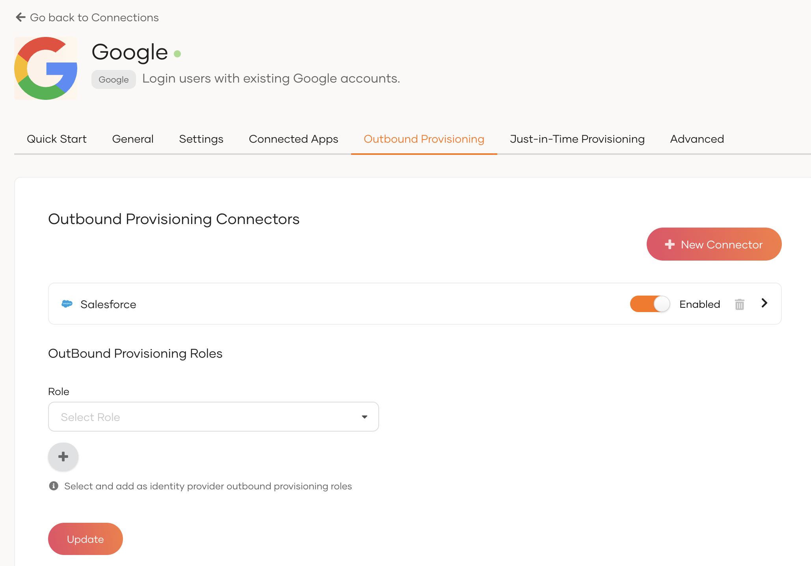

# Enable IdP-level outbound provisioning

IdP-level outbound provisioning lets you provision a user to an outbound connector at the time a user logs in with an external Identity Provider (IdP).

Follow the guides below to learn how to configure outbound provisioning at the IdP level.

## Configure a connection

Follow the steps below to create a connection and configure an outbound connector in it.

1. On the WSO2 Identity Server Console, click **Connections** and click **New Connection**.

2. Click **Create Connection** and create a connection for your preferred external IdP.

3. Add the connection to the login flow of an application.

    :::note

    Learn how to create a connection and add it to the login flow of an application in [Add federated login](../../../authentication/federated-login/index.md).

    :::

3. On the **Outbound provisioning** tab of the created connection, select **New Connector**.

4. Configure the outbound connector of your choice and click **Finish**.

    :::note

        WSO2 Identity Server supports the following outbound connectors. Learn how to configure the connector of your choice by following the relevant guide.
        <ul>
            <li><a href="/identity/7.0.0/guides/users/outbound-provisioning/outbound-connectors/google">Google</a></li>
            <li><a href="/identity/7.0.0/guides/users/outbound-provisioning/outbound-connectors/salesforce">Salesforce</a></li>
            <li><a href="/identity/7.0.0/guides/users/outbound-provisioning/outbound-connectors/scim2">SCIM2</a></li>
        </ul>

    :::

4. Switch on the toggle to enable the configured outbound connector.

     

5. Click **Update** to save the changes.

## Try it out

1. Navigate to the application URL.

2. Click **Login** to open the WSO2 Identity Server login page.

3. Sign in with your connection.

    :::note

    Signing in with the connection automatically triggers outbound provisioning in the configured outbound connector.

    :::
