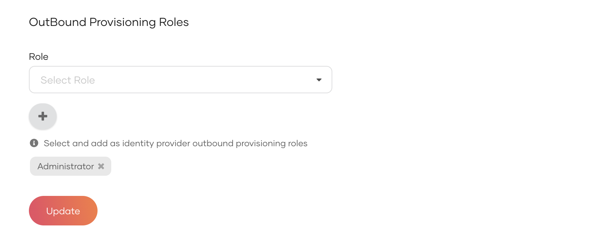

# Configure role-based outbound provisioning

This guide explains how you can automatically provision users to an external system based on the role assigned to the user. When role-based outbound provisioning is enabled, users assigned to the specified roles will be provisioned to the external system. When a user is removed from the role, the user is deprovisioned from the external system.

Follow the steps given below to configure role-based provisioning in WSO2 Identity Server.

## Prerequisites

Before you begin, ensure you have [set up outbound provisioning](setup-outbound-provisioning.md) at the organization level.

## Enable role-based provisioning

1. On the WSO2 Identity Server Console, go to **Connections**.

2. Select the connection in which you configured the outbound connector and navigate to its **Outbound Provisioning** tab.

3. Under **Outbound Provisioning Roles**, select a role from the dropdown and click the **add** icon. You can add multiple roles by repeating this step.

    

4. Click **Update** to save the changes.

## Try it out

1. On the WSO2 Identity Server Console, [create a user](../manage-users.md#onboard-single-user).
2. [Assign the created user to a role](../manage-roles.md#assign-users-to-a-role) that you specified for outbound provisioning. The user will be provisioned to the external system automatically.
3. Remove the user from the role. The user will be deprovisioned from the external system automatically.
