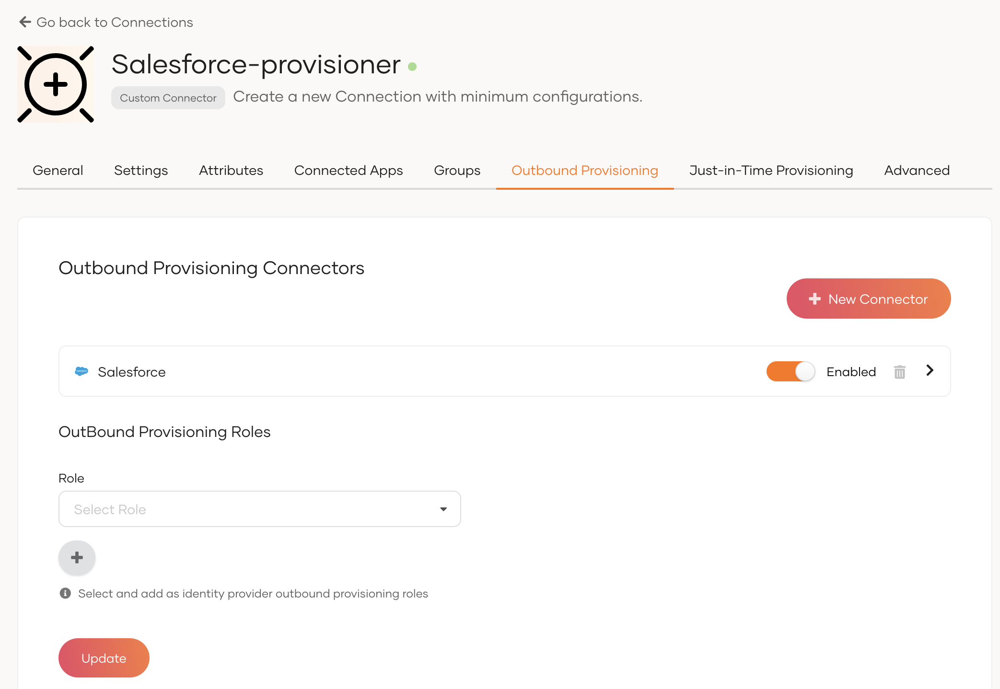
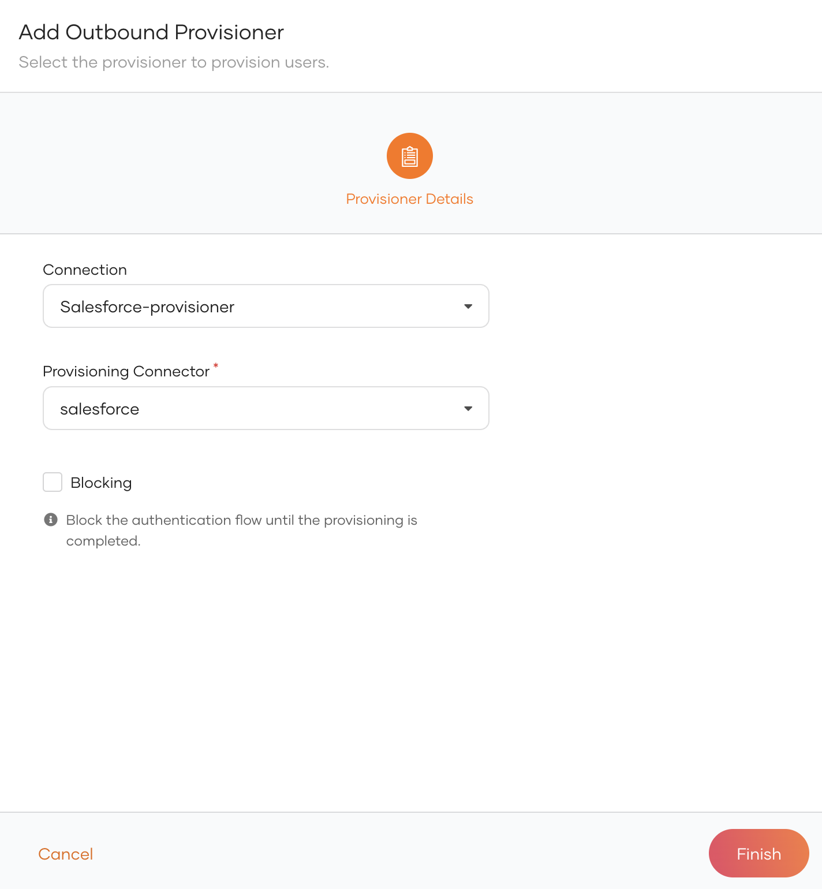

# Set up outbound provisioning

Follow the steps below to create a custom connection, configure an outbound connector, and enable outbound provisioning for your organization.

## Step 1: Create a provisioning connection

1. On the WSO2 Identity Server Console, click **Connections** and click **New Connection**.

2. Click **Create Connection** and select **Custom Connector**.

3. Provide a name and a description for the connector and click **Finish**.

4. On the **Outbound provisioning** tab of the created connection, select **New Connector**.

5. Configure the outbound connector of your choice and click **Finish**.

    :::note

    WSO2 Identity Server supports the following outbound connectors. Learn how to configure the connector of your choice by following the relevant guide.
    <ul>
    <li><a href="/identity/7.0.0/guides/users/outbound-provisioning/outbound-connectors/google">Google</a></li>
    <li><a href="/identity/7.0.0/guides/users/outbound-provisioning/outbound-connectors/salesforce">Salesforce</a></li>
    <li><a href="/identity/7.0.0/guides/users/outbound-provisioning/outbound-connectors/scim2">SCIM2</a></li>
    </ul>

    :::

6. Switch on the toggle to enable the configured outbound connector.

    

7. Click **Update** to save the changes.

## Step 2: Enable outbound provisioning for the organization

Organization-level outbound provisioning allows you to provision users to an external system when:

- a user is provisioned in WSO2 Identity Server over an API.
- an administrator onboards a user from the WSO2 Identity Server Console.
- a user self-signs up from a WSO2 Identity Server sign-in page.
- a user is JIT (Just-In-Time) provisioned in WSO2 Identity Server.

To enable organization-level outbound provisioning in WSO2 Identity Server:

1. On the WSO2 Identity Server Console, go to **Login & Registration**.

2. Under **Provisioning Settings**, click **Outbound Provisioning Configuration** and click **New Provisioner**.

3. Select the connection in which you have configured outbound provisioning as the **Connection** and the relevant outbound connector as the **Provisioning Connector**.

    

4. Enable any of the following.

    | Option | Description |
    |---|---|
    | **Blocking** | Makes the user onboarding process synchronous with the outbound provisioning process. WSO2 Identity Server waits for the response from the external system before proceeding with the user creation. |
    | **JIT Outbound** (Update level 7.0.0.73+) | Enables outbound provisioning for JIT provisioned users during authentication. |

5. Click **Finish**.

## Try it out

1. On the WSO2 Identity Server Console, do one of the following.
    <ul>
    <li>Use a <a href="/identity/7.0.0/apis/organization-apis/org-user-mgt/#tag/Users-Endpoint/operation/createUser">SCIM API</a> to create a user.</li>
    <li><a href="/identity/7.0.0/guides/users/manage-users/#onboard-single-user">Create a user from the Console</a></li>
    <li><a href="/identity/7.0.0/guides/account-configurations/user-onboarding/self-registration/">Enable self-registration</a> and let a user self-register to WSO2 Identity Server.</li>
    <li><a href="/identity/7.0.0/guides/authentication/jit-user-provisioning/">Enable JIT-provisioning</a> and let a user sign in with an external identity provider.</li>
    </ul>

    :::note

    Onboarding a user with any of the above methods automatically triggers outbound provisioning to the external system.

    :::

2. [Delete the user](../manage-users.md#delete-a-user). The user will be removed from the external system.
