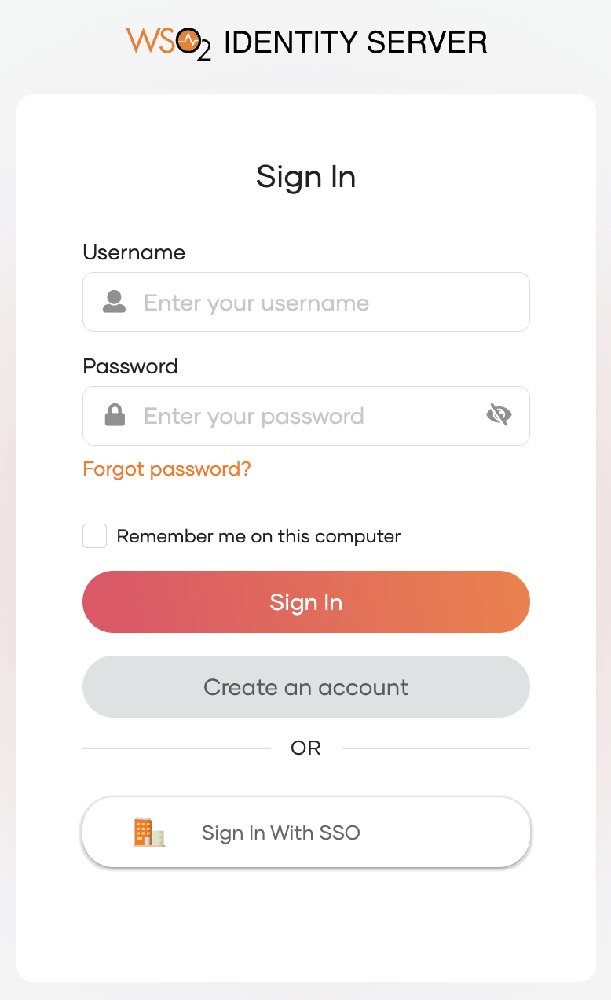
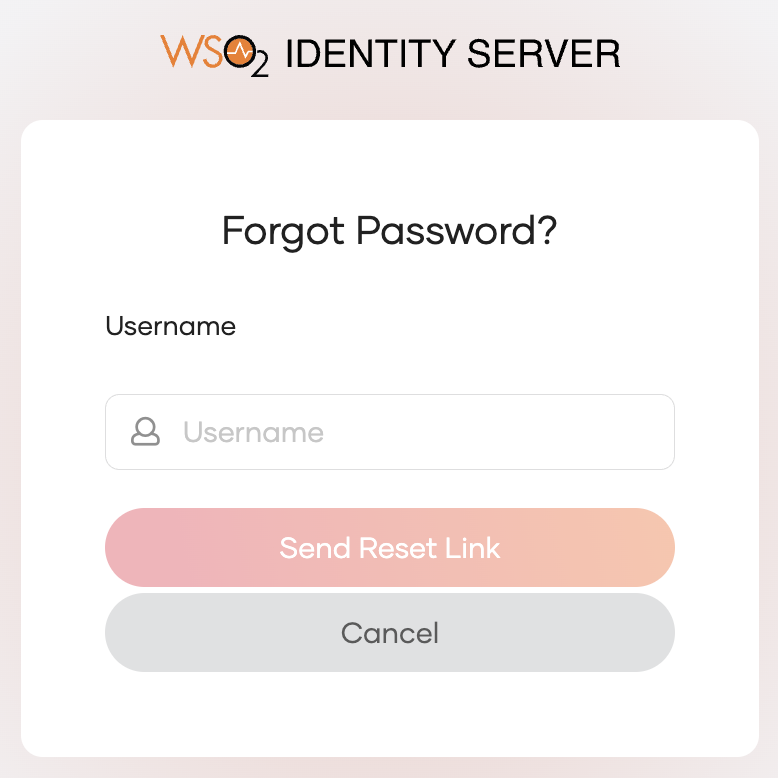
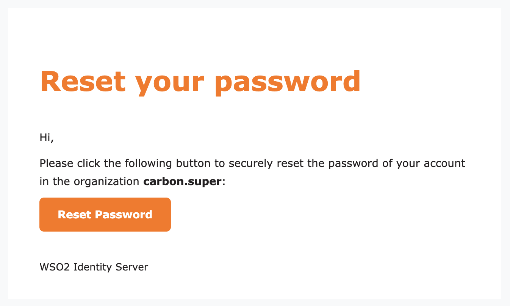

# Recover your password

If you are the owner or an administrator of an WSO2 Identity Server organization, the following guide explains how you can recover a forgotten password.

To recover your password:

1. Go to the sign-in page of the [My Account Portal](is-self-service.mdx#access-my-account-portal).

    

2. Click **Forgot password?**.

3. Enter your username and click **Send Reset Link**. An email notification will be sent to your email address.

    

4. Open the email you received and click **Reset Password**

    

5. Enter new password and **Proceed**.
