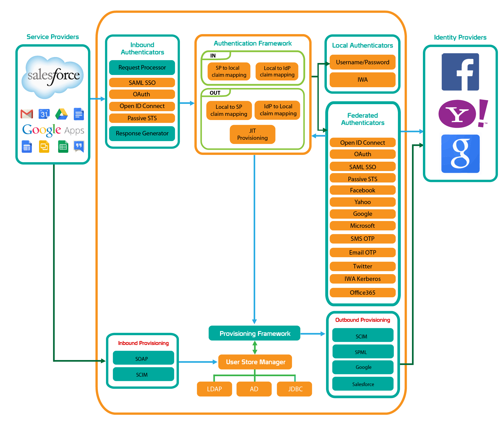

# Architecture

WSO2 Identity Server is a product built on top of WSO2 Carbon. Based on the OSGi specification, it enables easy customization and extension through its componentized architecture. Users have the option to deploy on-premise servers, private clouds, or public clouds.

WSO2 Identity Server is directly accessible to users through its user-friendly [Console](../guides/your-is/manage-console-access.md). In addition to the default admin user (with the username ‘admin’), other users can be created by admin users who have the privileges to create a new user or by signing up. Each user can have roles, with each role assigned specific privileges. A user’s roles can be changed at any time by an admin user. Apart from such registered users, Identity Server is also used as an identity provider for third party applications, which also have their own sets of users.

## Architecture and Process Flow

The architecture of the Identity Server and the various processes that occur within it are shown in the following diagram.

    

        <iframe src="https://www.youtube.com/embed/ZnWnDZJ_c4o" width="560" height="315" allowFullScreen="allowfullscreen" allow="accelerometer; autoplay; clipboard-write; encrypted-media; gyroscope; picture-in-picture"></iframe>
    

## Authentication Framework

The authentication framework includes several types of authenticators.

### Inbound Authenticators

Inbound authenticators identify and parse incoming authentication requests and then build the corresponding response. Each inbound authenticator comprises a Request Processor and a Response Builder. WSO2 Identity Server includes inbound authenticators for SAML 2.0, OpenID Connect, OAuth 2.0, and WS-Federation (passive). The responsibility of these components is to process specific protocol requests, validate them, and then build a response based on a common object model understood by the authentication framework.

### Local Authenticators

Local authenticators authenticate the user with locally available credentials, such as username/password, passkeys or Integrated Windows Authentication (IWA). They are decoupled from inbound authenticators. After an initial request is received, the authentication framework consults the applications configuration to identify the local authenticators registered for the current request. Successful local authentication notifies the framework, which then concludes the authentication process and proceeds to the response phase.

### Federated Authenticators

Outbound or federated authenticators authenticate users with external systems, like Facebook, Google, LinkedIn, Twitter, Salesforce, or any other identity provider. These authenticators are also decoupled from inbound authenticators. Once federated authentication is successfully completed, the authenticator notifies the framework, which then moves forward without requiring further authentication.

### Multi-Factor Authenticators

Applications can offer users multiple login options by selecting more than one authenticator, which can be a mix of local and federated authenticators. For multi-factor authentication, applications can define multiple login steps in the login flow, each with one or more authenticators, proceeding to the next step only after successful authentication in the current step.

## Provisioning Framework

The following are the provisioning components available in the provisioning framework.

### Inbound Provisioning

Inbound provisioning involves provisioning users to the WSO2 Identity Server, primarily via the SCIM 2.0 API, supporting HTTP Basic Authentication and OAuth 2.0.

### Just-In-Time Provisioning

This mechanism provisions users to the WSO2 Identity Server at the time of federated authentication, based on a positive authentication response from an external identity provider. JIT provisioning is configured against an identity provider, not applications.

### Outbound Provisioning

Outbound provisioning involves provisioning users to external systems and can be initiated by various actions, such as inbound provisioning requests, JIT provisioning, adding a user via the console, or assigning a user to a provisioning role. WSO2 Identity Server supports outbound provisioning with SCIM 2.0, Google and Salesforce provisioning APIs.
