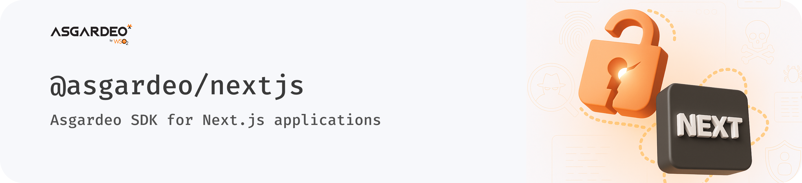

The WSO2 Identity Platform Next.js SDK (`@asgardeo/nextjs`) is a component-first library, offering a highly customizable set of components for authentication, user self-care, and organization management in Next.js applications.

## Installation

Use one of the following options to install the WSO2 Identity Platform Next.js SDK.

<Tabs>
<TabItem value="tab-0" label="npm">


```bash
npm install @asgardeo/nextjs
```

</TabItem>
<TabItem value="tab-1" label="yarn">


```bash
yarn add @asgardeo/nextjs
```

</TabItem>
<TabItem value="tab-2" label="pnpm">


```bash
pnpm add @asgardeo/nextjs
```

</TabItem>
</Tabs>

## Getting started

 Try out the [WSO2 Identity Server Next.js quickstart guide.](../../quick-starts/nextjs.mdx)

## Contexts

The SDK provides a context-based architecture, allowing you to easily manage authentication state and user data across your application. The main context is provided by the `AsgardeoProvider`, which wraps your application and provides access to authentication methods and user information.

- **`AsgardeoProvider`** – The main provider component that wraps your application, providing authentication context and configuration.

## Components

The WSO2 Identity Platform Next.js SDK provides a comprehensive set of components to handle authentication, user management, and organization features in your Next.js applications. The components are organized into different categories based on their functionality.

### Action Components

Action components trigger specific authentication-related actions when users interact with them.

- **`SignInButton`** – A customizable button that initiates the sign-in flow.
- **`SignUpButton`** – A button for user registration flows.
- **`SignOutButton`** – A button that handles user sign-out.

These components support both render props and traditional props patterns, giving you flexibility in how you implement them.

### Control Components

Control components manage the conditional rendering of content based on authentication state.

- **`SignedIn`** – Renders children only when the user is authenticated.
- **`SignedOut`** – Renders children only when the user is not authenticated.
- **`Loading`** – Shows loading state during authentication operations.

### User Self-care Components

- **`User`** – Provides render props access to user data.
- **`UserProfile`** – Displays comprehensive user profile information.
- **`UserDropdown`** – A dropdown menu with user info and actions.

### Organization Components (B2B)

- **`Organization`** – Displays organization information.
- **`OrganizationProfile`** – Shows detailed organization profile.
- **`OrganizationSwitcher`** – Allows switching between organizations.
- **`OrganizationList`** – Lists available organizations.
- **`CreateOrganization`** – Form for creating new organizations.

### Authentication Components

- **`SignIn`** – Complete sign-in form with multiple authentication options.
- **`SignUp`** – User registration form.

## Hooks

- **`useAsgardeo`** – Access authentication state and imperative methods for sign-in, sign-out, and token management.

## Customization

- Supports CSS classes, custom properties, and render props for full control over UI and theming.
- Integrates with popular UI libraries (Material-UI, Ant Design, Chakra UI, Tailwind CSS).

## Next Steps

<LinkCards>

- [Quick Start Guide](../../quick-starts/nextjs.mdx) – Get started with the WSO2 Identity Platform Next.js SDK.
- [Complete Guide](/identity/7.0.0/complete-guides/nextjs/introduction/) – Build a complete application using the WSO2 Identity Platform Next.js SDK.
- [AsgardeoProvider](contexts/asgardeo-provider.mdx) – Learn how to configure the root provider component.

</LinkCards>
