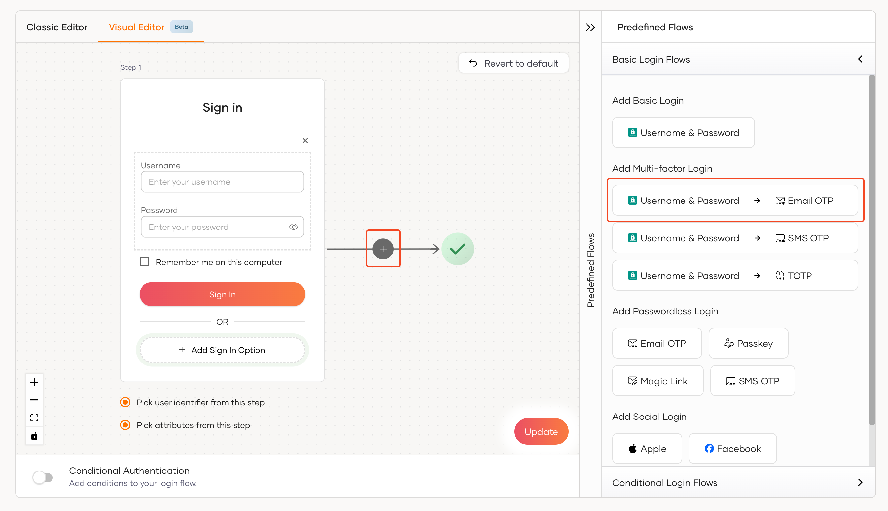
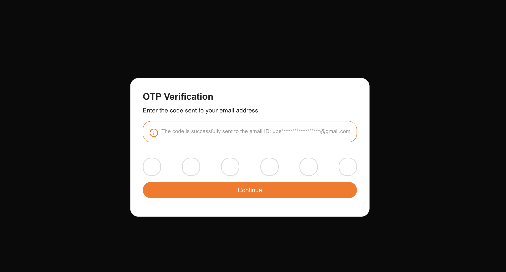

Multi-factor authentication (MFA) is a security mechanism that requires users to provide two or more forms of verification before granting access to an application. This adds an extra layer of security to your application and helps protect sensitive data from unauthorized access.

In this guide, we will look into enabling Email OTP as an MFA factor in your Next.js application. Email OTP is a simple and effective MFA method that sends a one-time passcode to the user's email address, which they must enter to complete the login process.

You can configure SMTP settings in the WSO2 Identity Server Console by navigating adding the SMTP configurations in the deployment.toml file.

First, let's set up Email OTP as an MFA factor by following the steps given below.

- Navigate to the WSO2 Identity Server Console and select your application under the **Applications** tab.
- Click on the **Login Flow** tab.
- Click on either the **+** button in the Visual Editor and select **Email OTP** from the pop-up prompt or click on **Username & Password -> Email OTP** button under the **Predefined Flows > Basic Login Flows > Add Multi-factor Login** section.

  
- Click on the **Update** button to save the changes.

You can now test the Email OTP MFA factor in your Next.js application. When a user logs in with their email and password, they will be redirected to the Email OTP page to enter the OTP code sent to their email address. Upon successful verification, the user will be redirected to the home page.

