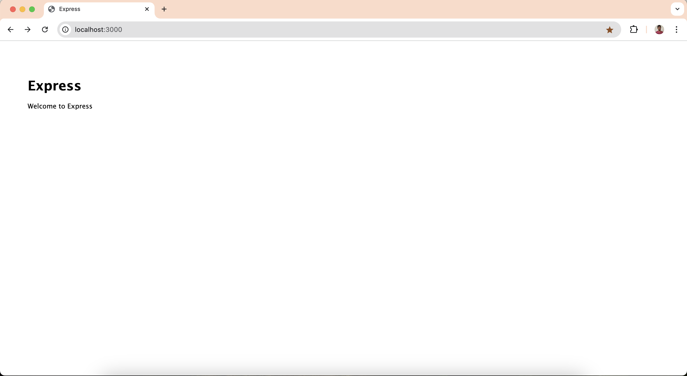

For this guide, you will be creating a simple Express.js app using the npx [express-generator](https://www.npmjs.com/package/express-generator) command.

Run the following command in the terminal to create the Express.js app and provide a suitable name for it.

```bash
npx express-generator passport-is-sample --view=ejs
```

Next, change the directory to the newly created app and install the dependencies.

```bash
cd passport-is-sample
npm install
```

Then run the following command to start the application.

```bash
npm start
```

Confirm that the application is up and running by verifying the output in the terminal. Then, navigate to [http://localhost:3000](http://localhost:3000)  and you should see the sample app working in the browser.

This allows you to see real-time updates and debug the app as you make changes.



At this point, you have a simple Express.js app up and running. In the next step, let’s try to integrate passport-asgardeo with the app.
