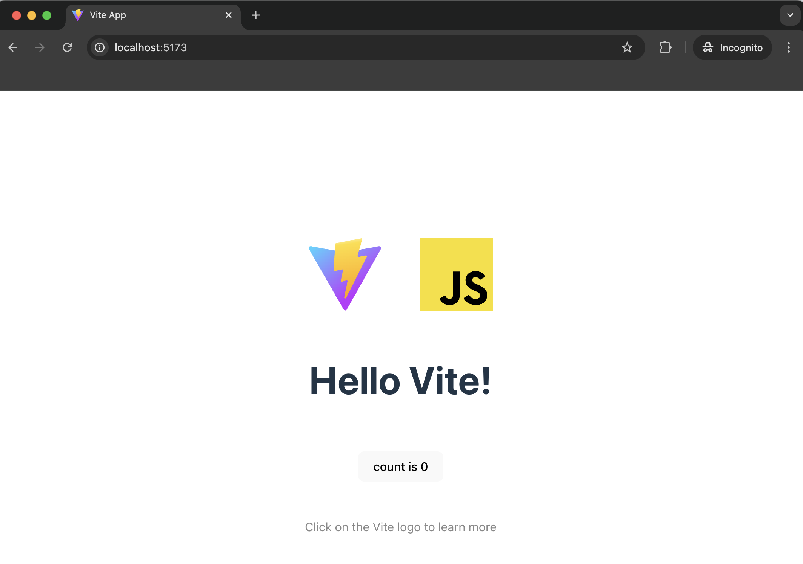

For this guide, you will be creating a simple JavaScript app using [Vite](https://vitejs.dev/), a modern, fast and lightweight tool that helps you quickly set up and develop modern JavaScript apps. 

Open a terminal, change directory to where you want to initialize the project, and run the following command to create your first JavaScript sample app.


```bash
npm create vite@latest wso2-javascript -- --template vanilla
```

Running this command will create a folder with a ready-to-run boilerplate JavaScript project, with a development server to run the project and instantly reload changes to the project in your browser without manual refresh.

Once the application is created, install the dependencies using the following command.

```bash
cd wso2-javascript
npm install
```

Then run the sample in the development mode. This allows you to see real-time updates and debug the app as you make changes.

```bash
npm run dev
```

Confirm that the dev server is up and running by verifying the output in the terminal. Then, navigate to [http://localhost:5173](http://localhost:5173)  and you should see the sample app working in the browser.



At this point, you have a simple yet fully functional JavaScript app. In the next step, let’s try to integrate the WSO2 Identity Platform JavaScript SDK with the app.
