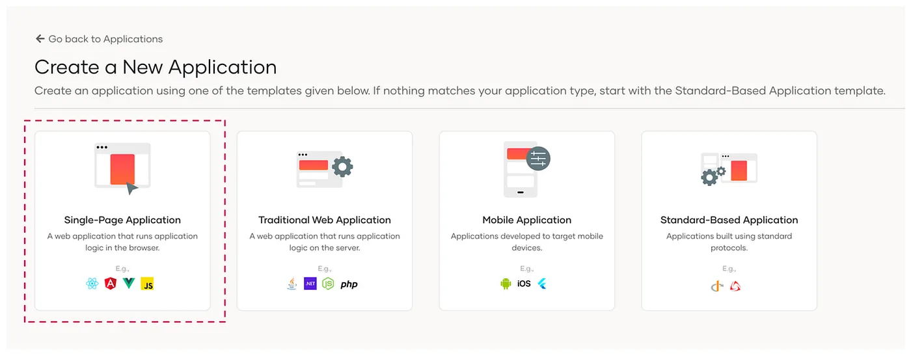
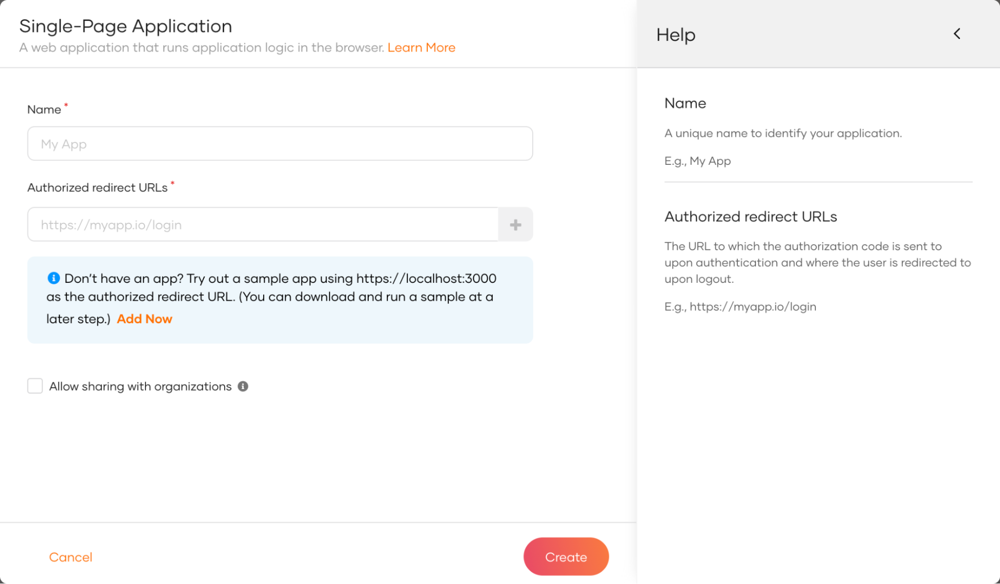

First unless you already have done that, you need to register your application as a single page application.

* Download and [setup WSO2 Identity Server](https://is.docs.wso2.com/en/latest/get-started/quick-set-up/)
* Sign into the WSO2 Identity Server console and navigate to **Applications > New Application.**
* Select Single Page Application

  

Next, complete the wizard popup by providing a suitable name and an authorized redirect URL.

:::note

name: is-react

Authorized redirect URL: http://localhost:5173

:::

:::info

The authorized redirect URL determines where WSO2 Identity Server should send users after they successfully log in. Typically, this will be the web address where your app is hosted. For this guide, we'll use [http://localhost:5173](http://localhost:5173), as the sample app will be accessible at this URL.

:::

You need the following information.

* Client ID - You can find this from the application's **Protocol** tab.
* Base URL - `https://localhost:9443`
* Redirect URL - `http://localhost:5173` or the custom redirect URL you specified when creating the application.

In this step, we have registered our React app as an application in the WSO2 Identity Server console and generated the required metadata. Next, we will create a React app using Vite.
