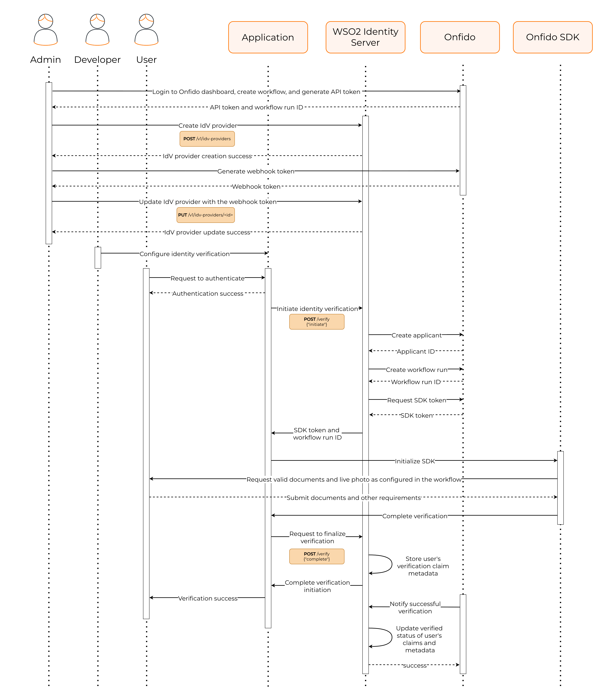

# Reference

This reference provides a complete, end-to-end overview of how to integrate Onfido for identity verification with WSO2 Identity Server and use it within your applications.

The process involves the following general steps:

## Administrator sets up Onfido and WSO2 Identity Server

The administrator performs the initial setup required to integrate Onfido with WSO2 Identity Server. This includes configuring both the Onfido platform and the WSO2 Identity Server Console. The steps are as follows:

- The administrator logs into the Onfido dashboard and,

    - Creates an Onfido workflow that defines the verification steps and requirements.

    - Generates credentials such as the API token and the workflow ID.

- The administrator logs into the WSO2 Identity Server Console and,

    - Creates an identity verification provider (IdVP) for Onfido using the API credentials obtained from Onfido.

    - Obtains the URL generated by WSO2 Identity Server to receive verification status updates from Onfido.

- The administrator returns to the Onfido dashboard and creates a webhook using the URL obtained from WSO2 Identity Server. WSO2 Identity Server receives verification status updates from Onfido through this webhook.

- The administrator returns to the WSO2 Identity Server Console and registers the webhook token in the Onfido connector configuration.

## Developer integrates identity verification into the application

The developer uses the Onfido SDK to integrate identity verification into the application. The Onfido SDK provides the necessary tools and components to capture user information and documents for verification.

## User undergoes identity verification

When a user attempts to access the application, the following steps occur:

- The user logs into the application.

- If the user's attributes need verification, the application sends a request to WSO2 Identity Server to initiate the identity verification process.

- WSO2 Identity Server interacts with Onfido to start the verification process. During this process,
  
    - WSO2 Identity Server creates an applicant in Onfido.

    - Runs an instance of the workflow for the applicant and generates a workflow run ID.

    - Generates an SDK token that allows the application to use the Onfido SDK for capturing user information.

- WSO2 Identity Server returns the workflow run ID and the SDK token to the application.

- The application uses the Onfido SDK along with the SDK token to capture the user's information and documents required for verification.

- The application sends a request to WSO2 Identity Server to finalize the verification process.

## WSO2 Identity Server completes the verification

WSO2 Identity Server does the following to complete the verification process:

- Onfido notifies WSO2 Identity Server of the verification results through the configured webhook.

- WSO2 Identity Server updates the verification status of the user attributes based on the results received from Onfido.

- WSO2 Identity Server responds to the application's request with the verification results.
