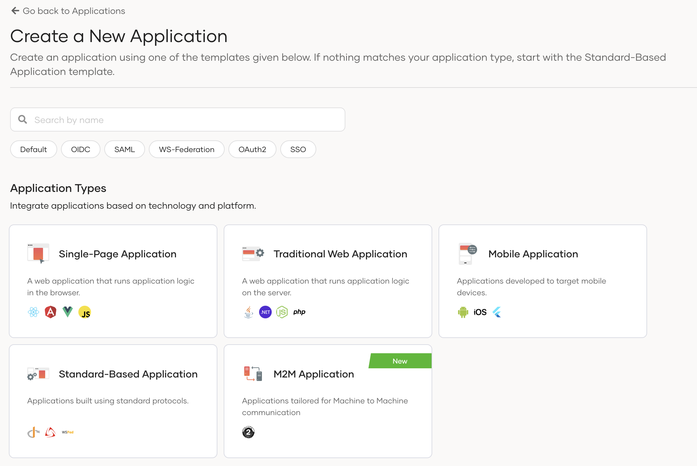
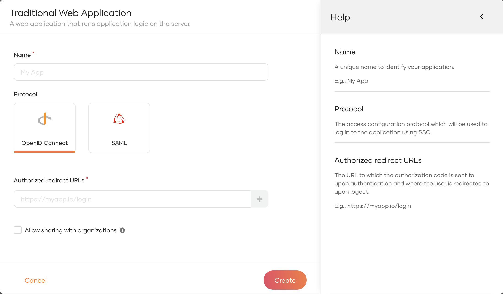
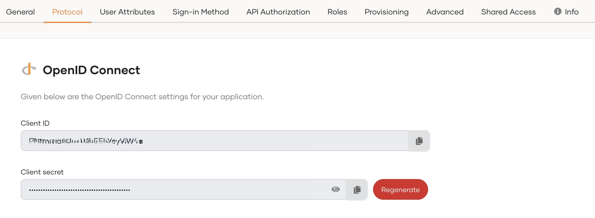
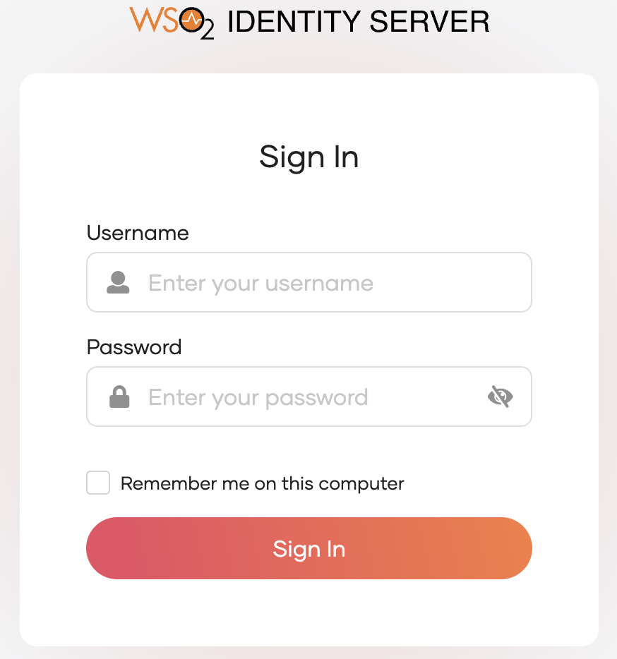

# Sample OIDC Java EE web app

By following this guide, you will be able to deploy a Java EE web application locally and secure it with OpenID Connect.

## Prerequisites

- **Apache tomcat 9.x or 8.x**

    If you don't have it, install [Apache tomcat](https://tomcat.apache.org/tomcat-9.0-doc/setup.html).

- **A user account in the WSO2 Identity Server**

    If you don't already have one, create a user account in the WSO2 Identity Server.

## Register the app

Follow the steps given below to register the sample Java EE web application in WSO2 Identity Server.

1. On the WSO2 Identity Server Console, go to **Applications**.

2. Click **New Application** and select **Traditional Web Application**:

    

3. Enter the following details:

    

    <table><tbody><tr><td>{"Name"}</td><td>{"Give a unique name to identify your application."}</td></tr><tr><td>{"Protocol"}</td><td>{"Select "}<b>{"OpenID Connect"}</b>{"."}</td></tr><tr><td>{"Authorized redirect URLs"}</td><td>{"The URL to which the user is redirected after a successful login. Use the following URL for this sample app: "}<p><code>{"http://localhost:8080/oidc-sample-app/oauth2client"}</code></p></td></tr></tbody></table>

4. Click **Create** to complete the registration.

5. Go to the **Protocol** tab and take note of the **Client ID** and the **Client secret**. You will need them to configure the application later.

    

:::tip

To provide a better experience for the user, it is recommended to configure an access URL for the application. You can set an access URL from the **General** tab of the application. (For this sample application, the access URL is <code>https://localhost:8080/oidc-sample-app</code>).

The access URL is used,

- in the application catalog and discovery flows.
- to redirect the user back to the application in the following scenarios.
    - if the login page times out
    - after a password reset
    - after the self sign-up verification
- to re-initiate the login flow if the login flow fails.

:::

## Download the sample

Click the button below to download the sample. You can also choose to view the source before doing so.

<div className={"centered-container"}><div className={"border-text skip-glightbox"}><br />{" "}<a href={"https://github.com/asgardeo/asgardeo-tomcat-oidc-agent/releases/latest/download/oidc-sample-app.war"} target={"_blank"}>{"Download sample"}</a></div><div className={"border-text"}>{" "}{" "}<br />{" "}<a href={"https://github.com/asgardeo/asgardeo-tomcat-oidc-agent/tree/master/io.asgardeo.tomcat.oidc.sample"} target={"_blank"}>{"View source"}</a></div></div>

## Configure the sample

Follow the steps given below to configure the sample app.

1. Move the  **war** file that you downloaded to the `<TOMCAT_HOME>/webapps` folder where `<TOMCAT_HOME>` is the home directory of your Tomcat server.
  
2. Open a terminal, navigate to the `<TOMCAT_HOME>/bin` folder, and start the Tomcat server using the following command:

    ```bash
    sh catalina.sh start
    ```

    :::note

    This will extract the contents of the **war** file. 
    If your Tomcat server is set to auto-deploy applications, you can skip this step.

    :::

3. Go to the `<TOMCAT_HOME>/webapps/oidc-sample-app/WEB-INF/classes` folder and open the `oidc-sample-app.properties` file in a text editor.
4. Update the following in the `oidc-sample-app.properties` file:

    ```json
    consumerKey={client ID}
    consumerSecret={client secret}
    scope=openid,address,email,profile

    callBackURL=http://localhost:8080/oidc-sample-app/oauth2client
    trustedAudience=http://localhost:8080/oidc-sample-app      

    issuer=https://localhost:9443/oauth2/token
    authorizeEndpoint=https://localhost:9443/oauth2/authorize
    logoutEndpoint=https://localhost:9443/oidc/logout
    tokenEndpoint=https://localhost:9443/oauth2/token
    jwksEndpoint=https://localhost:9443/oauth2/jwks
    #sessionIFrameEndpoint=https://localhost:9443/oidc/checksession

    skipURIs=/oidc-sample-app/index.html
    indexPage=index.html
    logoutURL=logout 
    errorPage=error.jsp
    ```
     <table><tbody><tr><th>{"Configuration"}</th><th>{"Description"}</th></tr><tr><td><code>{"consumerKey"}</code></td><td>{"The client id of the registered application."}</td></tr><tr><td><code>{"consumerSecret"}</code></td><td>{"The client secret of the registered application."}</td></tr><tr><td><code>{"scope"}</code></td><td><p>{"The list of OIDC scopes that are used for requesting user information. You can add OIDC scopes such as "}<code>{"profile"}</code>{" and "}<code>{"email"}</code>{" in a comma-separated list as follows:"}</p><code>{"scope=openid,address,email,profile"}</code></td></tr><tr><td><code>{"issuer"}</code></td><td>{"Issuer endpoint of the WSO2 Identity Server used for id token validation: "}<code>{"https://localhost:9443/oauth2/token"}</code></td></tr><tr><td><code>{"authorizeEndpoint"}</code></td><td>{"The authorization endpoint of the WSO2 Identity Server: "}<code>{"https://localhost:9443/oauth2/authorize"}</code></td></tr><tr><td><code>{"logoutEndpoint"}</code></td><td>{"The logout endpoint of the WSO2 Identity Server: "}<code>{"https://localhost:9443/oidc/logout"}</code></td></tr><tr><td><code>{"tokenEndpoint"}</code></td><td>{"The token endpoint of the WSO2 Identity Server: "}<code>{"https://localhost:9443/oauth2/token"}</code></td></tr><tr><td><code>{"jwksEndpoint"}</code></td><td>{"The jwks endpoint of the WSO2 Identity Server: "}<code>{"https://localhost:9443/oauth2/jwks"}</code></td></tr></tbody></table>

5. On your terminal, navigate to the `<TOMCAT_HOME>/bin` folder and run the following commands to restart the Tomcat server for the configurations to take effect:

    ```bash
    sh catalina.sh stop
    sh catalina.sh start
    ```

## Update the java keystore

By default, tomcat is using the default Java keystore (cacerts) to build the SSL connection. In WSO2 Identity Server, the default certificate is a self signed
certificate. This certificate needs to be added to the Java keystore. Please follow the given steps below to extract the public key from WSO2 Identity Server 
keystore and import it to the Java keystore.

1. Export the public key from WSO2 Identity Server keystore.

    - Command
    ```shell
    keytool -export -alias  -file  -keystore  -storepass 
    ```

    - Sample
    ```shell
    keytool -export -alias wso2carbon -file carbon_public2.crt -keystore wso2carbon.jks -storepass wso2carbon
    ```
    
        !!!tip
            The default keystore of WSO2 Identity Server can be found in **\{&lt;IS_HOME>\}/repository/resources/security** directory.

2. Convert the certificate to X509 format.

    - Command
    ```shell
    openssl x509 -in  -inform der -outform pem -out 
    ```

    - Sample
    ```shell
    openssl x509 -in carbon_public2.crt -inform der -outform pem -out certificate.pem
    ```

3. Import the created `.pem` certificate to Java keystore.

    - Command
    ```shell
    sudo keytool -import -trustcacerts -keystore  -storepass  -noprompt -alias  -file 
    ```

    - Sample
    ```shell
    sudo keytool -import -trustcacerts -keystore $JAVA_HOME/lib/security/cacerts -storepass changeit -noprompt -alias wso2carbon -file certificate.pem
    ```

4. After importing the certificate, restart the Tomcat server in order to fetch the latest certificates.

    ```bash
    sh catalina.sh stop
    sh catalina.sh start
    ```

## Run the sample

Follow the steps given below to run the sample.

1. Access the application using the following URL: `http://localhost:8080/oidc-sample-app/index.html`.

2. Click **Login**. You will be redirected to the WSO2 Identity Server login page.

    

3. Enter the credentials of your user account and click **Sign In**.

    :::note[Extend your login session]

    By default, the user login session is active for only `15 minutes`. You can extend the session to `14 days` by selecting the **Remember me on this computer** option provided at the login screen of your application.

    :::
