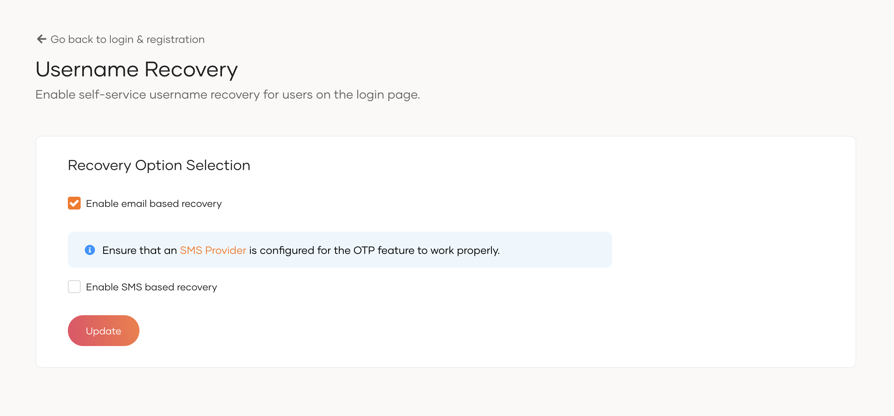

# Username recovery

You may enable self-service username recovery for users so that they may reset their forgotten usernames right from the login page. Once enabled, users can click the `Forgot username?` option and proceed to recover their usernames.

To do so,

1. On the WSO2 Identity Server Console, go to **Login & Registration**.
2. Under **Account Recovery**, click on **Username Recovery**.


3. Select both **email based recovery** and **SMS based recovery** or one of the options to enable them for your organization.

3. Click **Update** to save the changes.



:::note[Send recovery emails to non-unique users]


When a user attempts to recover the username, WSO2 Identity Server requests for the first name, last name and either the email address or mobile number. If based on the details, a unique user is found, an email will be sent to the registered email address. If a unique user is not found, no action will be taken.


To enable sending emails to all users matching the provided information, even if the user is not unique, add the following configuration to the `deployment.toml` file located in the `<IS_HOME>/repository/conf` directory:

```toml
[identity_mgt.username_recovery.non_unique_user]
enabled = true
```

:::
