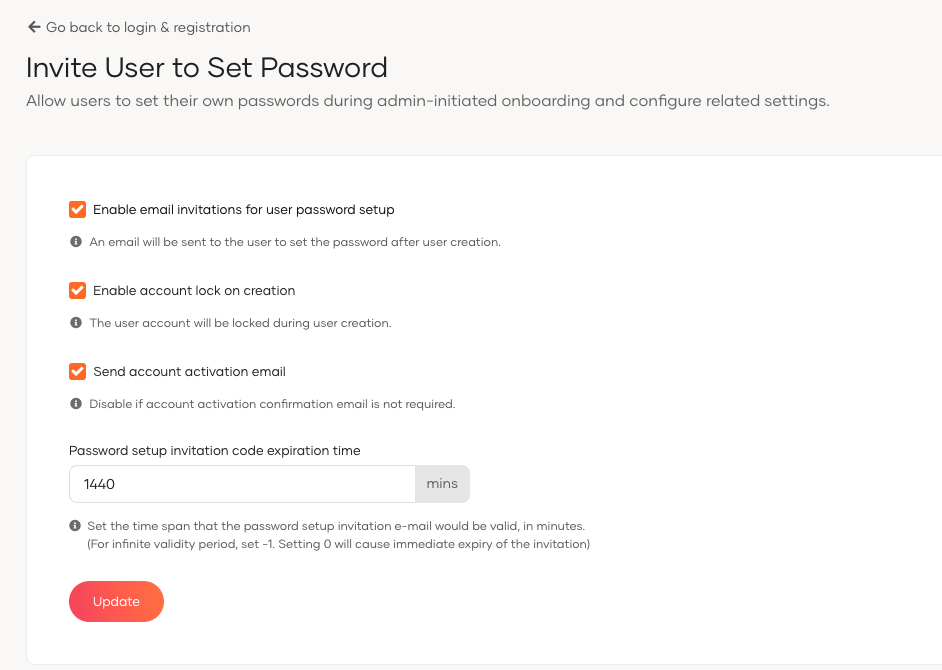

# Invite user to set password

Allow administrator to invite users to set their own passwords during the onboarding process in WSO2 Identity Server.

## Configuration instructions

For inviting users to set their password, follow these instructions:

1. On the WSO2 Identity Server Console, go to **Login & Registration** > **User Onboarding** > **Invite User to Set Password**.
2. Check the **Enable email invitations for user password setup** to send an email to the user to set the password after user creation.
3. Select the **Enable account lock on creation** to lock the user account during user creation.
4. If you want to send an account activation confirmation email, enable the **Send account activation email**.
5. Set the **Password setup invitation code expiration time** in minutes to define how long the password setup invitation e-mail would be valid. For infinite validity period, set -1. Setting 0 will cause immediate expiry of the invitation.
6. Click **Update** to save the changes.

## Parameters

<table>
  <tr>
    <th>Parameter</th>
    <th>Description</th>
  </tr>
  <tr>
    <td><code>Enable user email verification</code></td>
    <td>Triggers a verification notification during user creation if enabled.</td>
  </tr>
  <tr>
    <td><code>Enable account lock on creation</code></td>
    <td>Locks the user account during creation to prevent unauthorized access.</td>
  </tr>
  <tr>
    <td><code>Send account activation email</code></td>
    <td>Sends an email to users for account activation if enabled.</td>
  </tr>
  <tr>
    <td><code>Password Setup Invitation Code Expiration Time</code></td>
    <td>Defines the validity period in minutes for the password setup code sent to users. For infinite validity period, set -1.</td>
  </tr>
</table>
