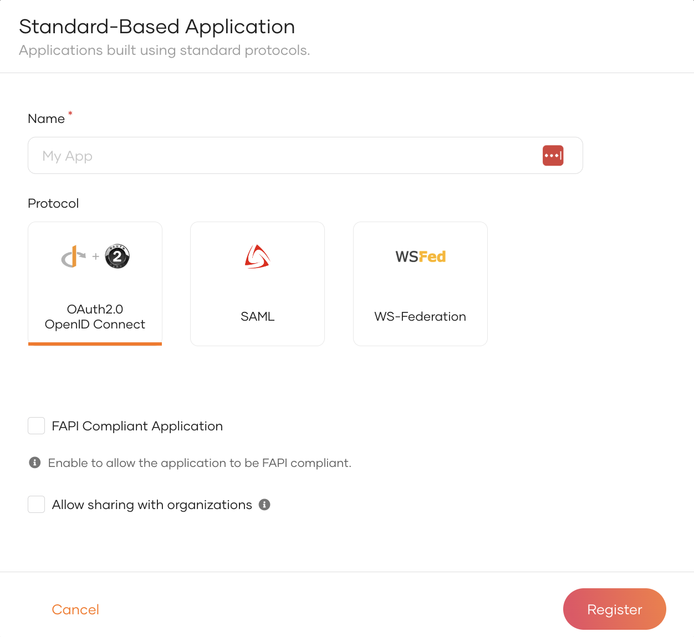

# Register a standard-based application

To integrate an application with WSO2 Identity Server, you need to register it through the WSO2 Identity Server Console. Registering a standard-based application lets you configure protocol settings (OIDC, SAML , WS-Fed) from scratch.

## Register an application

To register an application:

1. On the WSO2 Identity Server Console, go to **Applications**.
2. Click **New Application** and select **Standard-Based Application**.

    

3. Provide an application name.

4. Select your application's protocol and enter values for the related settings:

    <Tabs>
    <TabItem value="tab-0" label="OAuth 2.0 & OpenID Connect">

    Configure the following options:

    - **FAPI Compliant Application** - Check this box to restrict your application to use only FAPI-compliant protocol options. See [Register a FAPI-compliant application](register-a-fapi-compliant-app.mdx) for more information.

    </TabItem>
    <TabItem value="tab-1" label="SAML">

    Select a configuration method and follow the related steps:

    <Tabs>
    <TabItem value="tab-0" label="Manual">

    Configure the following options:

    - **Issuer** - A unique identifier for your application. This should match the `Issuer` value in incoming SAML authentication requests.
    - **Assertion consumer service URLs** - URL in your application where WSO2 Identity Server sends the SAML response after a successful login.

    </TabItem>
    <TabItem value="tab-1" label="File Based">

    Upload an XML file that contains the required metadata.

    </TabItem>
    <TabItem value="tab-2" label="URL Based">

    Configure the following options:

    - **Meta URL** - Provide a URL to fetch the required metadata.

    </TabItem>
    </Tabs>

    </TabItem>
    <TabItem value="tab-2" label="WS-Federation">

    Configure the following options:

    - **Realm** - Unique identifier for your application.

    - **Reply URL** - The URL in your application where WSO2 Identity Server sends the response after a successful login.

    </TabItem>
    </Tabs>

5. If you have set up [organizations](../organization-management/index.mdx), select **Allow sharing with organizations** to make this application available to them. You can customize sharing options in step 7.

6. Click **Register** to complete the registration.

7. If you enabled Allow sharing with organizations in step 5, a dialog appears prompting you to choose how to share the application. Select the appropriate option and click **Share Application** to proceed.

    

    <table>
        <tr>
            <th>Option</th>
            <th>Description</th>
        </tr>
        <tr>
            <td>Share with all organizations</td>
            <td>The application will be shared with all existing organizations and any new organizations you may create in the future.</td>
        </tr>
        <tr>
            <td>Share with only selected organizations</td>
            <td>You can select the organizations you wish to share the application with.</td>
        </tr>
    </table>

## Configure protocol-specific settings

Now that you've registered your standard-based application with basic settings, you can access a broader range of configuration options. Use the following pages to explore and customize these settings according to your needs.

- [OIDC configurations](../../references/app-settings/oidc-settings-for-app.mdx)
- [SAML configurations](../../references/app-settings/saml-settings-for-app.mdx)
- [WS-Federation configurations](../../references/app-settings/ws-federation-settings-for-app.mdx)
