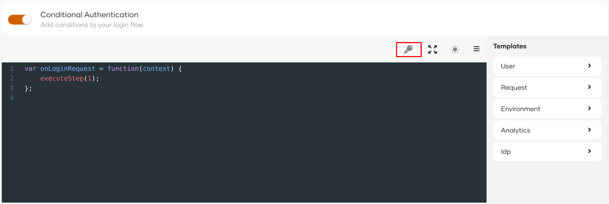
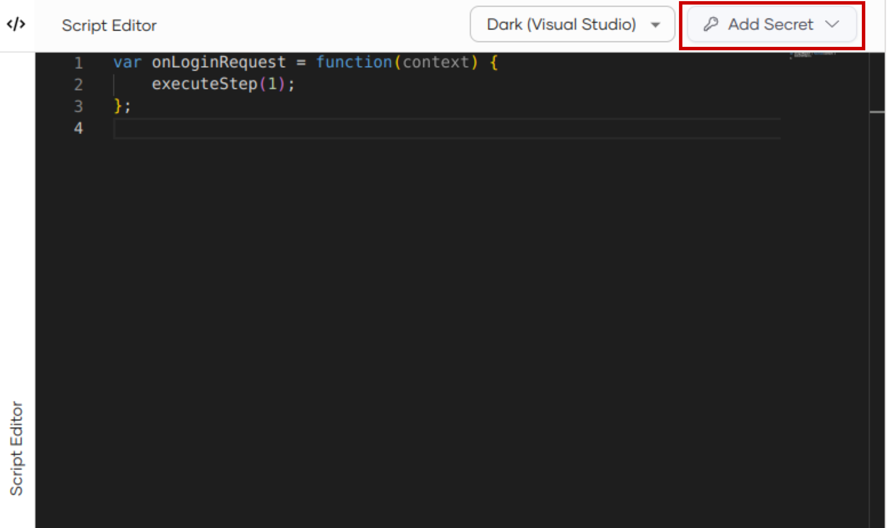
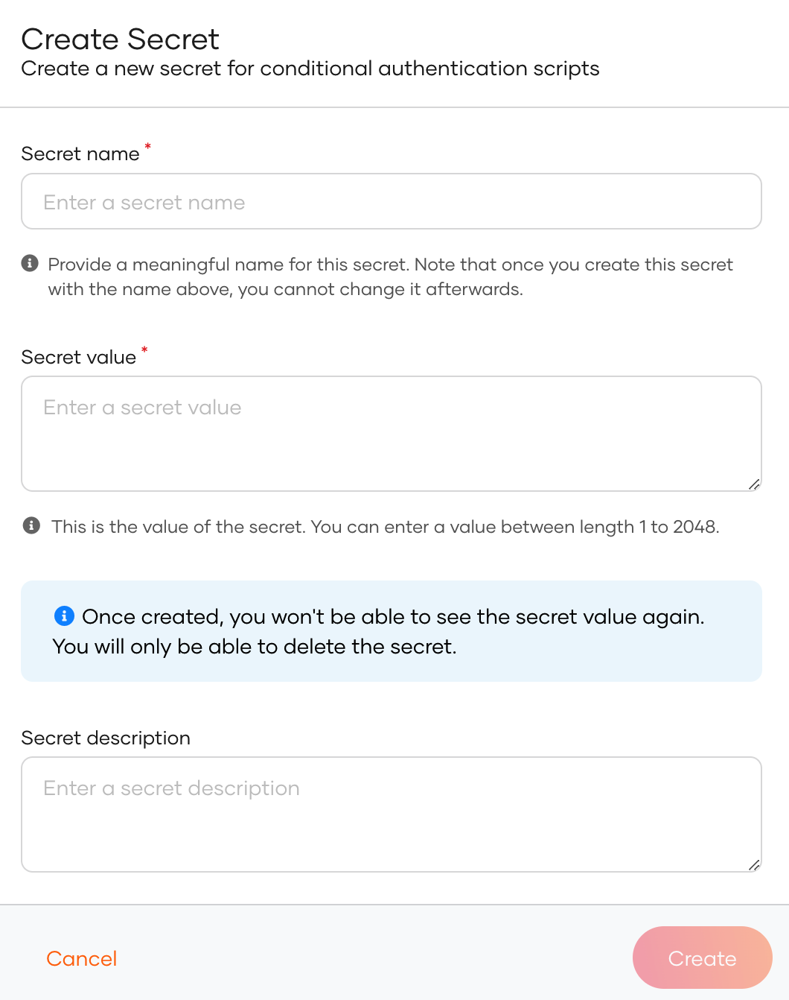

# Configure conditional authentication

Given below are the high-level steps for enabling conditional authentication in your applications.

:::note


- **ECMAScript Compliance**: Adaptive scripts currently comply with ECMAScript 2022 (ES13). 


- **Limitations**: Adaptive scripts do not support `Log.warn` logs or stringifying Java objects using `JSON.stringify()`.

:::
    

## Prerequisites

[Register your application](../add-login-to-apps.md) on the WSO2 Identity Server Console.


## Enable conditional authentication


Follow the steps given below.

1. On the WSO2 Identity Server Console, click **Applications**.
2. Select the application for which you wish to apply a conditional login flow and go to its **Login Flow** tab.
3. Click **Start with default configuration** to define the login flow starting with the `username and password` login.
4. Turn on **Conditional Authentication** by switching the toggle on. You can define your conditional authentication script in the editor.

    


    !!! warning Important
        As a security measure, WSO2 Identity Server does not allow the usage of two consecutive periods (`..`) in authentication scripts.

## Add conditional authentication script

There are two ways to add a conditional authentication script:

- Use a [predefined template](index.md#script-templates).
- Write a [new conditional auth script](write-your-first-script.md).


:::warning[Before you proceed]


When working with conditional authentication scripts, <b>never log secrets</b> or <b>sensitive information</b> within your authentication flows.

:::


## Add a secret to the script
Secrets securely store values associated with external APIs. These secret values are used in conditional authentication scripts when WSO2 Identity Server is required to interact with an external API (service endpoint) during the authentication process.

You can securely store these secret values on the WSO2 Identity Server Console and retrieve them whenever required for conditional authentication script.


### Create a new secret

To add a new secret:

1. On the WSO2 Identity Server Console, go to **Applications**.

2. Select your application and go to the **Login Flow** tab .

3. Add a new secret from your preferred editor:

    ---
    <Tabs>
    <TabItem value="tab-0" label="Classic Editor">

    Enable conditional authentication and click the key icon above the script to create a new secret.

    

    </TabItem>
    <TabItem value="tab-1" label="Visual Editor">

    Switch to the **Visual Editor** tab, expand the **Script Editor** and click **Add Secret**.

    

    </TabItem>
    </Tabs>

    ---

4. Click **Create new secret** from the drop-down menu.

5. Enter the following details:

    

    <table>
        <tr>
            <th>Parameter</th>
            <th>Description</th>
        </tr>
        <tr>
            <td>Secret Name</td>
            <td>A meaningful name for the secret. This name is not changeable and will be used in the script to reference the secret.</td>
        </tr>
        <tr>
            <td>Secret Value</td>
            <td>You can enter the secret value that is <code>1</code> to <code>2048</code> bits in length.</td>
        </tr>
        <tr>
            <td>Secret Description</td>
            <td>A short description for the secret.</td>
        </tr>
    </table>

6. Click **Finish** to complete the creation.


### Use secret in the script

You may refer to the previously added secrets in your conditional authentication scripts using the `secrets.{secret name}` syntax. For example, to retrieve a secret value, you may use:

```angular2html
var secretValue = secrets.secretName;
```

This allows you to securely access secret values within your authentication scripts, enhancing the security and flexibility of your authentication process.

### Delete an existing secret

To delete an existing secret:

1. On the WSO2 Identity Server Console, go to **Applications**.

2. Select your application and go to the **Login Flow** tab .

3. Delete the secret by using your preferred editor:

    ---
    <Tabs>
    <TabItem value="tab-0" label="Classic Editor">

    Enable conditional authentication and click the key icon above the script to delete a secret.

    

    </TabItem>
    <TabItem value="tab-1" label="Visual Editor">

    Switch to the **Visual Editor** tab, expand the **Script Editor** and click **Add Secret**.

    

    </TabItem>
    </Tabs>

    ---

4. Click the trash icon next to the secret you wish to delete.

5. Select the checkbox and confirm your action.
