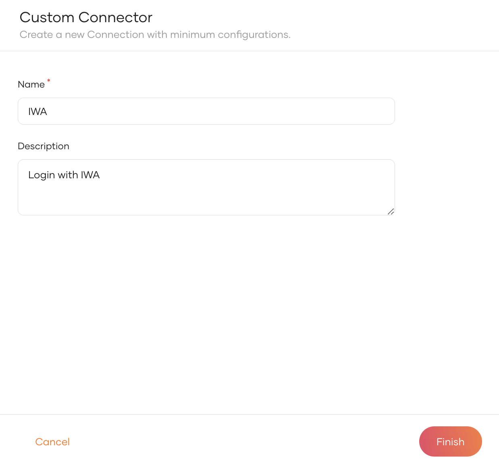
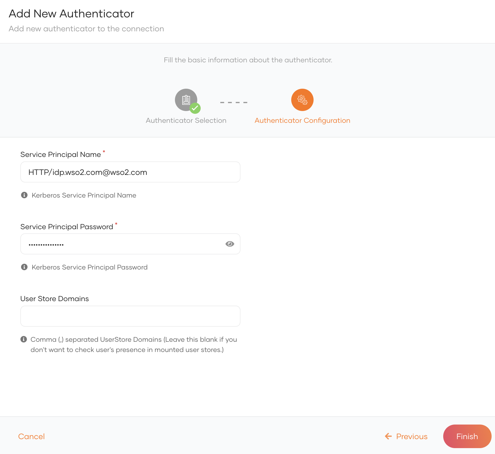
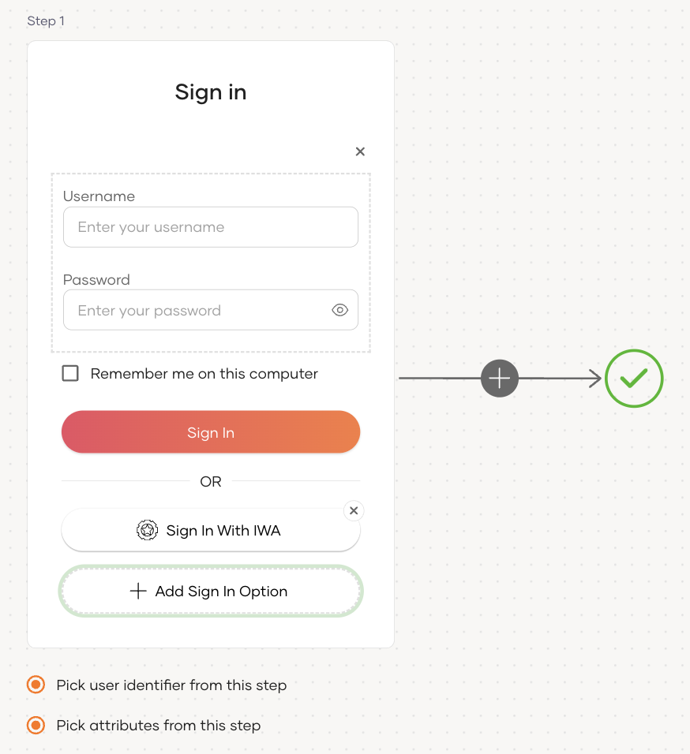
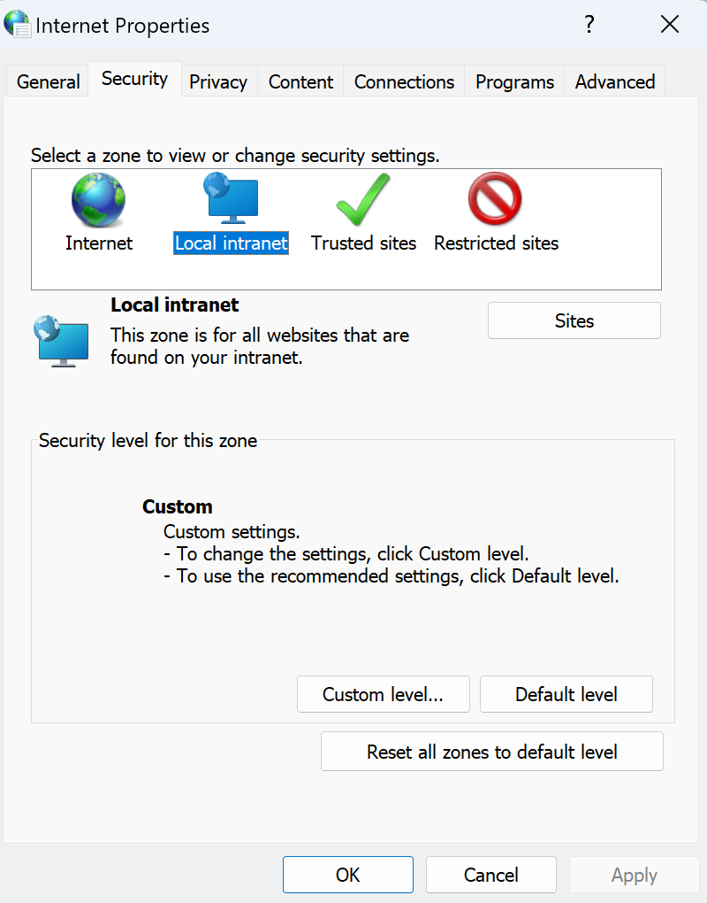
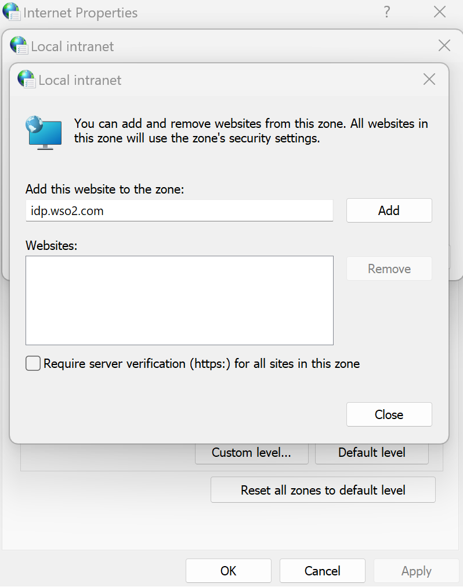
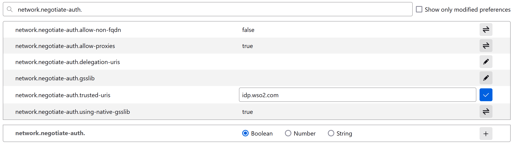
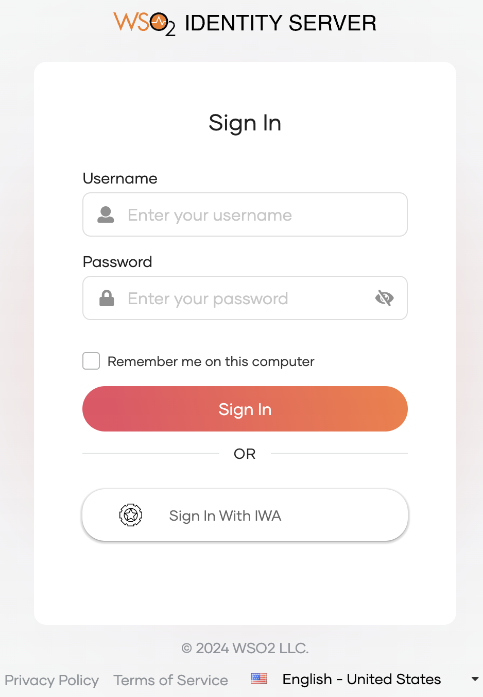
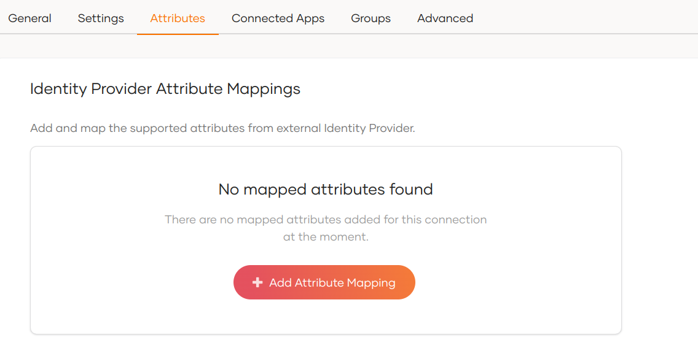
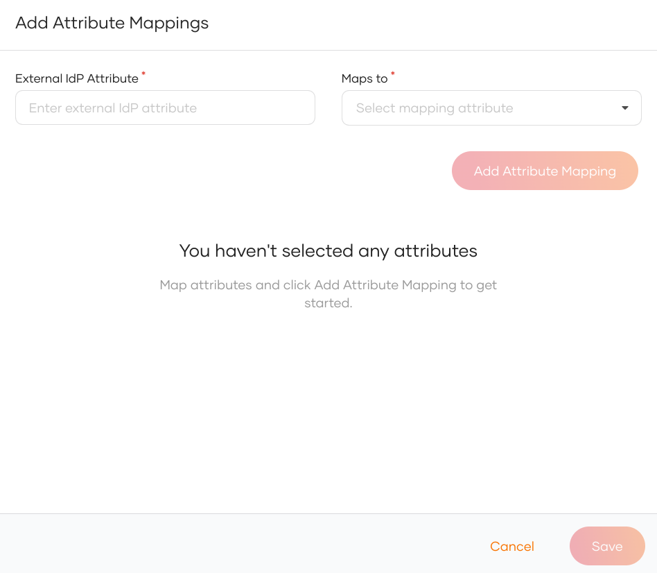

# Add login with Integrated Windows Authentication (IWA)

Integrated Windows Authentication (IWA) is a popular authentication mechanism used to authenticate users on Microsoft Windows servers. It uses Kerberos or NTLM to authenticate users based on an encrypted ticket exchange system between a browser and a server.

Follow the sections below to configure IWA as a local or a federated authenticator in WSO2 Identity Server.

## Set up Active Directory for IWA

Follow the steps below to register WSO2 Identity Server in Active Directory (AD).

1. Add a DNS host entry in Active Directory (AD) to map the IP address of WSO2 Identity Server to a hostname.

    :::info

    -   If there are multiple Kerberos domains, WSO2 Identity Server should have a virtual host name for each Kerberos domain.

    :::
		-   The DNS entry is generally created by taking the first part of the hostname and appending the Active Directory (AD) domain to it. For example, if the AD domain is `wso2.com`, the final result will be,
            ```java
            idp.wso2.com
            ```
		-   Kerberos does not work with IP addresses, it only relies on domain names and correct DNS entries.

2. Add an entry to the DNS tool of the local machine in which WSO2 Identity Server is running to map the specified host name to the local IP address.

3. Create a service account in the Active Directory for WSO2 Identity Server or use
    an existing account.

    :::note

    The account used for WSO2 Identity Server needs to be different from the one used by the user to login to the application.

    :::

4. Run the following commands to register WSO2 Identity Server as a service
    principal in Active Directory:

    :::note

    The format of these commands is:
    `[setspn -A HTTP/<url of the identity server> <service_account>]`

    :::

    ```bash
    setspn -A HTTP/idp.wso2.com <username>
    setspn -A HTTP/idp <username>
    ```

## Set up WSO2 Identity Server for IWA

Follow the steps below to configure WSO2 Identity Server for IWA.

1. Set the hostname of WSO2 Identity Server to match its DNS entry in Active Directory. To do so, open the `deployment.toml` found in the `<IS_HOME>/repository/conf` directory and add the following configuration:

    ```bash
    [server]
    hostname="idp.wso2.com"
    ```

2. Open the `jaas.conf` file found in the `<IS_HOME>/repository/conf/identity` folder and
    check if the configuration is as follows:

    :::info

    Learn more about [Java Authentication and Authorization Service (JAAS)](https://docs.oracle.com/javase/8/docs/technotes/guides/security/jaas/JAASRefGuide.html).

    :::

    ```java
    Server {
    com.sun.security.auth.module.Krb5LoginModule required
    useKeyTab=false
    storeKey=true
    useTicketCache=false
    isInitiator=false;
    };
    
    Client {
    com.sun.security.auth.module.Krb5LoginModule required
    useTicketCache=false;
    };
    ```

## Register the IWA IdP

Now, let's register IWA as an authenticator in WSO2 Identity Server.

1. On the WSO2 Identity Server Console, go to **Connections**.

2. Click **Create Connection** and select **Custom Connector**.

3. Provide a name and a description for the connector and click **Finish**.

      

4. On the created custom connector, go to the **Settings** tab.

5. Click **New Authenticator**, select **IWA Kerberos** and click **Next**.

6. Enter the following details and click **Finish**.

      

    <table><tbody><tr><td>{"Service Principal Name"}</td><td>{"The SPN registered above when setting up IWA with Active Directory in the form of "}<br />{" "}<code>{"<service class>/<host>@<AD domain>"}</code>{". "}<br />{" e.g. "}<code>{"HTTP/idp.wso2.com@wso2.com"}</code></td></tr><tr><td>{"Service Principal Password"}</td><td>{"The password of the service account associated with the SPN."}</td></tr><tr><td>{"User Store Domains"}</td><td><b>{"Fill only if you wish to configure IWA as a local authenticator. Leave this blank to set up IWA as a federated authenticator."}</b>{" "}<br /><p>{"Enter the name of a mounted user store (or a comma-separated list of multiple user stores) you want WSO2 Identity Server to search for the presence of the user account."}<br />{" e.g. "}<code>{"PRIMARY"}</code></p></td></tr></tbody></table>

## Enable IWA login

<Prerequisites title="Before you begin">

You need to [register an application with WSO2 Identity Server](../../applications/index.mdx). You can register your own application or use one of the [sample applications](../../../get-started/try-samples/index.mdx) provided.

</Prerequisites>

1. On the WSO2 Identity Server Console, go to **Applications**.
2. Select your application, go to the **Login Flow** tab and add IWA login from your preferred editor:

    

    1. Go to **Predefined Flows** > **Basic Flows** > **Add Passwordless login**.

    2. Select the IWA connection.

    3. Click **Confirm** to add IWA to the sign-in flow.

        

    

    :::note[Recommendations]


    :::
    It is recommended to add your social and enterprise connections to the first authentication step as they are used for identifying the user.

3. Click **Update** to save your changes.

## Try it out

<details>
<summary>Configure your browser to support Kerberos and NTLM.</summary>


Before you proceed, add the relevant configurations to the browser of your choice by following the steps below.

<details>
<summary>Microsoft Edge and Chrome</summary>

1. Open the **Start** menu.

2. Search for **Internet Options** and click on it.

3. Go to its **Security** tab.

4. Select **Local intranet** and click **sites**.

    

4. On the dialog box that appears, click **Advanced**.

5. Enter the URL of WSO2 Identity Server and click **Add**.

    

6. Click **Close** and click **OK**.

:::info

Chrome inherits the above settings and no additional configurations are necessary.

:::

</details>

<details>
<summary>Mozilla Firefox</summary>


1. On the address bar, type `about:config` and press Enter.

2. Ignore the warning and continue to the advanced settings of Firefox.

3. Search for `network.negotiate-auth.trusted-uris` from the address bar and click its "Edit" icon.

4. Enter the URL of WSO2 Identity Server and click the **Save** icon.

    

</details>

</details>

Follow the steps given below.

1. Access the application URL.

2. Click **Login** to open the WSO2 Identity Server login page.

3. On the WSO2 Identity Server login page, **Sign in with IWA**.

    

## Configure user attributes

Configuring attributes for an Identity Provider (IdP) involves mapping the attributes available in the external IdP to local attributes. This is done so that WSO2 Identity Server can identify the user attributes in the response sent from the external IdP.

To do so,

1. On the WSO2 Identity Server Console, click **Connections**.

2. Select the relevant IdP connection from the list and click **Set up**.

3. Go to the **Attributes** tab and under **Identity Provider Attribute Mappings**,  click **Add Attribute Mapping**.

    

4. Enter the external attribute, select the corresponding local attribute to which it maps and click **Add Attribute Mapping**.

    

5. Click **Save** to save the entries.

6. Under **Subject**, select a **Subject Attribute** that will be used to uniquely identify the user.

7. Under **Provisioning Attributes Selection**, select the required attributes that needs to be sent in the response to provision the user in WSO2 Identity Server.

8. Click **Update** to save the changes.


## Configure connection

To learn more about other configurations available for the connection, refer to the [add federated login](../federated-login/index.mdx) documentation.

## Troubleshooting tips

- Use hostnames only (no IP addresses).

- Verify the configurations in the `jaas.conf` file, particularly the `isInitiator=false` property under the `Server` section (see the [Set up Active Directory for IWA](#set-up-wso2-identity-server-for-iwa) section).

- Make sure that your service principal (IS) is associated with only one account.

- If you get an exception with an error message along the lines of “Checksum failed”, check whether you have given the correct password.
