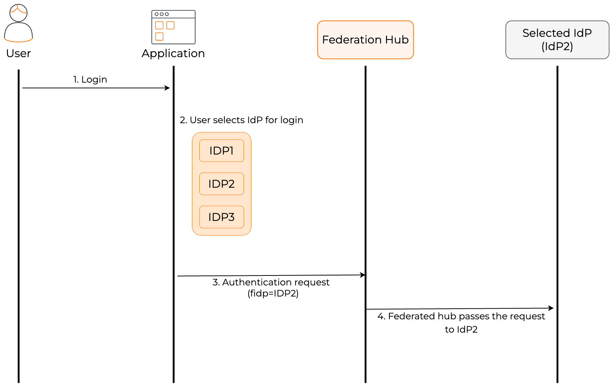

# Add federated login

WSO2 Identity Server lets you add and configure external Identity Providers (IdP) so that users can bring their identities in these external IdPs and log in to applications. Follow the guides below to learn how you can integrate the external IdP of your choice with WSO2 Identity Server.

## Create a connection

You can register an external IdP in WSO2 Identity Server by creating a connection. WSO2 Identity Server supports a variety of connections for your convenience. Select your preferred connection and follow the guide to learn how to configure it.

<div className="center-all">
  <div className="cards-container">
    <a href="/identity/7.1.0/guides/authentication/social-login/add-facebook-login" className="card square">
      
      <span>Facebook</span>
    </a>
    <a href="/identity/7.1.0/guides/authentication/social-login/add-github-login" className="card square">
      
      
      <span>GitHub</span>
    </a>
    <a href="/identity/7.1.0/guides/authentication/social-login/add-google-login" className="card square">
      
      <span>Google</span>
    </a>
    <a href="/identity/7.1.0/guides/authentication/social-login/add-apple-login/" className="card square">
      
      
      <span>Apple</span>
    </a>
    <a href="/identity/7.1.0/guides/authentication/social-login/add-microsoft-login" className="card square">
      
      <span>Microsoft</span>
    </a>
    
    <a href="/identity/7.1.0/guides/authentication/enterprise-login/add-microsoft-365-login" className="card square">
      
      <span>Microsoft 365</span>
    </a>
    <a href="/identity/7.1.0/guides/authentication/enterprise-login/add-iwa-login" className="card square">
      
      <span>IWA</span>
    </a>
    <a href="/identity/7.1.0/guides/authentication/enterprise-login/add-ad-fs-login" className="card square">
      
      <span>AD FS</span>
    </a>
    <a href="/identity/7.1.0/guides/authentication/social-login/add-x-login/" className="card square">
      
      
      <span>X</span>
    </a>
    
    <a href="/identity/7.1.0/guides/authentication/standard-based-login/add-oidc-idp-login" className="card square">
      
      <span>OpenID Connect</span>
    </a>
    <a href="/identity/7.1.0/guides/authentication/standard-based-login/add-saml-idp-login" className="card square">
      
      <span>SAML</span>
    </a>
    
    <a href="/identity/7.1.0/guides/authentication/standard-based-login/add-ws-federation" className="card square">
      
      <span>WS-Federation</span>
    </a>
    
    
  </div>
</div>

## Configure JIT provisioning


#### JIT user provisioning
    
When a user logs in with an external identity provider using the same email address registered in a local account, JIT-provisioning overrides the attributes of the local account with the attributes received from the external identity provider.

WSO2 Identity Server, by default, disables Just-In-Time (JIT) user provisioning for your external identity provider.

To enable JIT-provisioning,

1. On the WSO2 Identity Server Console, click **Connections** and select the relevant connection.

2. Go to the **Just-in-Time Provisioning** tab of the selected connection.

3. Check/Uncheck the **Just-in-Time (JIT) User Provisioning** checkbox to enable/disable it.

    

4. Click **Update** to save the changes.

:::note


- Learn more about JIT provisioning configurations in [configure JIT user provisioning](../jit-user-provisioning.md).

- You can use the [identity provider APIs](../../../apis/idp.md#tag/Provisioning/operation/getJITConfig) to customize the attribute syncing behavior between the external identity provider and WSO2 Identity Server.

:::


## Map groups with WSO2 Identity Server

### Map local attributes to external attributes

Follow the steps below to map attributes of WSO2 Identity Server with that of a connection.

1. On the WSO2 Identity Server Console, go to **Connections**.

2. Select your connection and go to its **Attributes** tab.

3. Click **Add Attribute Mapping** to add a new attribute mapping.

    

4. Enter the  **External IdP Attribute** of the connection and map it to the **Groups** attribute of WSO2 Identity Server.

    

5. Click **Add Attribute Mapping** and then click **Save**.

    

6. Click **Update** to save the changes.

    


### Add required attributes for provisioning

When provisioning users from an external identity provider (IdP), you may want to include specific attributes in the user’s profile. Follow the steps below to define the required attributes and assign default values.

1. On the WSO2 Identity Server Console, go to **Connections**.
2. Select your connection and go to its **Attributes** tab.
3. Under **Provisioning Attributes Selection**, click **Add Attribute**.
4. Move the attributes that you want to include in the provisioned user's profile and click **Save**.

    

5. Add a default value to the attribute. If the federated user lacks data for it, the system adds the default to the provisioned user’s profile.

    

    :::note


    To add default values to the provisioned user’s profile when the federated user has no value, configure the following in the `<IS_HOME>/repository/conf/deployment.toml` file.

    ```toml
    [authentication.endpoint]
    enable_merging_custom_claim_mappings_with_default = true
    ```

    :::


### Add groups to connections

Follow the steps below to add the groups from your connection to WSO2 Identity Server:

1. On the WSO2 Identity Server Console, go to **Connections**.
2. Select your connection and go to its **Groups** tab.
3. Click **New Group** and enter the group name. Be sure to enter the exact group name that will be returned from the connection.

    

4. Click **Finish** to add the group information.


## Add connections to federation hub

Federation hub is a collection of multiple IdPs configured on WSO2 Identity Server. On the federation hub, each IdP is recognized by the **home realm identifier** of the IdP.

The following diagram illustrates an authentication flow involving a federated hub.



:::note

On the application's login page, you can support either local and federated authentication or just federated authentication. This can be done by setting the `proxy_mode` configuration to one of the following modes:

<table>
    <tr>
        <td><code>smart</code></td>
        <td>Allow both local and federated authentication </td>
    </tr>
    <tr>
        <td><code>dumb</code></td>
        <td>Allow only federated authentication. The home realm identifier must be configured to operate in this mode.  If it is not configured, a separate screen should be displayed to get it from the user.</td>
    </tr>
</table>
Configure the `proxy_mode` by opening the `deployment.toml` file in the `<IS_HOME>/repository/conf` directory
and setting one of the above modes as follows.

```bash
[authentication] 
proxy_mode="smart"
```

:::
To add a connection to federation hub,

1. On the WSO2 Identity Server Console, click **Connections** and select the relevant connection.

2. Go to the **Advanced** tab of the selected connection.

3. Turn on the **Federation Hub** toggle to add the connection.

4. Enter the **Home Realm Identifier**. This value is an identifier used when your application uses a federated IdP. If a user selects this IdP and sends an authentication request, the fidp query parameter will be populated with this value. (example: fidp = googleIdP)

5. Click **Update** to save the changes.


## Delete a connection


:::note[Before you begin]

If your connection has applications associated with it, you will not be able to delete the connection.

Before deleting such connections:

1. Check the associated applications from the **Connected Apps** tab of the connection.
2. Click on an application that uses the connection and you will be redirected to the Login Flow tab of the respective application.
3. Remove the connection from the sign-in flow of the associated applications.
4. Repeat steps 2 and 3 for all listed applications.
5. Proceed to delete the connection.

:::

To delete a connection:

1. On the WSO2 Identity Server Console, go to **Connections**.
2. Click **Set up** and navigate to the **General** tab.
3. At the bottom of the page, click the button in the **Delete connection**.

    :::note

        You cannot delete connections that are available by default.

    :::

3. Select the checkbox and confirm your action.

    
