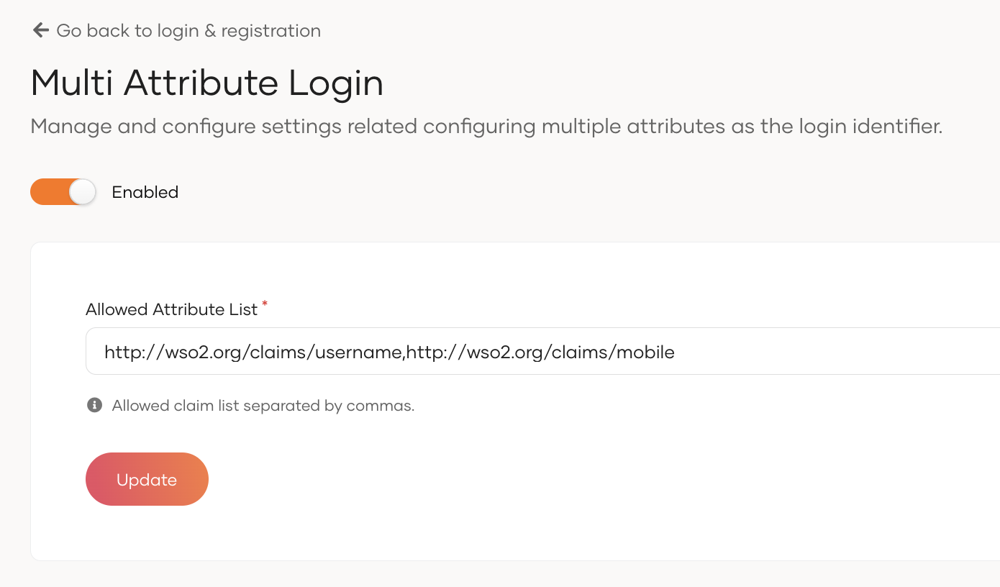
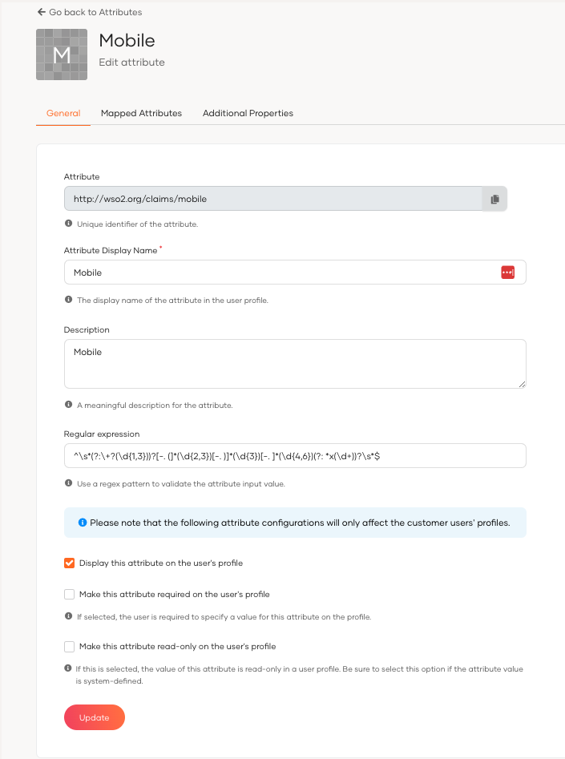
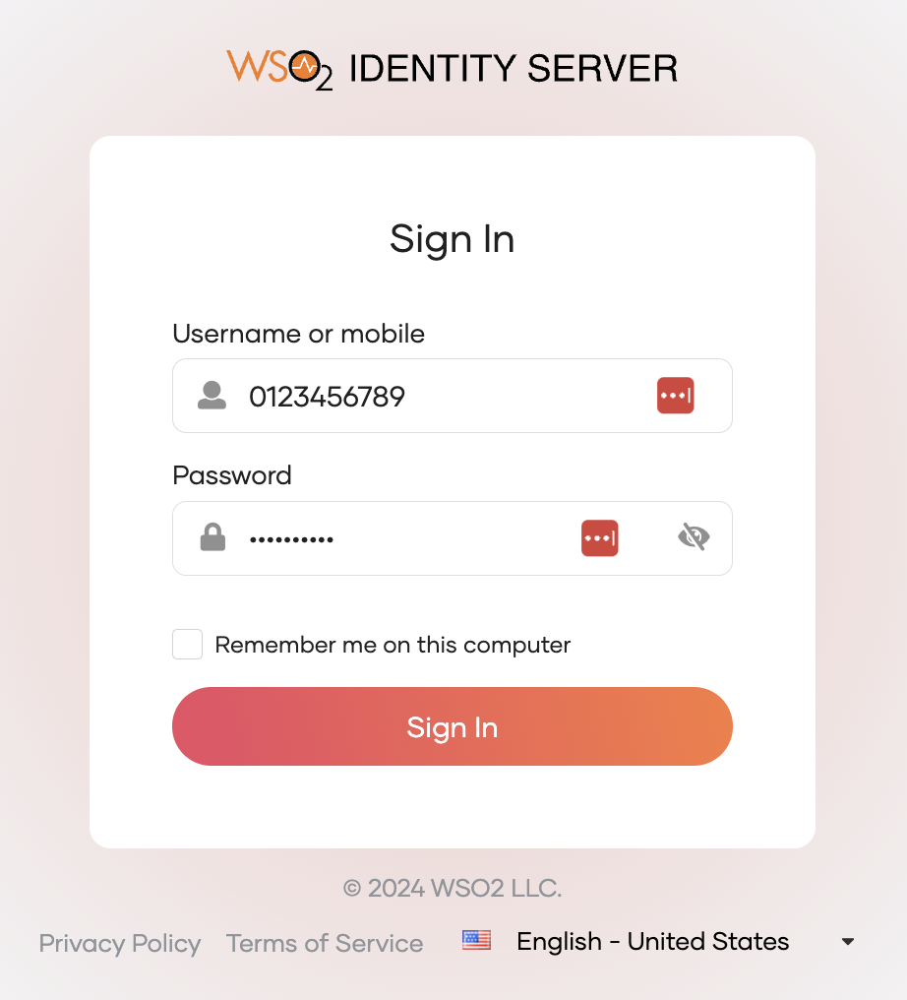

# Multi-attribute login

WSO2 Identity Server uses the username as the default login identifier. When you enable multi-attribute login, you can configure any user attributes such as email address, mobile number, or other supported attributes as valid login identifiers.

Users can then log in using any of the configured attributes, giving flexibility beyond the traditional username.

:::info[Supported flows]

Multi-attribute login is supported in the following flows:

-   Identifier first authenticator
-   Username & Password Authenticator
-   Authentication REST APIs
-   Oauth Password grant
-   Password recovery flow

:::

The following section explains how to configure WSO2 identity server for multi-attribute login.

## Enable multi-attribute login

To configure multi-attribute login, follow the steps below:

1. On the WSO2 Identity Server Console, go to **Login & Registration** > **Login Identifier** > **Multi Attribute Login**.
2. Toggle the switch to enable multi attribute login.
4. Add attribute URIs for attributes that users are allowed to use as login identifiers.
5. Click **Update** to save the changes.

## Add regular expressions for allowed attributes

Once you have configured WSO2 Identity Server for multi-attribute login, you need to provide regular expressions for the 
allowed user attributes. Some user attributes have regex defined by default. 

If you need to define regex for a user attribute, follow the steps below.

1.  On the WSO2 Identity Server Console, go to **User Attributes and Stores** > **Attributes**.
2.  Click **Attributes** again under the **Manage Attributes** section.
3.  Click **Edit** for the attribute you want to update.
4.  Enter the regex pattern under the **Regular Expression** field.
5.  Click **Update** to save the changes.

Here are a few examples of regex patterns.

<table>
  <tr>
    <th>Attribute URI</th>
    <th>Example Regex pattern</th>
  </tr>
  <tr>
    <td>http://wso2.org/claims/emailaddress</td>
    <td>^([a-zA-Z0-9_\.\-])+\@(([a-zA-Z0-9\-])+\.)+([a-zA-Z0-9]\{2,4\})+$</td>
  </tr>
  <tr>
    <td>http://wso2.org/claims/mobile</td>
    <td>^(\+\d\{1,2\}\s?)?1?\-?\.?\s?\(?\d\{3\}\)?[\s.-]?\d\{3\}[\s.-]?\d\{4\}$</td>
  </tr>
  <tr>
    <td>http://wso2.org/claims/username</td>
    <td>^[a-zA-Z0-9._-]\{3,\}$</td>
  </tr>
</table>

:::note

Username regex configuration is already available in the user store configurations. You can update the regex pattern as needed. Refer to [User Store Properties](../users/user-stores/user-store-properties/index.mdx) to learn more. Once the username regex is updated, the usernames of existing users must comply with the new pattern; otherwise, authentication will fail.

:::

You have now successfully set up WSO2 Identity Server to allow multi-attribute login.

## Try it out

When multi-attribute login is configured in WSO2 Identity Server, application users can use any of the configured attributes to login. 

In this example scenario, let's allow users to use the mobile number as a login identifier:

1.  Configure multi-attribute login for the attribute `http://wso2.org/claims/mobile` and `http://wso2.org/claims/username`.
2.  Go to the My Account: `https://localhost:9443/myaccount`.
3.  Enter mobile number as the login identifier and click **Sign In**.

:::tip

- **What happens if two users use the same value for an attribute?** 

    Multi-attribute login will not work for these users. Retaining uniqueness for attribute values avoids this conflict. Learn about [configuring the uniqueness of attributes](../users/attributes/configure-unique-attributes.mdx).

:::
