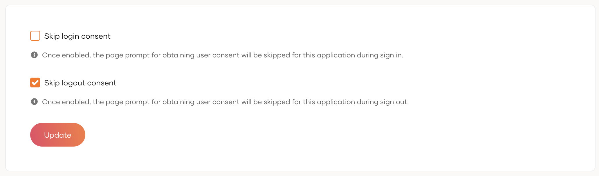

# Add logout with OIDC to application

OpenID Connect provides [OpenID Connect RP-Initiated Logout](https://openid.net/specs/openid-connect-rpinitiated-1_0.html) to terminate user sessions. The logout endpoint is used to terminate the user session at WSO2 Identity Server and to log the user out. When a user is
successfully logged out, the user is redirected to the `post_logout_redirect_uri` sent in the logout request.

:::note

Your application should redirect the user's browser to the logout endpoint, as WSO2 Identity Server uses the browser session to identify the session to terminate. To terminate user sessions from a backend service, use the [Session Management API](../../../apis/session-mgt-rest-api.md). The application calling this API should be [authorized](../../applications/register-machine-to-machine-app.md#authorize-the-api-resources-for-the-app) to access the **Session Management API** with the `internal_session_delete` scope.

:::

## Logout endpoint

```text
https://localhost:9443/oidc/logout
```

## Sample request

Redirect the user's browser to the logout endpoint with the following parameters. Make sure to URL-encode the parameter values.

```text
https://localhost:9443/oidc/logout?
id_token_hint=<id_token>
&post_logout_redirect_uri=<post_logout_redirect_uri>
&state=<state>
```

The logout request has the following parameters:

:::note

See [RP-initiated logout request](https://openid.net/specs/openid-connect-rpinitiated-1_0.html#RPLogout) for more details.

:::

<table>
  <tr>
    <th>Request Parameter</th>
    <th>Description</th>
  </tr>
  <tr>
    <td><code>id_token_hint</code>&lt;Badge text="Recommended" type="recommended"/></td>
    <td>The ID token that WSO2 Identity Server returned to the application in the token response. It gives WSO2 Identity Server a hint about the user's current authenticated session on the application.</td>
  </tr>
  <tr>
    <td><code>client_id</code>&lt;Badge text="Optional" type="optional"/></td>
    <td>The client ID obtained when registering the application in WSO2 Identity Server. This can be used instead of the <code>id_token_hint</code> parameter.</td>
  </tr>
  <tr>
    <td><code>post_logout_redirect_uri</code>&lt;Badge text="Optional" type="optional"/></td>
    <td>
    The URL to redirect the user to after logout. The value defined here should be added as one of the <a href="/identity/7.1.0/references/app-settings/oidc-settings-for-app/#authorized-redirect-urls">authorized redirect URLs</a>. This should be passed along with either the <code>id_token_hint</code> or the <code>client_id</code>.
    If the <code>post_logout_redirect_uri</code> parameter is not passed, the user will be routed to WSO2 Identity Server's common page after logout.
    </td>
  </tr>
  <tr>
    <td><code>state</code>&lt;Badge text="Optional" type="optional"/></td>
    <td>The parameter passed from the application to WSO2 Identity Server to maintain state information. If an application sends this parameter, WSO2 Identity Server will return this information in the response.</td>
  </tr>
</table>

## Sample response

```text
http://myapp.com?state=state-param
```

If **Skip logout consent** is disabled for the application, WSO2 Identity Server prompts the user to confirm the logout before logging the user out. To configure this, go to **Applications** in the WSO2 Identity Server Console, select your application, and use the **Skip logout consent** option in its **Advanced** tab.



<br />
