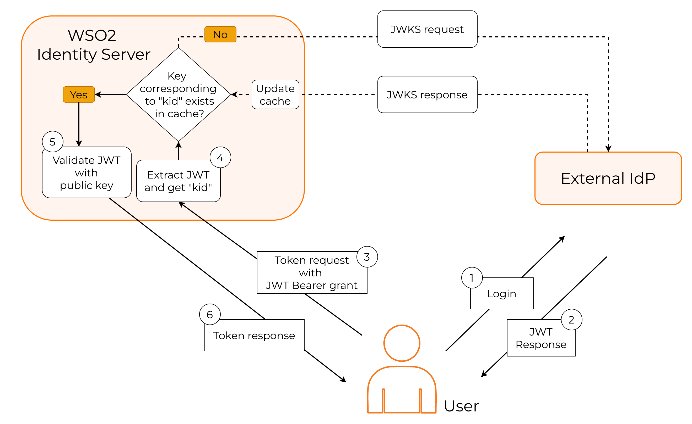

# Validate JWT with JSON Web Key Set (JWKS)

This guide explains JSON Web Key Set (JWKS) and how to use it to validate JSON Web Tokens (JWT) with WSO2 Identity Server.

## Overview

A JWKS end-point exposes an authorization server’s public keys in the JWKS format. Clients can use these keys to verify the signatures of JWTs issued by the server. A JWKS endpoint comes with the following advantages.

- Programmatic key discovery by client applications - Clients can automatically fetch the Identity Provider (IdP)’s public keys without manual configuration.

- Simpler integration with multiple relying parties - Multiple apps can use the same IdP keys without individual updates.

- Seamless key rollover without service disruption - When the IdP changes keys, clients can verify tokens without breaking existing sessions.

WSO2 Identity Server exposes its own JWKS endpoint when acting as an IdP. When acting as a service provider (SP), it can validate JWTs issued by external IdPs by calling the corresponding JWKS endpoints. The following sections explore how to configure and implement these two scenarios.

## WSO2 Identity Server acting as the IdP

In this instance, WSO2 Identity Server works as the JWT issuer. The following diagram explains this process.


- The user authenticates with WSO2 Identity Server to access the protected resource.

- WSO2 Identity Server authenticates the user, and returns a signed JWT.

- The application calls the JWKS endpoint of WSO2 Identity Server to get the public keys.

- The application should then find the correct key based on the kid (key ID), validate the JWT response and grant access to the protected resource.

WSO2 Identity Server exposes its public keys from the following URL:


<Tabs>
<TabItem value="tab-0" label="Format">


```bash
https://<HOST_NAME>:<IS_HTTPS_PORT>/oauth2/jwks
```

</TabItem>
<TabItem value="tab-1" label="Example">


```bash
https://localhost:9443/oauth2/jwks
```

</TabItem>
</Tabs>


The contents of the WSO2 Identity Server JWKS endpoint take the following form:

```json
{
  "keys": [
    {
      "kty": "RSA",
      "x5t#S256": "m_eCU6DLMVTX9h5TomL64Swtp-AMsmA-6xvWCTr5gf4",
      "e": "AQAB",
      "use": "sig",
      "kid": "OWJmNzgyNTNhMGNiMzE1NGQ3ZjYxZTUzYTI2MmZhZTEyYzJkYTdlMDBjYjI2MDNlZWIxYmQ2MDkzYWY5ODFmZQ_RS256",
      "x5c": [
        "MIIDtTCCAp2gAwIBAgIUdYqOmjbFWs31cUW2cjkBlEUK3tQwDQYJKoZIhvcNAQELBQAwYjELMAkGA1UEBhMCVVMxCzAJBgNVBAgMAkNBMRQwEgYDVQQHDAtTYW50YSBDbGFyYTENMAsGA1UECgwEV1NPMjENMAsGA1UECwwEV1NPMjESMBAGA1UEAwwJbG9jYWxob3N0MB4XDTI1MDEwODA4MzIwN1oXDTI2MDEwODA4MzIwN1owYjELMAkGA1UEBhMCVVMxCzAJBgNVBAgMAkNBMRQwEgYDVQQHDAtTYW50YSBDbGFyYTENMAsGA1UECgwEV1NPMjENMAsGA1UECwwEV1NPMjESMBAGA1UEAwwJbG9jYWxob3N0MIIBIjANBgkqhkiG9w0BAQEFAAOCAQ8AMIIBCgKCAQEApKrcXnoAU82tf7lfrK7nXly0NXGuooK5976cApos9eKFd3I2ln7PEZEkeW5U+bsx/fSYBnSlf4rCD3xGI79H86dfJm6xewMeYkGW+gq/qyBJWR+qB4MSbh0LRci3swpVMfV4C+4jOJ0QmSjpr04toXz+yRO1YQIfZnO8ESlSby2gxnaimAkgjdv4pZJv4SK2YEQiOsUkYklRckMxVO3g/l4RIP83yBRLJaU5IiY/0YyKeR3XIM1QDv+0ZzI13MSPhb2TYzHevwgZ9cPnADMBT/RtRg9y5jscA+A/FdDcZ/QLsrWMYNqp9AlNBvKssrqZQ6PrfA+YngYu9rXIG3BuUw"
      ],
      "alg": "RS256",
      "n": "pKrcXnoAU82tf7lfrK7nXly0NXGuooK5976cApos9eKFd3I2ln7PEZEkeW5U-bsx_fSYBnSlf4rCD3xGI79H86dfJm6xewMeYkGW-gq_qyBJWR-qB4MSbh0LRci3swpVMfV4C-4jOJ0QmSjpr04toXz-yRO1YQIfZnO8ESlSby2gxnaimAkgjdv4pZJv4SK2YEQiOsUkYklRckMxVO3g_l4RIP83yBRLJaU5IiY_0YyKeR3XIM1QDv-0ZzI13MSPhb2TYzHevwgZ9cPnADMBT_RtRg9y5jscA-A_FdDcZ_QLsrWMYNqp9AlNBvKssrqZQ6PrfA-YngYu9rXIG3BuUw"
    },
    {
      "kty": "RSA",
      "x5t#S256": "m_eCU6DLMVTX9h5TomL64Swtp-AMsmA-6xvWCTr5gf4",
      "e": "AQAB",
      "use": "sig",
      "kid": "OWJmNzgyNTNhMGNiMzE1NGQ3ZjYxZTUzYTI2MmZhZTEyYzJkYTdlMDBjYjI2MDNlZWIxYmQ2MDkzYWY5ODFmZQ_PS256",
      "x5c": [
        "MIIDtTCCAp2gAwIBAgIUdYqOmjbFWs31cUW2cjkBlEUK3tQwDQYJKoZIhvcNAQELBQAwYjELMAkGA1UEBhMCVVMxCzAJBgNVBAgMAkNBMRQwEgYDVQQHDAtTYW50YSBDbGFyYTENMAsGA1UECgwEV1NPMjENMAsGA1UECwwEV1NPMjESMBAGA1UEAwwJbG9jYWxob3N0MB4XDTI1MDEwODA4MzIwN1oXDTI2MDEwODA4MzIwN1owYjELMAkGA1UEBhMCVVMxCzAJBgNVBAgMAkNBMRQwEgYDVQQHDAtTYW50YSBDbGFyYTENMAsGA1UECgwEV1NPMjENMAsGA1UECwwEV1NPMjESMBAGA1UEAwwJbG9jYWxob3N0MIIBIjANBgkqhkiG9w0BAQEFAAOCAQ8AMIIBCgKCAQEApKrcXnoAU82tf7lfrK7nXly0NXGuooK5976cApos9eKFd3I2ln7PEZEkeW5U+bsx/fSYBnSlf4rCD3xGI79H86dfJm6xewMeYkGW+gq/qyBJWR+qB4MSbh0LRci3swpVMfV4C+4jOJ0QmSjpr04toXz+yRO1YQIfZnO8ESlSby2gxnaimAkgjdv4pZJv4SK2YEQiOsUkYklRckMxVO3g/l4RIP83yBRLJaU5IiY/0YyKeR3XIM1QDv+0ZzI13MSPhb2TYzHevwgZ9cPnADMBT/RtRg9y5jscA+A/FdDcZ/QLsrWMYNqp9AlNBvKssrqZQ6PrfA+YngYu9rXIG3BuUw"
      ],
      "alg": "PS256",
      "n": "pKrcXnoAU82tf7lfrK7nXly0NXGuooK5976cApos9eKFd3I2ln7PEZEkeW5U-bsx_fSYBnSlf4rCD3xGI79H86dfJm6xewMeYkGW-gq_qyBJWR-qB4MSbh0LRci3swpVMfV4C-4jOJ0QmSjpr04toXz-yRO1YQIfZnO8ESlSby2gxnaimAkgjdv4pZJv4SK2YEQiOsUkYklRckMxVO3g_l4RIP83yBRLJaU5IiY_0YyKeR3XIM1QDv-0ZzI13MSPhb2TYzHevwgZ9cPnADMBT_RtRg9y5jscA-A_FdDcZ_QLsrWMYNqp9AlNBvKssrqZQ6PrfA-YngYu9rXIG3BuUw"
    }
  ]
}
```

<table><tbody><tr><td>{"kty"}</td><td>{"The public key type. e.g., RSA"}</td></tr><tr><td>{"x5t#S256"}</td><td>{"A SHA-256 hash of the X.509 certificate in the JWKS. Used to quickly identify which certificate was used to sign the JWT."}</td></tr><tr><td>{"e"}</td><td>{"Exponent used in the RSA algorithm."}</td></tr><tr><td>{"use"}</td><td>{"Indicates the intended use of the key. "}<ul><li><code>{"sig"}</code>{": signature verification"}</li><li><code>{"enc"}</code>{": encryption"}</li></ul></td></tr><tr><td>{"kid"}</td><td>{"The key ID. Helps to identify which key signed the JWT."}</td></tr><tr><td>{"x5c"}</td><td>{"The X.509 certificate chain. The chain can include intermediate certificates up to a trusted root. Useful for clients that validate signatures against trusted Certificate Authorities (CA)."}</td></tr><tr><td>{"n"}</td><td>{"Modulus value used in the RSA algorithm."}</td></tr></tbody></table>

## WSO2 Identity Server acting as the SP

In this instance, WSO2 Identity Server works as the JWT validator. The following diagram explains this process.



- The user first authenticates with the external IdP to access the protected resource.

- The external IdP issues a signed JWT and returns it to the user.

- Because the resource server trusts WSO2 Identity Server, not the external IdP, the user must exchange this JWT for an access token in WSO2 Identity Server.

- WSO2 Identity Server reads the kid (key ID) from the JWT header to determine which key was used to sign it.

- If the corresponding key is already available in the cached JWKS content from the external IdP, WSO2 Identity Server uses it to validate the JWT.

- If the key is not cached, WSO2 Identity Server retrieves the JWKS from the external IdP and updates the cache.

- After successfully validating the JWT, WSO2 Identity Server issues an access token to the user.


Follow the steps below to implement this use case.

### Configure external JWKS endpoint properties

The following properties control how WSO2 Identity Server retrieves and processes keys from an external JWKS endpoint. Configure them in the `<IS_HOME>/repository/conf/deployment.toml` file and restart WSO2 Identity Server.

```toml
[oauth.jwks_endpoint]
enable= true
connection_timeout= 1000 # time in milliseconds
read_timeout= 1000 # time in milliseconds
size_limit_bytes= 51200
```

### Exchange signed JWT to a WSO2 Identity Server token


You can see JWT validation in action by following the guide and implementing the [JWT Bearer Grant type](../configure-jwt-bearer-grant.md) for your application.
