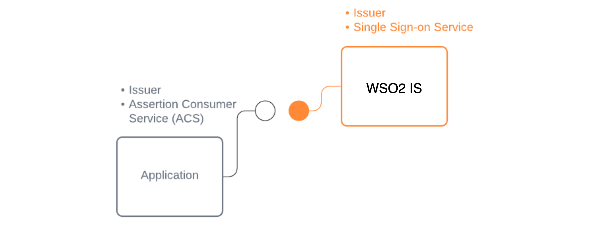
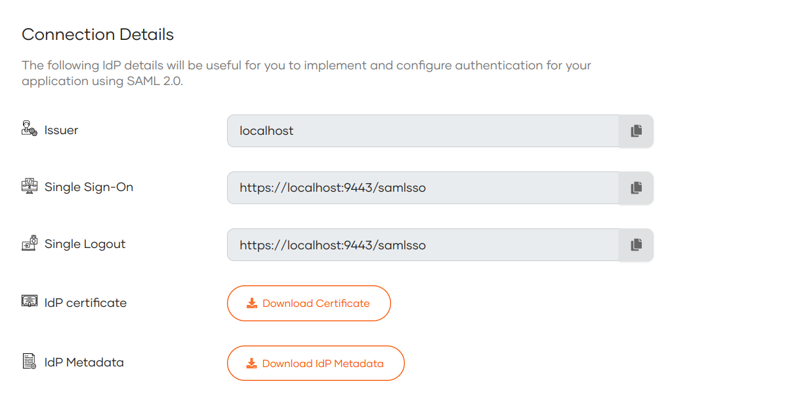

# Discover SAML endpoints and configs in WSO2 Identity Server

You can follow this document to obtain required information and the configurations to:
- Integrate sign in with WSO2 Identity Server for your SAML web application
- Build login with WSO2 Identity Server using a SAML supported library

When configuring SAML based sign in with WSO2 Identity Server, you need to know:

1. SAML IdP endpoints of WSO2 Identity Server
2. Issuer of WSO2 Identity Server
3. The public certificate of WSO2 Identity Server

    

<Prerequisites>

## Prerequisites
To get started, you need to have an application registered in WSO2 Identity Server. If you don't have an app registered, go to WSO2 Identity Server to [register a SAML application](../../applications/register-saml-web-app.mdx).

</Prerequisites>

## Get SAML configs
You need to know the SAML IdP configurations of WSO2 Identity Server if you want to add SAML login to your application.

There are two options for a SAML application to get the SAML IdP configurations of WSO2 Identity Server:

1. [Use SAML IdP metadata of WSO2 Identity Server](#use-saml-metadata)
2. [Get SAML IdP configurations of WSO2 Identity Server from Console](#get-saml-configurations)

### Use SAML metadata

[SAML metadata](https://docs.oasis-open.org/security/saml/v2.0/saml-metadata-2.0-os.pdf) is an XML document that contains information necessary to integrate a SAML application with a SAML-supported identity provider.

The SAML IdP metadata document contains:

 1. Endpoints (single sign-on URLs, single logout URLs, etc)

 2. Supported bindings

 3. IdP identifiers (entityID or sometimes called Issuer)

 4. Public certificate

**Sample SAML IdP metadata of WSO2 Identity Server**

```xml
<?xml version="1.0" encoding="UTF-8"?>
<EntityDescriptor
    xmlns="urn:oasis:names:tc:SAML:2.0:metadata" entityID="localhost">
    <IDPSSODescriptor WantAuthnRequestsSigned="false" protocolSupportEnumeration="urn:oasis:names:tc:SAML:2.0:protocol" validUntil="2021-07-07T07:01:06.536Z">
        <KeyDescriptor use="signing">
            <KeyInfo
                xmlns="http://www.w3.org/2000/09/xmldsig#">
                <X509Data>
                    <X509Certificate>MIIC/jCCAeagAwIBAgIECXIstjANBgkqhkiG9w0BAQQFADBBMRAwDgYDVQQDDAdiaWZyb3N0MQ0w
CwYDVQQLDAROb25lMQ8wDQYDVQQKDAZOb25lIEwxDTALBgNVBAYTBE5vbmUwHhcNMjEwMzIwMDYz
NTU5WhcNMzEwNDE3MDYzNTU5WjBBMRAwDgYDVQQDDAdiaWZyb3N0MQ0wCwYDVQQLDAROb25lMQ8w
DQYDVQQKDAZOb25lIEwxDTALBgNVBAYTBE5vbmUwggEiMA0GCSqGSIb3DQEBAQUAA4IBDwAwggEK
AoIBAQCL+LfgKAXwhl3x7buxjeUmRfozJbt7aggfR/86WfB+1N1L5ICaYgybTpB3KEOvR/JxO41H
2GOwSFKb15xLmRmH2qy598tvU3TjUyXftUTqp44o/gChy9iavSu2kfRNSCped0N4UAAXegtWFROi
TD0iT5PbdwQ8MDyAwKZB/s2N7t82xDpoK7PO99R6Re9GcOX/tkAeBvD/SDK6MgnXU2UqI1uYJ0ow
BOfrxPBDhTlEkP34hPTOLNabVyJX5k5zXYvwCxQj5AWMudSUzhLjZfWiPRNqjWgv1XxAYBIccgYq
on1jG++e7Fod3jY0UUclzAHiguWKuM7Ijkd8plEUTgXNAgMBAAEwDQYJKoZIhvcNAQEEBQADggEB
AEIeJ9o5QYlRV2KJN5bLL7s6GV3hkYMIrzDoxHFgSvEt2XJULHWj3yvKe1hk/HzEII79fYYKS6xJ
v7MORegQP/zFCD8oAHt/3lnhrG1yM/SQDe60Kd5emWqLqMxNQBmmaYQDTY7F5PIdC9KJ/EeKIoz2
P2QlT5TNOcj9chtRHtsohNNv6Nkew6HZ49Xlm4BsFxhP6J5YPExV4bBw+RsHeiNdcxXNGaNtD5n2
L4KOHbmKddsL1x/KZ4Q67xzaS50IhNnfC84pOFxmYT2FsB02ZuVv97UsNF+8xv+GIN3qc+pIJEWd
HFY29KP4da//BDdQrftzYCATe37Um09id/0KMGs=</X509Certificate>
                </X509Data>
            </KeyInfo>
        </KeyDescriptor>
        <ArtifactResolutionService Binding="urn:oasis:names:tc:SAML:2.0:bindings:SOAP" Location="https://localhost:9443/samlartresolve" index="1"/>
        <SingleLogoutService Binding="urn:oasis:names:tc:SAML:2.0:bindings:SOAP" Location="https://localhost:9443/samlsso" ResponseLocation="https://localhost:9443/samlsso"/>
        <SingleLogoutService Binding="urn:oasis:names:tc:SAML:2.0:bindings:HTTP-POST" Location="https://localhost:9443/samlsso" ResponseLocation="https://localhost:9443/samlsso"/>
        <SingleLogoutService Binding="urn:oasis:names:tc:SAML:2.0:bindings:HTTP-Redirect" Location="https://localhost:9443/samlsso" ResponseLocation="https://localhost:9443/samlsso"/>
        <SingleSignOnService Binding="urn:oasis:names:tc:SAML:2.0:bindings:HTTP-POST" Location="https://localhost:9443/samlsso"/>
        <SingleSignOnService Binding="urn:oasis:names:tc:SAML:2.0:bindings:HTTP-Redirect" Location="https://localhost:9443/samlsso"/>
        <SingleSignOnService Binding="urn:oasis:names:tc:SAML:2.0:bindings:HTTP-POST" Location="https://localhost:9443/samlsso"/>
        <SingleSignOnService Binding="urn:oasis:names:tc:SAML:2.0:bindings:HTTP-Redirect" Location="https://localhost:9443/samlsso"/>
    </IDPSSODescriptor>
</EntityDescriptor>
```

There are two ways to get the SAML IdP metadata of WSO2 Identity Server.

- [File based metadata](#use-file-based-metadata)
- [URL based metadata](#use-url-based-metadata)

Based on the capability of your SAML application or library, you can choose either approach.

#### Use File Based Metadata

To download the SAML metadata file of your organization in WSO2 Identity Server,

1. In the WSO2 Identity Server Console, Select **Applications**.

2. Select the SAML application from the application view.

3. Go to the **Info** section.

4. Click **Download IdP Metadata** to download the metadata xml file.

    

#### Use URL Based Metadata

You can use below endpoint URL to get the SAML IdP metadata information.

```
https://localhost:9443/identity/metadata/saml2
```

**Sample endpoint URL**
```
https://localhost:9443/identity/metadata/saml2
```

:::note

When integrating WSO2 Identity Server as a SAML IdP in Salesforce, be sure to add the SAML metadata URL to the [Salesforce remote site settings](https://developer.salesforce.com/docs/atlas.en-us.apexcode.meta/apexcode/apex_callouts_remote_site_settings.htm) to recognize it as an authorized network address.

:::

### Get SAML configurations

Some applications and SDKs do not have the capability to dynamically resolve endpoints from  SAML metadata file. You need to configure endpoints manually to support them.

You can login to WSO2 Identity Server and get endpoints of WSO2 Identity Server.

1. In the WSO2 Identity Server Console, click **Applications**.

2. Select the SAML application from the application view.

3. Go to the **Info** section of the application and finds the below server information related to your organization:

    - **Issuer** : Issuer name of WSO2 Identity Server
    - **Single Sign-On** : Sign-on URL of WSO2 Identity Server
    - **Single Logout** : Logout URL of WSO2 Identity Server
    - **IdP certificate** : Public certificate of WSO2 Identity Server

    

4. You can download the certificate of WSO2 Identity Server from **IdP certificate**.

## What's next?
Now you've integrated your SAML web application. You also can:
<LinkCards>

- [Configure SAML settings](../../../references/app-settings/saml-settings-for-app.mdx)

</LinkCards>
