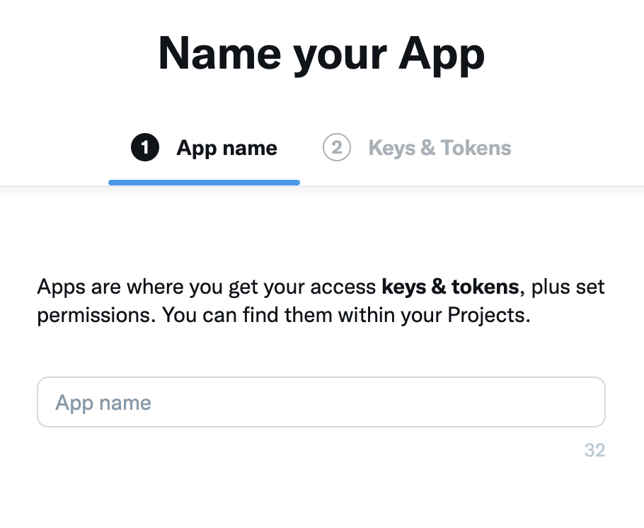
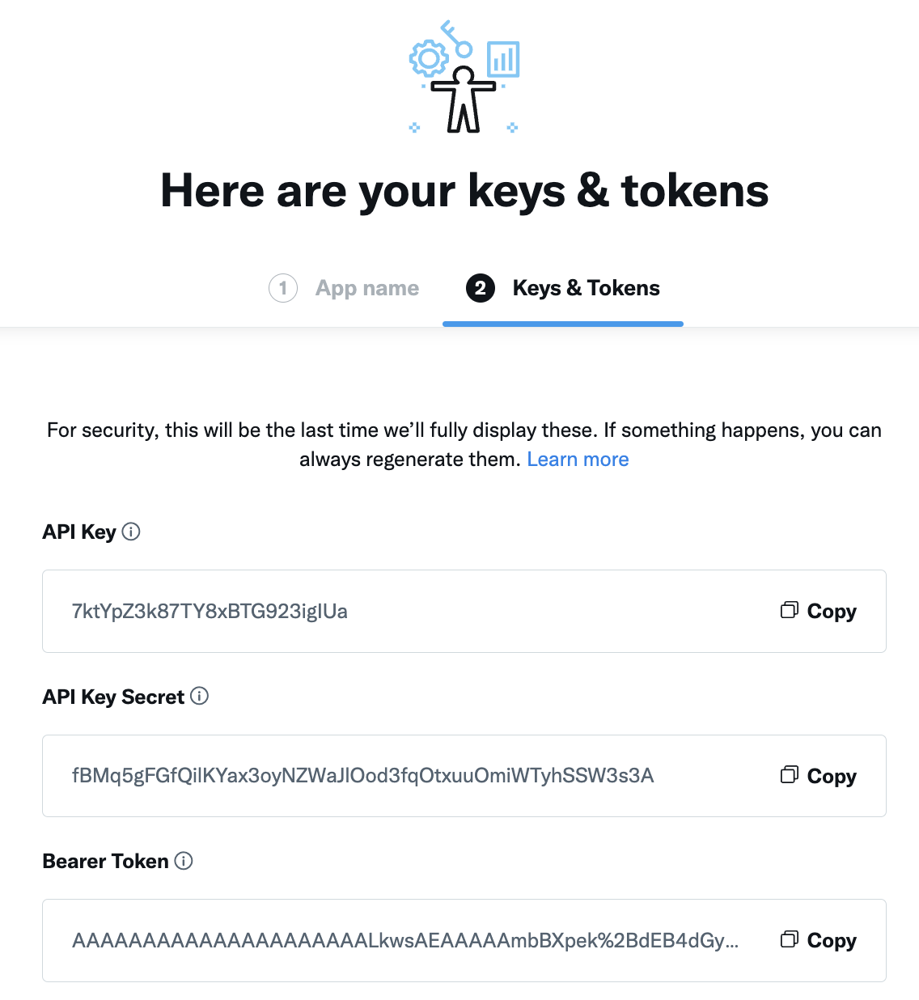
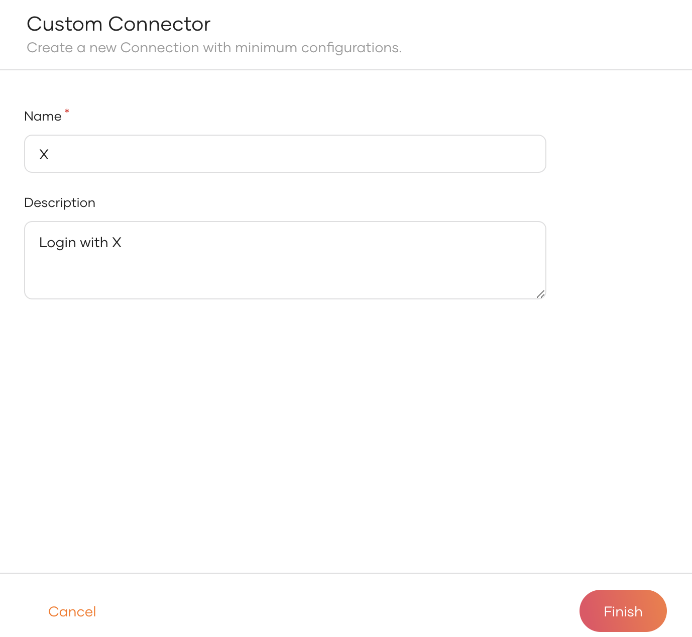
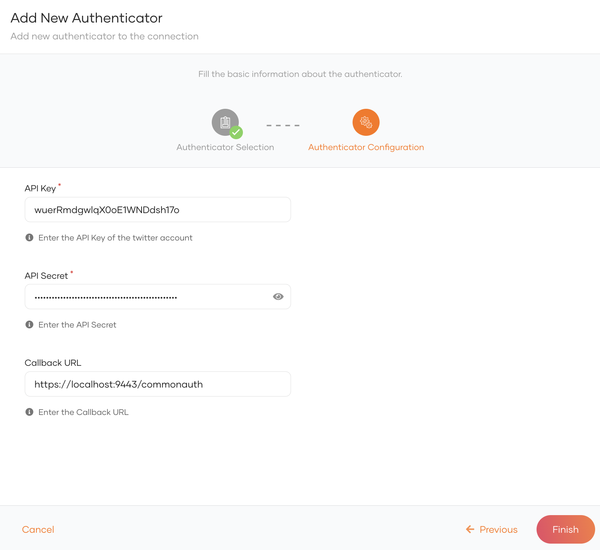
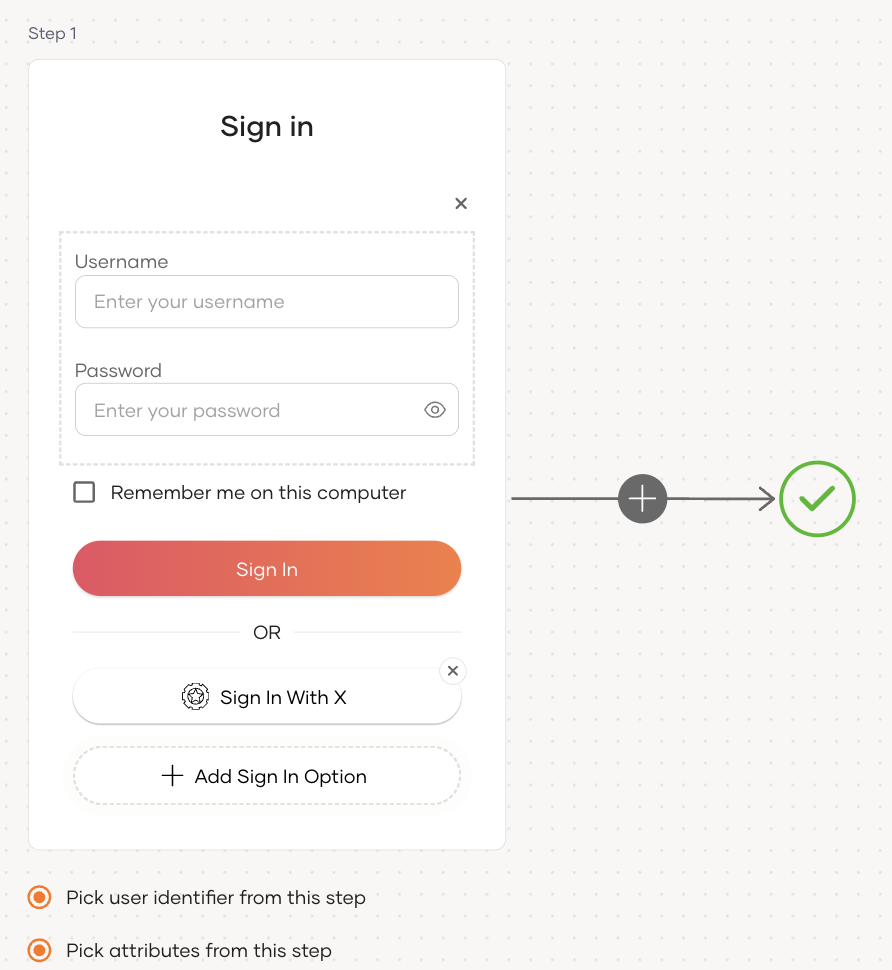
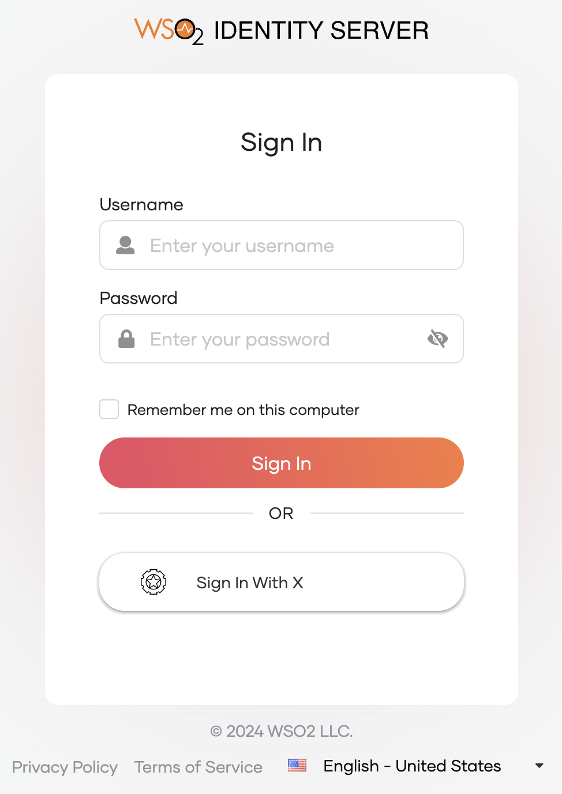

# Add X login

You can add X login to your applications using WSO2 Identity Server and enable users to log in with their X accounts.

## Register WSO2 Identity Server on X

1. Log in to the [X Developer Portal](https://developer.twitter.com/) using your X credentials.

2. Navigate to **Projects & Apps**, click **Add project** and provide details of your project.

3. Either during project creation, or by navigating to your created project in **Projects & Apps**, click **Add App**.

    1. Provide an **App name**.
       

    2. Take note of the **API Key** and **API Key Secret** of the application.
       

4. Click **App Settings** at the bottom of the page.

5. Click **Set up** under **User Authentication Settings** and do the following.

   1. Under **Type of App** select **Web App, Automated App or Bot**.

   2. Fill in the user authentication details with the following values.

      - Callback URI / Redirect URL - `/commonauth`
      - Website URL - `http://localhost.com:8080/pickup-dispatch/home.jsp`

   3. Click **Save**.

    :::note

    The **App Client ID** and **App client secret** presented at this moment is not required for this guide.

    :::

## Register the X IdP

Now, let's register the Microsoft IdP in WSO2 Identity Server.

1. On the WSO2 Identity Server Console, go to **Connections**.

2. Click **Create Connection** and select **Custom Connector**.

3. Provide a name and a description for the connector and click **Finish**.

      

4. On the created custom connector, go to the **Settings** tab.

5. Click **New Authenticator**, select **Twitter** and click **Next**.

6. Enter the following details and click **Finish**.

      

      {"<tr\">"}<table><tbody><tr><th>{"Parameter"}</th><th>{"Description"}</th></tr><tr><td>{"API Key"}</td><td>{"The "}<code>{"API key"}</code>{" generated when registering WSO2 Identity Server in X."} {" e.g. "}<code>{"wuerRmdgwlqX0oE1WNDdsh17o"}</code></td></tr><tr><td>{"API Secret"}</td><td>{"The "}<code>{"API Key Secret"}</code>{" generated when registering WSO2 Identity Server in X. "} {" e.g. "}<code>{"771tqnkpcbRyTBSCRQvVud1x8j1uQlCDpNZo3hRG0s4cEtsFky"}</code></td></tr><tr><td>{"Callback URL"}</td><td>
{"The Callback URL you entered when registering WSO2 Identity Server in X. This is the URL to which the browser should be redirected after the authentication is successful."}
{" e.g. "}<code>{"/commonauth"}</code></td></tr></tbody></table>

#### JIT user provisioning
    
When a user logs in with an external identity provider using the same email address registered in a local account, JIT-provisioning overrides the attributes of the local account with the attributes received from the external identity provider.

WSO2 Identity Server, by default, disables Just-In-Time (JIT) user provisioning for your external identity provider.

To enable JIT-provisioning,

1. On the WSO2 Identity Server Console, click **Connections** and select the relevant connection.

2. Go to the **Just-in-Time Provisioning** tab of the selected connection.

3. Check/Uncheck the **Just-in-Time (JIT) User Provisioning** checkbox to enable/disable it.

    

4. Click **Update** to save the changes.

:::note

- Learn more about JIT provisioning configurations in [configure JIT user provisioning](../jit-user-provisioning.mdx).

- You can use the [identity provider APIs](../../../apis/idp.mdx#tag/Provisioning/operation/getJITConfig) to customize the attribute syncing behavior between the external identity provider and WSO2 Identity Server.

:::

## Enable X login

<Prerequisites title="Before you begin">

You need to [register an application with WSO2 Identity Server](../../applications/index.mdx). You can register your own application or use one of the [sample applications](../../../get-started/try-samples/index.mdx) provided.

</Prerequisites>

1. On the WSO2 Identity Server Console, go to **Applications**.
2. Select your application, go to the **Login Flow** tab and add X login from your preferred editor:

    
    1. Click **Add Sign In Option** to add a new authenticator to the first step.

    2. Select the Twitter connection.

    3. Click **Confirm** to add login with X to the sign-in flow.

        
    

    :::note[Recommendations]

    :::
    It is recommended to add your social and enterprise connections to the first authentication step as they are used for identifying the user.

3. Click **Update** to save your changes.

## Try it out

Follow the steps given below.

1. Access the application URL.

2. Click **Login** to open the WSO2 Identity Server login page.

3. On the WSO2 Identity Server login page, **Sign in with X**.

    

4. Log in to X with an existing user account.

:::note

When a user successfully logs in with X for the first time, a **user** account is created in the WSO2 Identity Server Console with the X username. This new user account will be managed by X.

:::

## Configure user attributes

Configuring attributes for an Identity Provider (IdP) involves mapping the attributes available in the external IdP to local attributes. This is done so that WSO2 Identity Server can identify the user attributes in the response sent from the external IdP.

To do so,

1. On the WSO2 Identity Server Console, click **Connections**.

2. Select the relevant IdP connection from the list and click **Set up**.

3. Go to the **Attributes** tab and under **Identity Provider Attribute Mappings**,  click **Add Attribute Mapping**.

    

4. Enter the external attribute, select the corresponding local attribute to which it maps and click **Add Attribute Mapping**.

    

5. Click **Save** to save the entries.

6. Under **Subject**, select a **Subject Attribute** that will be used to uniquely identify the user.

7. Under **Provisioning Attributes Selection**, select the required attributes that needs to be sent in the response to provision the user in WSO2 Identity Server.

8. Click **Update** to save the changes.

## Configure connection

To learn more about other configurations available for the connection, refer to the [add federated login](../federated-login/index.mdx) documentation.
