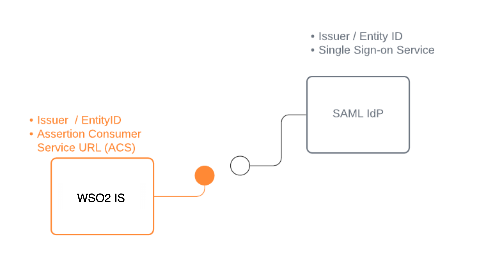
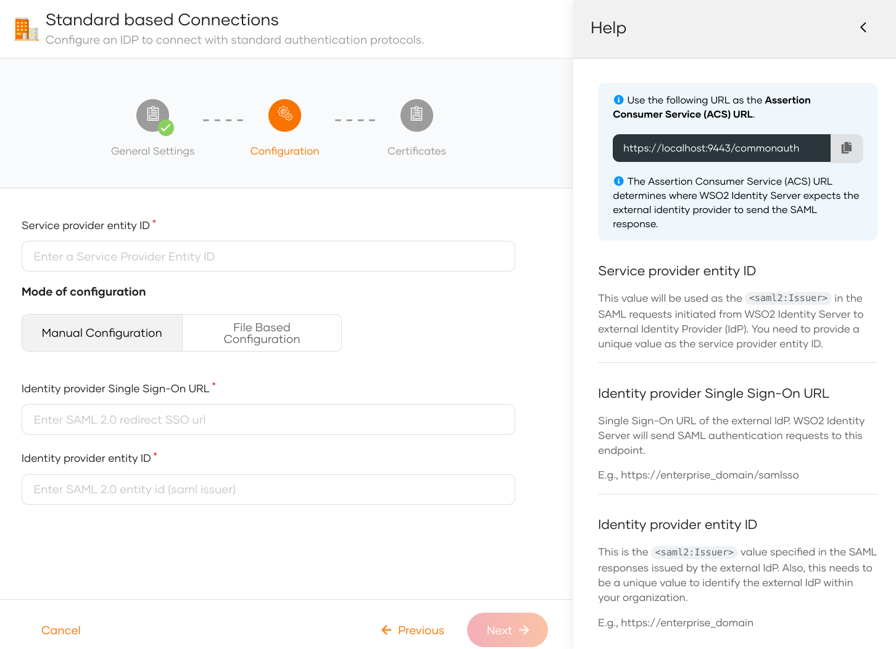
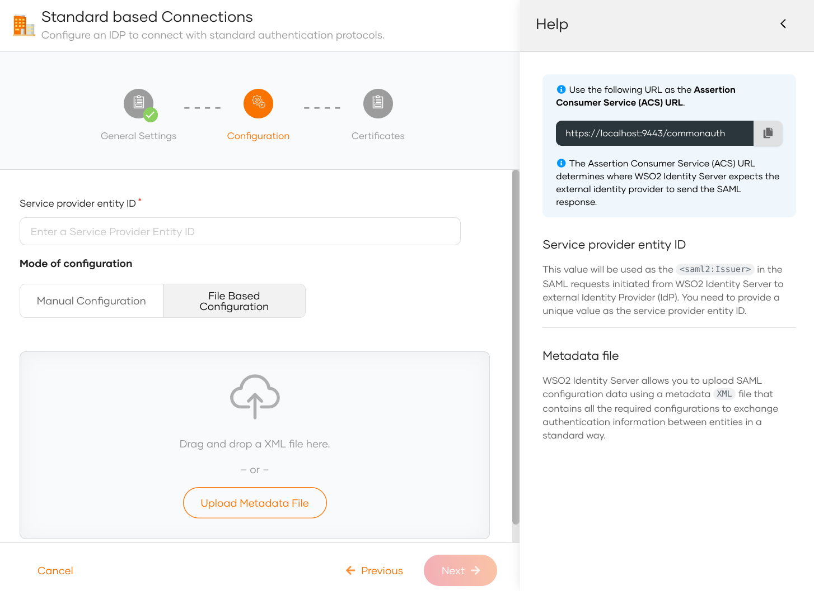

# Add login with a SAML identity provider

You can add standard SAML login to your applications using an external SAML Identity Provider (IdP) and enable users to log in with their external identities.

Follow this guide to register a SAML IdP in WSO2 Identity Server and add it to the login flow of your application.



## Register WSO2 Identity Server in the IdP
You need to register WSO2 Identity Server as a SAML application in the external identity provider. Follow the identity provider's documentation to know how to register a SAML application.

You can use the following URL as the **Assertion Consumer Service URL** (also known as callback URL/ redirect URL/ ACS URL) in the application that represents WSO2 Identity Server.

```bash
https://localhost:9443/commonauth
```

After you register the app, you should get the required configurations, as explained below.

- If you are manually applying the IdP configurations to WSO2 Identity Server, you need the following configurations:
    - **Issuer** (also known as entityId)
    - **Single sign on URL** of the identity provider (also known as login URL)
    - **Identity Provider Certificate**

- If you are using metadata to apply the IdP configurations to WSO2 Identity Server, you need the following:
    - **SAML IdP metadata file** of the identity provider
    - **Identity Provider Certificate**

## Register the SAML IdP

Now, let's register the SAML IdP in WSO2 Identity Server.

1. On the WSO2 Identity Server Console, click **Connections**.
2. Click **New Connections** and select **Standard-Based IdP**.
3. Provide a unique **identity provider name**, select **SAML**, and click **Next**.
   

4. Select one of the following methods and add the SAML configurations:

    <table>
        <tr>
            <th>File Based Configuration</th>
            <td><p>Upload a SAML metadata file with the required configurations.</p> See [Use a SAML metadata file](#use-a-saml-metadata-file).</td>
        </tr>
        <tr>
            <th>Manual Configuration</th>
            <td><p>Use this option to manually specify the required SAML configurations.</p> See [Add SAML configs manually](#add-saml-configs-manually).</td>
        </tr>
    </table>

### Add SAML configs manually

If you selected **Manual Configuration** in the previous step, follow the steps given below.

1. Enter the following details and click **Next**.

    

    <table>
        <tr>
            <th>Parameter</th>
            <th>Description</th>
        </tr>
        <tr>
            <td>Service provider entity ID</td>
            <td> This value will be used as the <code>saml2:Issuer</code> in the SAML requests initiated from WSO2 Identity Server to the external identity provider (IdP).</td>
        </tr>
        <tr>
            <td>Identity provider Single Sign-On URL</td>
            <td>This value specifies the single sign-on URL of the external IdP. This is where WSO2 Identity Server will send its authentication requests. You need to get this value from the external IdP.</td>
        </tr>
        <tr>
            <td>Identity provider entity ID</td>
            <td>This is the <code>saml2:Issuer</code> value specified in the SAML responses issued by the external IdP. You need to get this value from the external IdP.</td>
        </tr>
    </table>


2. (Optional) Upload the public certificate of the identity provider.


3. Click **Finish** to complete the registration.

### Use a SAML metadata file

If you selected **File Based Configuration** in the previous step, follow the steps given below.

:::note

A SAML IdP metadata file contains the following:
- IdP identifiers (`entityID` or `Issuer`)
- Endpoints (single sign-on URLs, single logout URLs, etc.)
- Supported bindings

:::

1. Specify the **service provider entity ID**.

    :::note

    This value will be used as the <code>saml2:Issuer</code> in the SAML requests initiated from WSO2 Identity Server to the external identity provider (IdP).

    :::

2. Upload the IdP metadata file and click **Next**.

    


3. (Optional) Upload the public certificate of the identity provider.


4. Click **Finish** to complete the registration.

:::note

Once the SAML identity provider is created, you can configure [additional SAML settings](../../../references/idp-settings/saml-settings-for-idp.md) from the **Settings** tab.

:::


## Enable the SAML IdP for login

:::note[Before you begin]

You need to [register an application with WSO2 Identity Server](../../applications/index.md). You can register your own application or use one of the [sample applications](../../../get-started/try-samples/index.md) provided.

:::

1. On the WSO2 Identity Server Console, click **Applications**.
2. Select your application, go to the **Login Flow** tab and add SAML identity provider from your preferred editor:

    :::note[Recommendations]

    WSO2 Identity Server recommends adding your social and enterprise connections to the first authentication step, as they are used for identifying the user.

    :::

    
    1. Click **Add Sign In Option** to add a new authenticator to the first step.

    2. Select the SAML IdP connection.

    3. Click **Confirm** to add login with an SAML IdP to the sign-in flow.

        
    

    :::note[Recommendations]


    :::
    It is recommended to add your social and enterprise connections to the first authentication step as they are used for identifying the user.

3. Click **Update** to save your changes.


Configuring attributes for an Identity Provider (IdP) involves mapping the attributes available in the external IdP to local attributes. This is done so that WSO2 Identity Server can identify the user attributes in the response sent from the external IdP.

To do so,

1. On the WSO2 Identity Server Console, click **Connections**.

2. Select the relevant IdP connection from the list and click **Set up**.

3. Go to the **Attributes** tab and under **Identity Provider Attribute Mappings**,  click **Add Attribute Mapping**.

    

4. Enter the external attribute, select the corresponding local attribute to which it maps and click **Add Attribute Mapping**.

    

5. Click **Save** to save the entries.

6. Under **Subject**, select a **Subject Attribute** that will be used to uniquely identify the user.

7. Under **Provisioning Attributes Selection**, select the required attributes that needs to be sent in the response to provision the user in WSO2 Identity Server.

8. Click **Update** to save the changes.


    :::note

    By default, WSO2 Identity Server uses the subject attribute sent by the external SAML IdP as the subject identifier. To configure a different attribute as the subject, enable the **Find user ID from requests** from the **Settings** tab of the SAML IdP.

    :::

### How it works

Consider a scenario where a SAML IdP returns the authenticated user's nickname and profile updated time to WSO2 Identity Server in the SAML authentication response as follows:

- http://schemas.idp.com/nickname   : nickname
- http://schemas.idp.com/updated_at : profile updated time

You may want to convert them to the local attribute URI so that the application can receive them in the local attribute URI. If you don't do that mapping, the application will receive the attributes as sent by the external IdP.

**A sample IdP attribute mapping done from the WSO2 Identity Server Console**:


**Sample attributes in the SAML assertion of the integrated SAML app**:

```xml
<saml2:AttributeStatement>
    <saml2:Attribute Name="http://wso2.org/claims/modified"
                        NameFormat="urn:oasis:names:tc:SAML:2.0:attrname-format:basic"
                        >
        <saml2:AttributeValue xmlns:xsi="http://www.w3.org/2001/XMLSchema-instance"
                                xsi:type="xsd:string"
                                >Mon Aug 30 2021 07:26:40 GMT+0000 (Coordinated Universal Time)</saml2:AttributeValue>
    </saml2:Attribute>
    <saml2:Attribute Name="http://wso2.org/claims/nickname"
                        NameFormat="urn:oasis:names:tc:SAML:2.0:attrname-format:basic"
                        >
        <saml2:AttributeValue xmlns:xsi="http://www.w3.org/2001/XMLSchema-instance"
                                xsi:type="xsd:string"
                                >John</saml2:AttributeValue>
    </saml2:Attribute>
</saml2:AttributeStatement>
```

**Sample subject attribute** in the assertion looks as shown below:

```xml
<saml2:Subject>
    <saml2:NameID Format="urn:oasis:names:tc:SAML:1.1:nameid-format:emailAddress">John</saml2:NameID>
    <saml2:SubjectConfirmation Method="urn:oasis:names:tc:SAML:2.0:cm:bearer">
        <saml2:SubjectConfirmationData InResponseTo="jimhbeljflkppacldhnjcfjkhoobkddhngnkamom"
                                        NotOnOrAfter="2021-08-30T09:49:21.336Z"
                                        Recipient="http://localhost:8081/sample-app/home.jsp"
                                        />
    </saml2:SubjectConfirmation>
</saml2:Subject>
```

## Configure connection

- To learn more about other configurations available for the connection, refer to the [add federated login](../federated-login/index.md) documentation.

- To learn more about SAML settings available for the IdP, refer to the [SAML settings](../../../references/idp-settings/saml-settings-for-idp.md) documentation.
