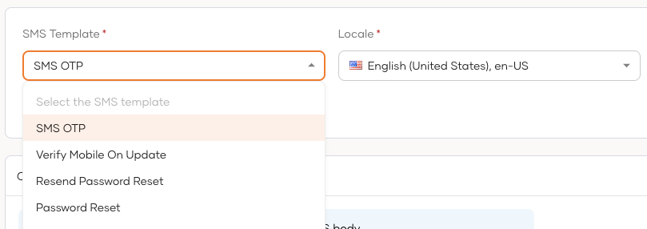

# Customize SMS templates

The following topics explain how you can customize SMS notifications that are sent to users of your WSO2 Identity Server organization.

:::note[SMS templates for B2B applications]

If you have set up [organizations](../organization-management/manage-organizations.mdx),
refer [SMS template inheritance](../organization-management/inheritance-in-organizations/email-sms-templates-inheritance.mdx) to see how SMS templates are inherited.

:::

You can tailor the **body** of SMS notifications to your preferences by following the steps below.

:::note

This feature is only available for the most frequently used SMS templates. You can customize [all available SMS templates](../../references/sms-templates.mdx) using the [Notification Templates API](../../apis/notification-templates.mdx).

:::

1. On the WSO2 Identity Server, go to **Branding** > **SMS Templates**.
2. Select the SMS template and the relevant locale that you wish to modify.

    

3. Make your modifications in the **SMS Template Body** input field and use the **Preview** for a real-time preview.

4. Click **Save** to publish your changes.

:::warning[Apply changes to user profiles]

To apply these changes to each user's profile in your organization:

1. Display the `local` attribute on the user's profile. Learn how to do so in [updating user attributes](/identity/7.1.0/guides/users/attributes/manage-attributes/#update-attributes).

2. Update the `local` attribute value with the [required locale code](localization.mdx#supported-languages). The value should be updated by,

    - the admin, if the admin onboards the user to the organization.

    - the user, if the user self-registers to the organization.

:::

Alternatively, you can customize the content of SMS templates using the [Notification Templates API](../../apis/notification-templates.mdx) provided by WSO2 Identity Server.
