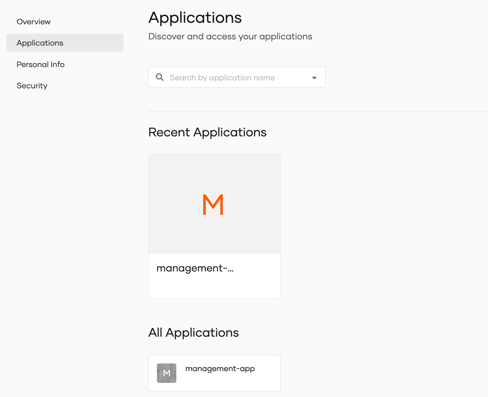

# Discover applications

Users can discover applications that they can access within the organization by following the steps below.

:::note

Administrators should go to the General tab of an application registered in WSO2 Identity Server and enable the <b>Discoverable application</b> option to [make an application discoverable](../applications/index.mdx#make-an-application-discoverable) in the My Account portal.

:::

1. In the user's MyAccount portal, navigate to **Applications**.

    

2. In the **All Applications** section, users can view all the applications discoverable to them.

3. Users can click on any application and get redirected to its landing page.
