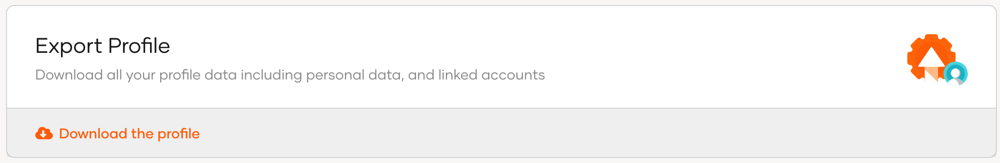

# Export profile information


Users can export profile information via the My Account portal as a `JSON` file by following the steps below.

1. Sign in to the My Account portal.

2. Click **Personal Info** and go to **Export Profile**.

3. Click **Download the profile** to export the user profile information.

    

    :::note[Sample JSON file]

    This is a sample `json` file of an exported user profile.
    ```json
    {
       "user_profile": {
          "accountState": "UNLOCKED",
          "emailVerified": "true",
          "country": "SriLanka",
          "givenname": "firstname",
          "created": "2021-04-07T15:07:58.001440Z",
          "modified": "2023-04-25T04:31:05.838894Z",
          "emailaddress": "tom@wso2.com",
          "userid": "36d2dd61-6e58-4b54-bfbe-f8621236c88b",
          "username": "tom@wso2.com",
          "lastname": "Jerry"
       }
    }
    ```

    :::
