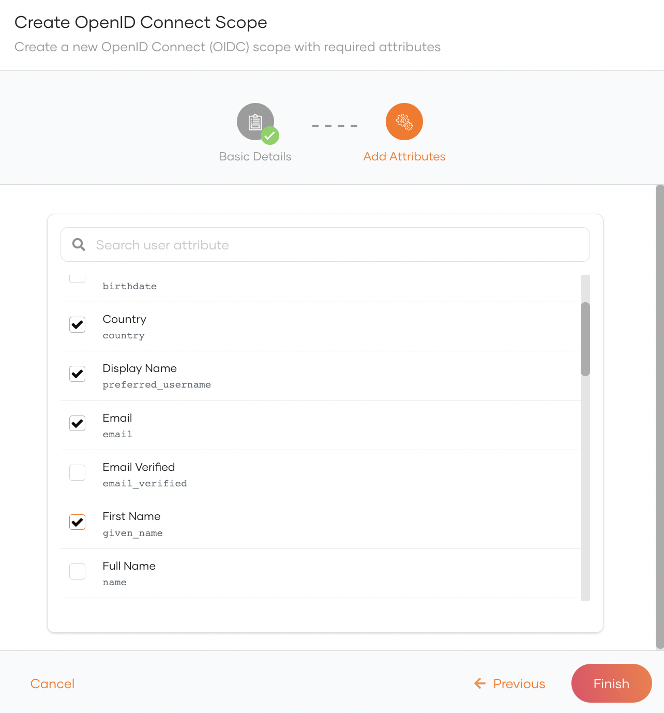
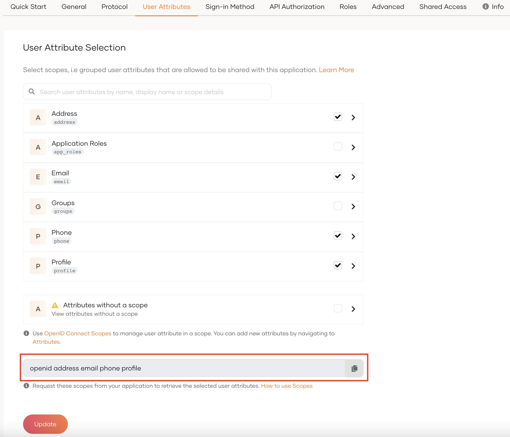

# Manage OIDC Scopes

In WSO2 Identity Server, each piece of user information is mapped to a [user attribute](/identity/7.1.0/guides/users/attributes/manage-attributes/).

[OpenID Connect (OIDC) Scopes](https://openid.net/specs/) are a convenient way of grouping such user attributes. Applications can use scopes to request access to the user attributes corresponding to them. Access to other attributes that do not belong to the requested scopes is restricted.

## Default OIDC scopes
WSO2 Identity Server uses `openid` as a marker scope during authentication and it will not return any user attributes for the `openid` scope.

Listed below are the default OpenID Connect scopes that applications can request and the corresponding user attributes:

<table>
  <tr>
    <th>Scope</th>
    <th>Description</th>
    <th>Attributes</th>
  </tr>
   <tr>
      <td><code>profile</code></td>
      <td>This requests to retrieve profile information of the user.</td>
      <td>
        <ul>
          <li>name</li>
          <li>family_name</li>
          <li>given_name</li>
          <li>middle_name</li>
          <li>nickname</li>
          <li>preferred_username</li>
          <li>profile</li>
          <li>picture</li>
          <li>website</li>
          <li>gender</li>
          <li>birthdate</li>
          <li>zoneinfo</li>
          <li>locale</li>
          <li>updated_at</li>
        </ul>
      </td>
    </tr>
  <tr>
    <td><code>email</code></td>
    <td>This requests access to the end-user's email related claims.</td>
    <td>
      <ul>
        <li>email</li>
        <li>email_verified</li>
      </ul>
    </td>
  </tr>
  <tr>
    <td><code>address</code></td>
    <td>This scope value requests access to the address view of the user. This will return sub fields of the address claim.</td>
    <td>
      <ul>
        <li>address</li>
        <li>street_address</li>
      </ul>
    </td>
  </tr>
  <tr>
      <td><code>phone</code></td>
      <td>This scope value requests access to the information related to the phone number of the user.</td>
      <td>
        <ul>
          <li>phone_number</li>
          <li>phone_number_verified</li>
        </ul>
      </td>
  </tr>
  <tr>
      <td><code>groups</code></td>
      <td>This scope value requests access to the groups to which the user belongs.</td>
      <td>
        <ul>
          <li>groups</li>
        </ul>
      </td>
  </tr>
</table>

## Create custom scopes

To add new scopes to your organization:

1. In the WSO2 Identity Server Console, go to **User Attributes & Stores** > **Attributes** > **Manage Attribute Mappings** > **OpenID Connect**.
2. Under **Manage Attribute Mappings**, click **OpenID Connect**.
3. Click **Scopes**
4. Click **New OIDC Scope** to open the **Create OpenID Connect Scope** dialog box.
5. Enter values for the required properties and click **Next**:
    <table>
            <tbody>
                <tr>
                    <td>**Scope**</td>
                    <td>The scope name that will be shared with applications.</td>
                </tr>
                <tr>
                    <td>**Display name**</td>
                    <td>The scope name that will be displayed in the Scopes section. Applications should use this scope name to request the corresponding attributes.</td>
                </tr>
                <tr>
                    <td>**Description**</td>
                    <td>The description of the scope.</td>
                </tr>
            </tbody>
        </table>
6. Select the attributes that should correspond to the scope and click **Finish**.

    

## Edit Scopes

You can add attributes to scopes or delete them by following the steps below.

1. On the WSO2 Identity Server Console, go to **User Attributes & Stores** > **Attributes** > **Manage Attribute Mappings** > **OpenID Connect**.

2. Click **Scopes**.
3. Click on a scope to edit.
4. To add a new attribute to the scope:

    1. Click **New Attribute**.
    2. Select the attribute you wish to add and click **Save**.

5. To delete an attributes from a scope, click the trash icon next to it.

6. Click **Save Changes** to save the updates.

## Use scopes to request attributes

As an application developer, you can follow the steps given below to configure your applications to request user attributes using scopes.

1. First, go to the WSO2 Identity Server Console and [select user attributes for your application](../../authentication/user-attributes/enable-attributes-for-oidc-app.mdx#select-user-attributes).

2. Copy the scopes listed at the end of the **User Attributes** section.

    

3. When configuring the authentication request in your client app, append the **scope** parameter with the scopes that you need:

    - For client apps using the SDK:

        ```json {6}
        {
          "clientID": "<client ID>",
          "baseUrl": "https://localhost:9443",
          "signInRedirectURL": "https://localhost:3000",
          "signOutRedirectURL": "https://localhost:3000",
          "scope": [ "openid", "address", "phone", "profile" ]
        }
        ```

        :::note

        Find out more about [configuring applications](../../../get-started/start-integrating-apps/index.mdx).

        :::

    - For client apps using direct API calls to authenticate:

        ```js {6}
        curl -X GET \
        https://localhost:9443/oauth2/authorize \
          -d 'client_id={client_id}'
          -d 'response_type=code'
          -d 'redirect_uri={redirect_uri}'
          -d 'scope=openid%address%phone%profile'
        ```

When the user logs in, WSO2 Identity Server will prompt the user with a consent screen to authorize access to the user attributes. Once the user consents, your application will have access to the requested user attributes.
