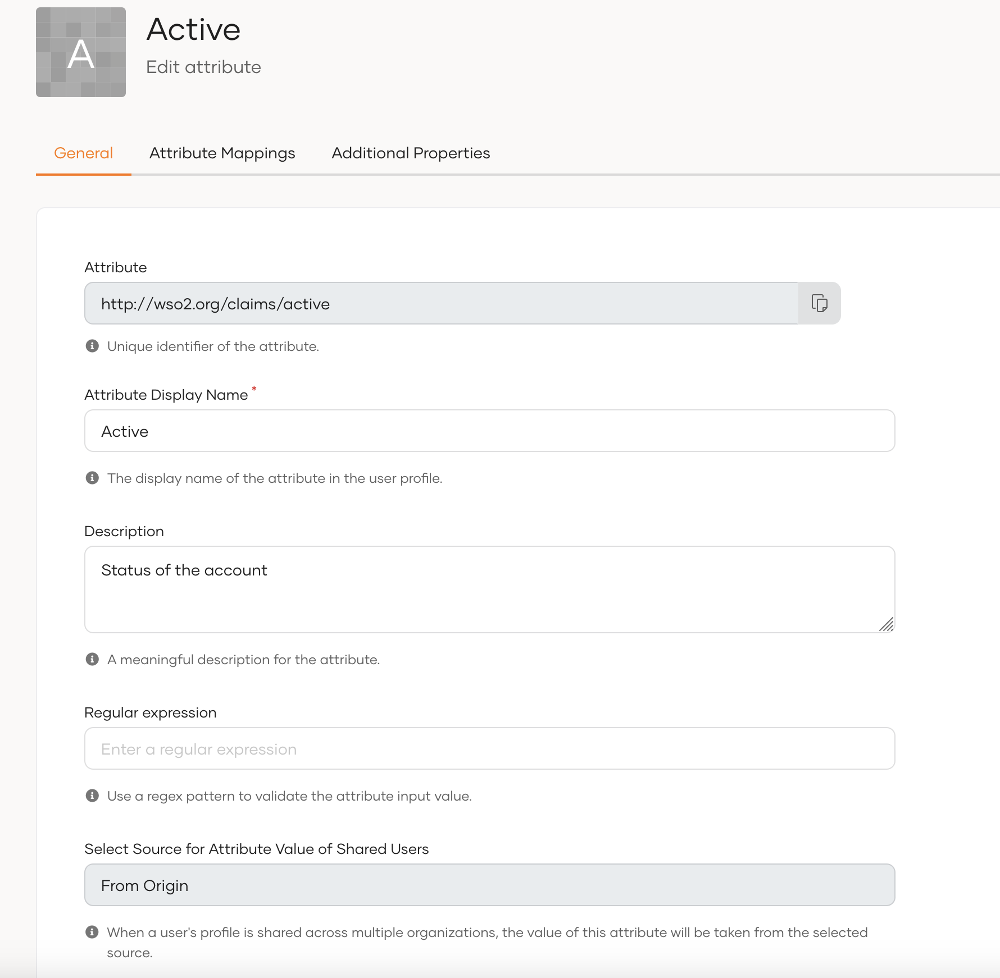
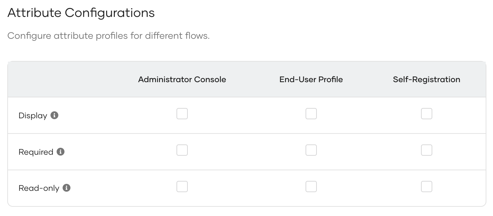
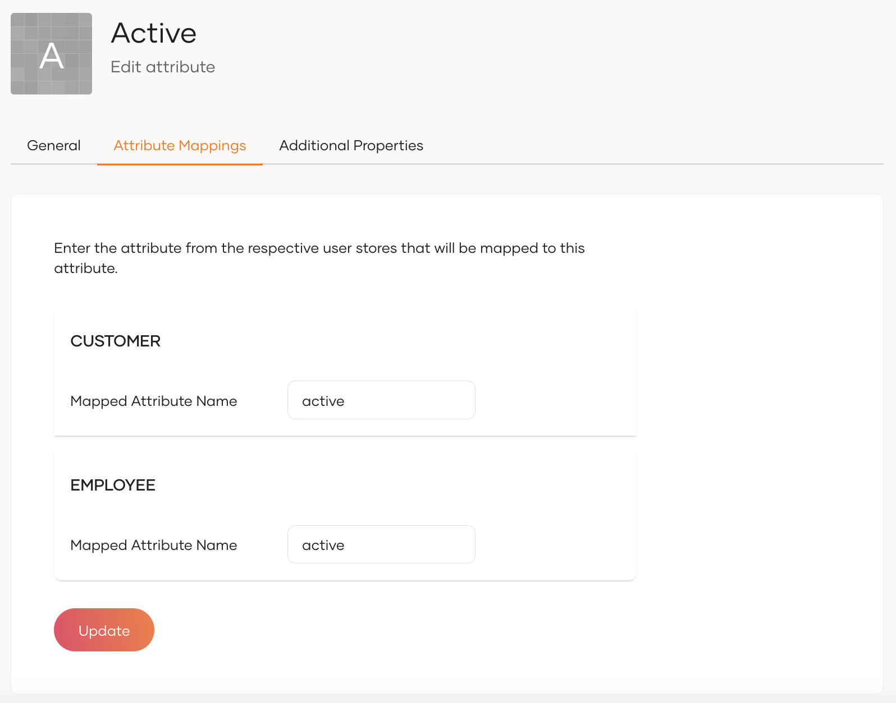
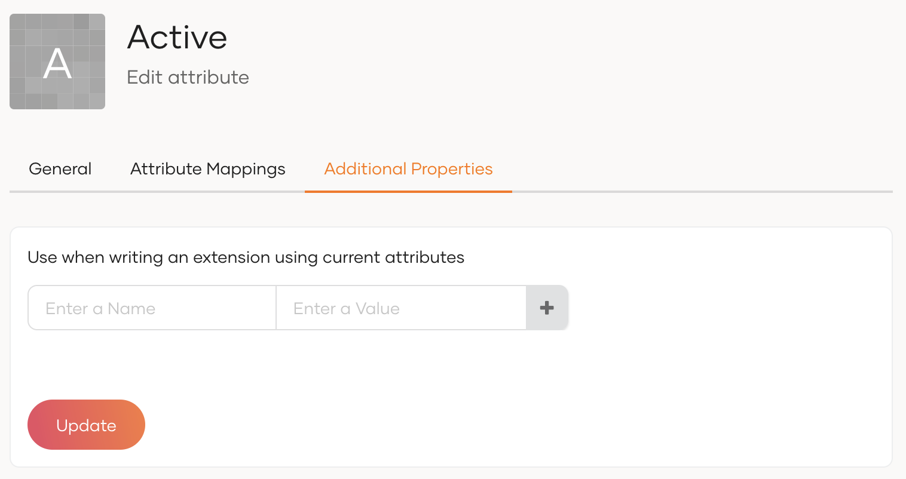
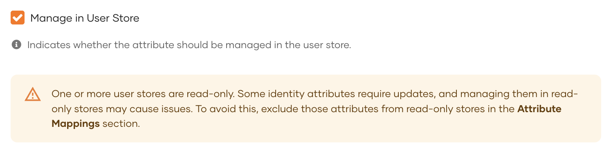
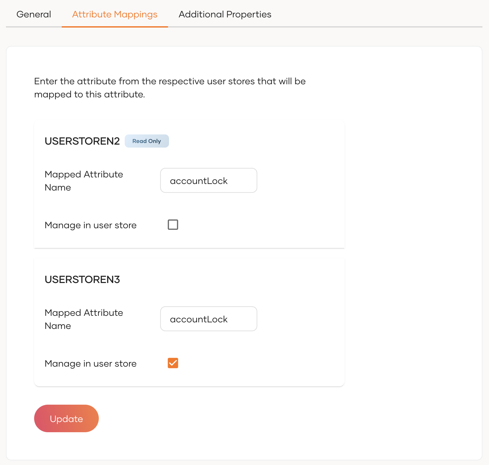

# Configure attributes

This guide walks you through the available configuration options for default and custom attributes.

To configure attributes,


1. On the WSO2 Identity Server Console, go to **User Attributes & Stores** > **Attributes**.
2. Under **Manage Attributes**, click **Attributes** to view the list of all attributes.
3. Click **Edit** for the attribute you want to update.

    

    :::note

    The **Attribute** field specifies the unique identifier of the attribute. It always starts with `http://wso2.org/claims`. This can't be edited.

    :::

4. In the **General** tab, update the following values.

    <table><tbody><tr><td><b>{"Attribute Display Name"}</b></td><td>{"Update the display name of the attribute that will show in user profiles."}</td></tr><tr><td><b>{"Description"}</b></td><td>{"Update the description for the attribute."}</td></tr><tr><td><b>{"Regular expression"}</b></td><td>{"The attribute value will be validated against the regex pattern specified here."}</td></tr><tr><td><b>{"Select Source for Attribute Value of Shared Users"}</b></td><td>{"When a user's profile is shared across multiple organizations, the value of this attribute will be taken from the selected source."}<br /><ul><li><b>{"From Origin:"}</b>{" The attribute value is inherited from the original organization which manages the user's profile."}</li><li><b>{"From Shared Profile:"}</b>{" The attribute value is taken from the shared user profile in the respective organization."}</li><li><b>{"From First Found in Hierarchy:"}</b>{" The attribute value is retrieved from the first organization in the hierarchy that has assigned a non-null value to the attribute."}</li></ul>{" At the moment, you can only configure this option for custom attributes."}</td></tr><tr><td><b>{"Uniqueness Validation"}</b></td><td>{"Select one of the following scopes to validate attribute uniqueness: "}<ul><li><b>{"None:"}</b>{" No validation is applied. Users can have duplicate values for the selected attribute."}</li><li><b>{"Within User Store:"}</b>{" Users within the same user store can't have duplicate values for the selected attribute. However, users in other user stores may have duplicates."}</li><li><b>{"Across User Stores:"}</b>{" Attribute values are unique across all user stores preventing duplicates throughout the organization."}</li></ul></td></tr></tbody></table>

5. Under **Attribute Configurations**, use the table to configure how attributes are handled for each entity.

    

    The table contains the following entities:

    - Administrator Console: User profiles as seen from the administrator's Console.
    - End-User Profile: User profiles as seen from the users' My Account portal.
    - Self-Registration: The form presented to users during self-registration.

    For each of these entities, you can configure the following properties:

    <table><tbody><tr><td><b>{"Display"}</b></td><td>{"If selected, the entity displays the attribute."}</td></tr><tr><td><b>{"Required"}</b></td><td>{"If selected, the entity must contain a value for this attribute."}</td></tr><tr><td><b>{"Read-only"}</b></td><td>{"If selected, the value will be read-only for the entity and can't be modified."}</td></tr></tbody></table>

    :::danger[Warning]

    These settings only control how the attributes behave in WSO2-managed UIs (Administrator Console, End-User Profile (i.e. My Account), Self-Registration). They **do not** affect backend or API validation.

    :::

    If you create a custom end-user profile UI, you can reference these configurations to apply the same rules (Display, Required, Read-only) in your own forms.

    :::note

    Using the attribute configurations, you can also configure which attributes are displayed in the user creation form when
    [onboarding users](../../manage-users.mdx#onboard-a-single-user) in the console.

    :::

    To display an attribute in the user creation form, select the **both** **Display** and **Required** checkboxes for the **Administrator Console** entity.

6. Go to the **Attribute Mappings** tab and enter the attribute from each user store that you need to map.

    

7. Optionally, you may use the **Additional Properties** tab to add additional properties that can be used when writing an extension.

    


## Configure the storage location of attributes

WSO2 Identity Server gives you freedom to choose in what databases each attribute gets stored. You can divide attributes into two broad categories and WSO2 Identity Server manages each of them differently as explained in the following sections.

- **User attributes** - Personal information that identifies a user, such as their name, email, or phone number.

- **Identity attributes** - Information that describes the state or status of a user account rather than personal details. Unlike user store attributes, identity attributes focus on account-related properties, such as whether the account is verified, locked, active, or disabled.

### Change the default identity attribute store

By default, WSO2 Identity Server stores identity attributes internally in the user store configured in the `<IS_HOME>/repository/conf/deployment.toml` file. To change this,

1. Add the following configuration to the `deployment.toml` file. The `IdentityDataStoreService` OSGi service uses this value to determine which data store implementation to access.

    ```toml
    [identity_datastore]
    datastore_type = "<Name of the identityDataStore class>"
    ```

    :::note


    The class name configuration for the identity data store is now separate from the listener configurations. If you're using a custom data store class, it's crucial to update your `deployment.toml` file to reflect this choice. This update ensures that your custom class will override the default configuration.

    To either maintain the previous behavior or use your custom data store, simply follow these steps and update your deployment.toml:

    By making this configuration adjustment, you can ensure that your system aligns with your preferred data store class, whether it's the previous default or a custom class you've implemented. This helps you tailor the system to your specific needs.

    :::

2. For each attribute below, open its **Attribute Mappings** tab and map it to the corresponding attribute in the connected store.

    - `http://wso2.org/claims/identity/accountLocked`: Stores the locked status of the user's account.

    - `http://wso2.org/claims/identity/unlockTime`: Time at which the user’s account gets unlocked.

    - `http://wso2.org/claims/identity/failedLoginAttempts`: Tracks the number of consecutive failed login attempts. Account locking happens based on this value.


### Select storage location for selected attributes


:::note


The selective configuration of storage location for attributes is available in WSO2 IS 7.1.0 from update level 42 onwards.
 See how to [Upgrade the WSO2 Identity Server](../../../../deploy/upgrade/upgrade-wso2-is.mdx).

:::


WSO2 Identity Server, by default, stores identity attributes internally and user attributes in the connected user stores. If you want to store and manage an identity attribute in your user stores or a user attribute in the identity store, you can do so by following the steps below.

1. On the WSO2 Identity Server Console, go to **User Attributes & Stores** > **Attributes**.

2. Under **Manage Attributes**, click **Attributes** to view the list of all attributes.

3. Click **Edit** for the attribute you want to update.

4. In the **General** tab, check/uncheck the **Manage in User store** checkbox. If,

    - **checked**: The attribute values for all user stores will be managed in the user store.

    - **unchecked**: The attribute values for all user stores will be managed internally by the system.

    :::note


    This checkbox is, by default,

    - checked for user attributes.
    - unchecked for identity attributes.

    :::

    

5. Go to the **Attribute Mappings** tab and further customize the storage behavior. To do so,

    1. Against each connected user store, check/uncheck the **Manage in user store** checkbox. If,

        - **checked**: The attribute values for this user store will be managed in the user store.

        - **unchecked**: The attribute values for this user store will be managed internally by the system.

    2. Map the attribute from each user store that corresponds to the specific attribute.

    

    :::danger[Warning]


    Changing the attribute storage location may cause any existing attribute values stored in the user store or 
    managed internally to become inaccessible. Ensure that you understand the impact before making this change.

    If you have configured a **Read-Only User Store** and enable **Manage in User Store** for an identity attribute, 
    the attribute will not be editable in the user profile. Consequently, certain internal functions that rely on 
    updating these attributes may not work as expected.

    :::

6. Click **Update** to save the changes.
