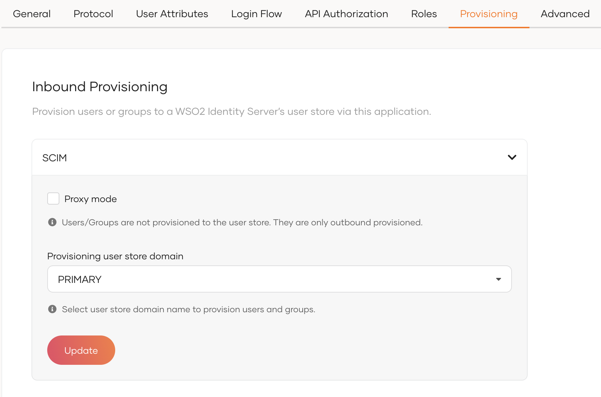

# Enable inbound provisioning

Inbound provisioning is the process of automatically provisioning user accounts from external systems to WSO2 Identity Server. This guide explains how you can configure inbound provisioning for an application so that users logging in to the application can be provisioned in WSO2 Identity Server.

<Prerequisites title="Before you begin">

Prepare user stores for SCIM2 inbound provisioning. Learn how to do so in the following guides.
- [Configure user stores](../user-stores/configure-user-stores-for-scim2.mdx)
- [Configure active directory user stores](../user-stores/configure-active-directory-user-stores-for-scim2.mdx)

</Prerequisites>

WSO2 Identity Server supports inbound provisioning using the SCIM2 protocol. To configure inbound provisioning,

1. On the WSO2 Identity Server Console, [create an application](../../applications/index.mdx).

2. Select the created application and go to its **Provisioning** tab.

    


3. Under **Provisioning user store domain**, select the user store to which you wish to provision the user.

    :::note

    Selecting **Proxy mode** allows WSO2 Identity Server to act as a mediator. In this case, the user will not be provisioned to a user store but will be provisioned to the external system through the configured outbound connectors.

    :::

4. Click **Update** to save the changes.

## Try it out

For inbound provisioning to occur using a SCIM request, the application should invoke the API with an access token with the correct permissions. Let's use an OAuth application for this example and try out inbound provisioning.

1. Obtain an OAuth access token.

    1. Go to the **Protocol** tab of the application and take note of the **Client ID** and the **Client secret**.

    2. Select the **Password** grant type under **Allowed grant types** and click **Update**.

    3. On the **API Authorization** tab of the application, provide authorization to the **SCIM2 Users API** API resource.

        :::note

        Learn how to [authorize API resources for an app](../../authorization/api-authorization/api-authorization.mdx#authorize-the-api-resources-for-an-app).

        :::

    3. Make the following token request.

        ```curl
        curl -v -X POST 
        -H "Authorization: Basic Base64(<clientid>:<client-secret>)" 
        -H "Content-Type: application/x-www-form-urlencoded;charset=UTF-8" 
        -k -d "grant_type=password&username=admin&password=admin&scope=internal_user_mgt_create" 
        https://localhost:9443/oauth2/token
        ```

    4. Obtain the access token from the response.

2. Use the access token to provision the user.

    1. Make the following SCIM request to provision the user.

        ```curl
        curl -v -k 
        --header "Authorization: Bearer <access_token>"  
        --data '{"schemas":[],"name":{"familyName":"Doe","givenName":"John"},"userName":"johndoe","password":"mypassword","emails":[{"primary":true,"value":"johndoe@wso2.com"}]}' 
        --header "Content-Type:application/json" 
        https://localhost:9443/scim2/Users
        ```

    2. On the WSO2 Identity Server Console, go to **User Management** > **Users** and verify that the user is created.
