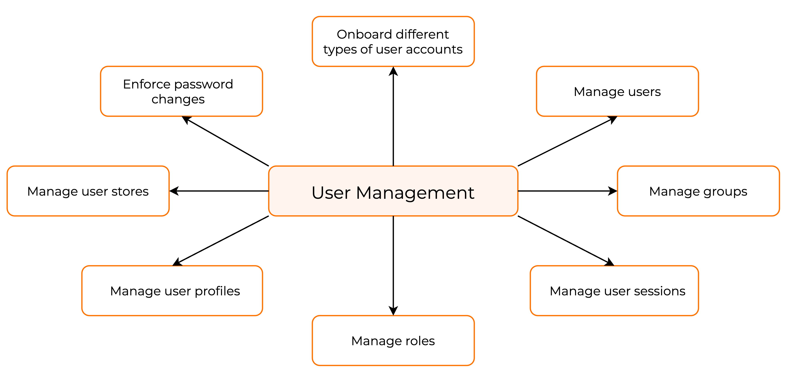

# User management

The users in WSO2 Identity Server are the digital representations of the identities of physical users who interact with your
organization. With WSO2 Identity Server, the identity lifecycle of each of these users can be easily managed by the admins of the
organization.

The admins can grant users access to resources in your organization and control user access. Admins can also manage various user operations via the WSO2 Identity Server Console and SCIM APIs.

Shown below are some main user management capabilities available in WSO2 Identity Server.

## User accounts

WSO2 Identity Server supports the following types of user accounts based on their relationship to the organization.

### Administrator

An administrator can manage the organization and has access to the organization's administrative operations. Administrators can,

* onboard users
* manage users, roles and groups
* manage applications

Refer [Manage administrators](manage-administrators.md) for more information.

### User

A user registered in an organization can login and use applications in that organization.

Refer [Manage users](manage-users.md) for more information.

## What's next?

Following are the main components that are required for user management.

- [Groups](manage-groups.md)
- [Roles](../../references/user-management/user-roles.md)
