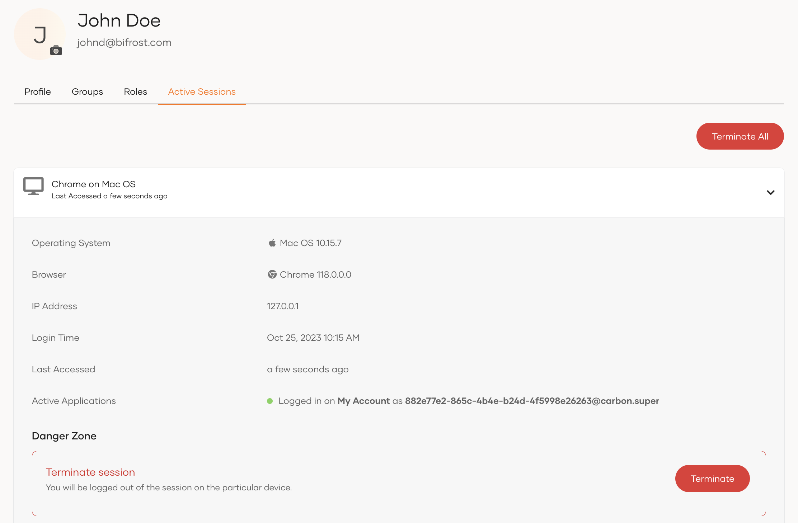

# Manage active sessions

A session corresponds to the time a user spends on an application from a single user agent (e.g., browser) instance. Generally, session duration is the time between when a user logs in and ends when the user logs out.

WSO2 Identity Server maintains user sessions based on session cookies. Active sessions in WSO2 Identity Server are terminated in the following instances:

- User closes the browser
- User tries to terminate the sessions via the WSO2 Identity Server Console and My Account
- User logs out of an application
- User resets the password

Active sessions can be terminated explicitly by using the session management APIs as well.

An administrator or an owner can view and terminate the active session(s) of users via the WSO2 Identity Server Console.

## View active sessions of users

To view all active sessions of a user:

1. On the WSO2 Identity Server Console, go to **User Management** > **Users**.
2. Select a user and click **Edit**.
3. Go to **Active Sessions** to view details.

    

## Terminate active sessions

You can terminate a specific user session or terminate all active sessions of the user by following the steps below.

1. On the WSO2 Identity Server Console, go to **User Management** > **Users**.

2. Select a user, click **Edit** and navigate to the **Active Sessions** tab.

3. Do one of the following.
    - Click **Terminate All** to terminate all sessions of the user.
    - Expand a session and click **Terminate** to terminate the specific session.

4. Select the checkbox to confirm your action and click **Confirm**.
