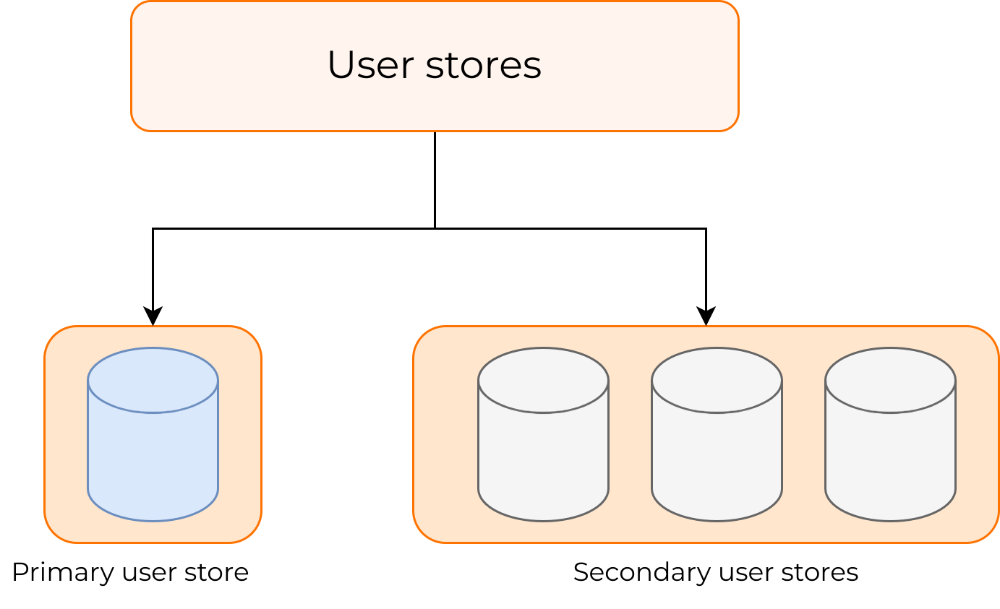

# Manage User stores

WSO2 Identity Server allows configuring multiple user stores to your system that
are used to store users and their groups. Out of the box, WSO2
Identity Server supports JDBC, LDAP, and Active Directory user stores with the
capability of configuring custom user stores. There are different user store adapters called *User store managers*, which are used to connect
with these user store types.

There are two types of user stores:

- Primary User store (Mandatory)
- Secondary user stores (Optional).

All the supported user stores can be configured under these two types.



:::info[Configure how WSO2 Identity Server handles unreachable user stores]


By default, WSO2 Identity Server ignores inaccessible user stores during authentication. This ensures that authentication for users in reachable user stores continues without failure, even if another user store is unreachable. To control this behavior, you can configure the following properties in the `<IS_HOME>/repository/conf/deployment.toml` file:

```toml
[user_store_commons]
maxConnectionRetryCount=2
minConnectionRetryDelayInMilliSeconds=60000
```

During authentication, WSO2 Identity Server will attempt to connect to the user store up to `maxConnectionRetryCount` times, with a delay of `minConnectionRetryDelayInMilliSeconds` between each attempt. If the connection is still unavailable, the user store will be skipped.

If required, you can disable this behavior. However, note that disabling it may disrupt the authentication flow when a user store is unreachable, leading to a degraded user experience. To disable this behavior, add the following configuration to the `<IS_HOME>/repository/conf/deployment.toml` file:

```toml
[user_store_commons]
enable_circuit_breaker_for_user_stores=false
```

:::

## Primary user store (Mandatory)

This is the main user store that is shared 
in the system. Only one user store should be configured as the primary
user store and it is configured in the
`<IS_HOME>/repository/conf/deployment.toml` file. By default,
WSO2 Identity Server uses the embedded H2 database as the primary user store.
It is recommended to change this default configuration in the production
system.

See, [Configure the Primary User Store](primary-user-store/index.md)

---

## Secondary user store(s) (Optional)

Any number of secondary user stores can be easily set up for your system.
You can use the management console to create secondary user stores or
you can create them manually. These will be stored in an xml file with the
configurations corresponding to the secondary user store.

See, [Configure a Secondary User Store](configure-secondary-user-stores.md)

---

## User store manager

Adapters used to connect with different user stores are called *User store Managers*. By default, there are user store managers for JDBC,
LDAP and Active Directory user stores. If you need to add a new user store implementation, see [Write a Custom User store
Manager](../../../references/extend/user-stores/write-a-custom-user-store-manager.md). When you configure the
user store, you have to set the user store manager class name.

:::note

The permissions attached to roles are always stored in an RDBMS. With
the default configurations, permissions are stored in the embedded H2
database. For information on how to set up a RDBMS repository for
storing permission, see [Configure the Authorization
Manager](../../../deploy/configure/user-stores/configure-authorization-manager.md).

:::
