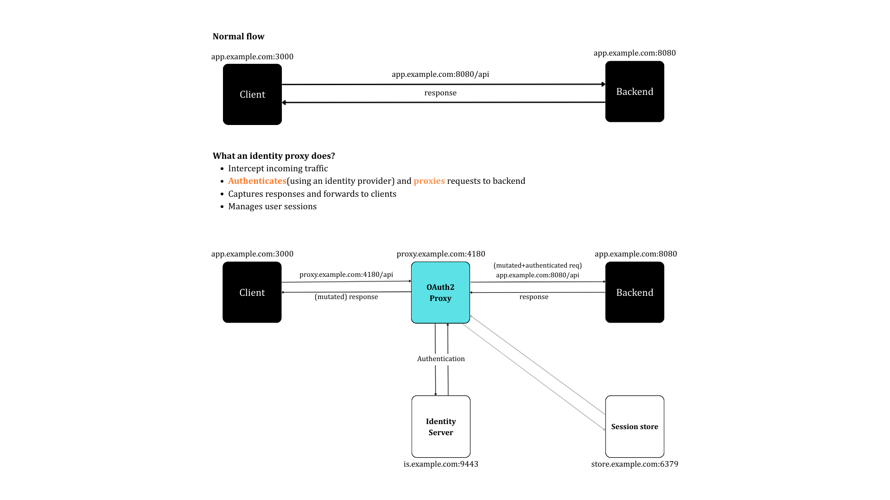
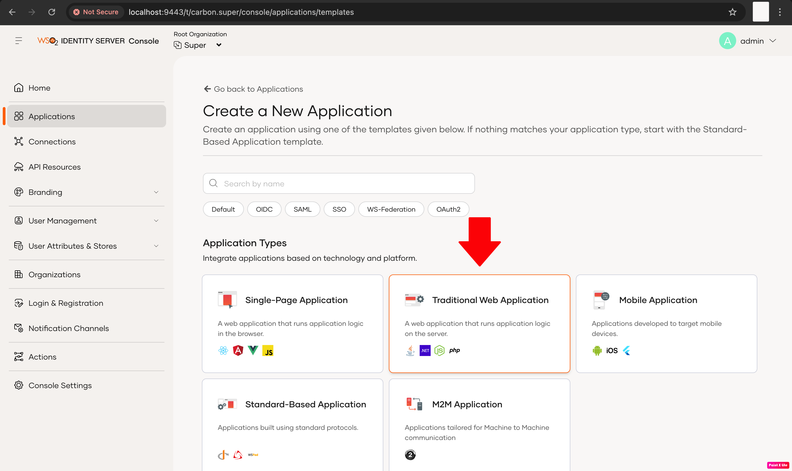
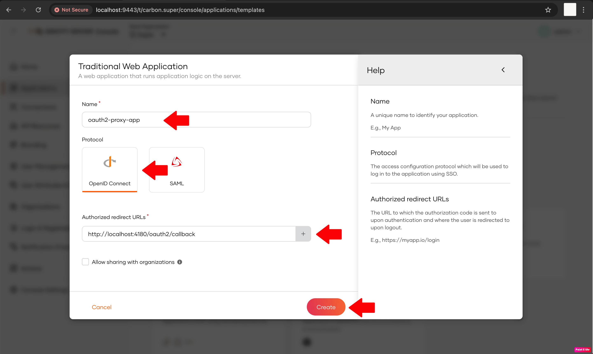
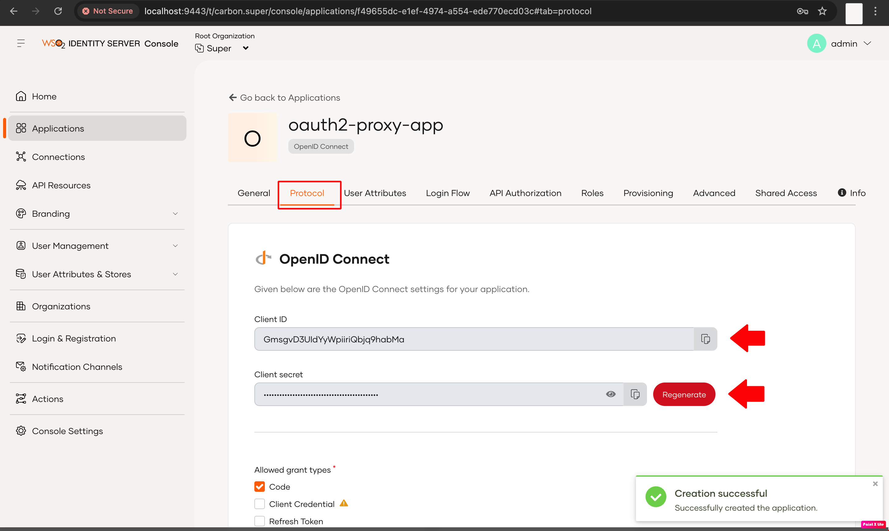
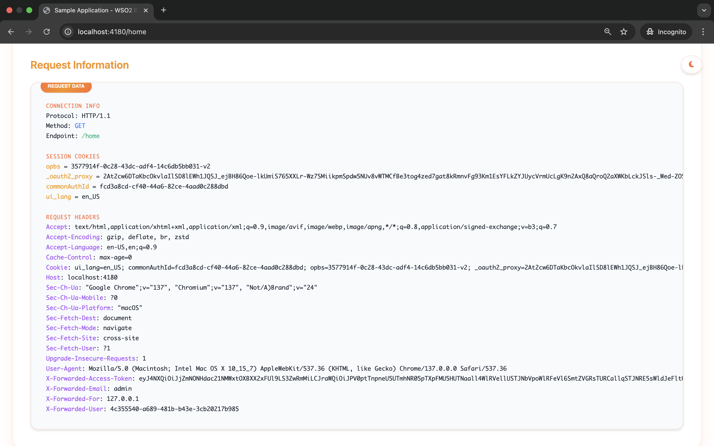

# Integrate OAuth2 Proxy with WSO2 Identity Server

[OAuth2 Proxy](https://github.com/oauth2-proxy/oauth2-proxy) is an open-source reverse proxy that authenticates users through an external OAuth2 provider (such as WSO2 Identity Server) and forwards user identity information to your application via HTTP headers. This tutorial explains how you can connect WSO2 Identity Server with OAuth2 Proxy.

You can use OAuth2 Proxy if you want to,

- add OAuth2/OIDC authentication to legacy apps without code changes.
- centralize authentication logic.
- forward user identity details (for example, username or email) as HTTP headers.

\{: width: 500px;\}

Follow the steps below to connect WSO2 Identity Server with OAuth2 Proxy.

<Prerequisites>

## Prerequisites

- **Go 1.16 or later**. To install Go, follow the steps in the [Go documentation](https://go.dev/doc/install).

- An application with a back-end. If you don't have one, you can use this [sample application](https://github.com/wso2/samples-is/raw/refs/heads/master/identity-gateway/sample-request-logger-app/request-logger.jar).

- (Optional) Redis for advanced session storage.

</Prerequisites>

<Steps>

## Install and run WSO2 Identity Server {/* #step-1-install-and-run-wso2-identity-server */}

Follow the following steps below to download and install WSO2 Identity Server. Refer to the [quick setup](../../../get-started/quick-set-up.mdx) to learn more.

1. Download the latest WSO2 Identity Server version from the [website](https://wso2.com/identity-server/).

2. Unzip the archive using the following command:

      ```sh
      unzip wso2is-<version>.zip
      # Replace <version> with your downloaded version, e.g., wso2is-7.1.0
      ```

3. Start the server:

    <Tabs>
    <TabItem value="tab-0" label="Linux/macOS">


    ```sh
    cd path/to/wso2is-<version>/bin
    ./wso2server.sh
    ```

    </TabItem>
    <TabItem value="tab-1" label="Windows">


    ```sh
    cd path/to/wso2is-<version>/bin
    wso2server.bat
    ```

    </TabItem>
    </Tabs>

4. You can access the WSO2 Identity Server Console by visiting the following URL and providing the default credentials of `admin`, `admin`.

      ```url
      https://localhost:9443
      ```

## Create an OIDC application {/* #step-2-create-an-oidc-application */}

To connect your OAuth2 Proxy reverse proxy to WSO2 Identity Server, you need to register it as an application. To do so,

1. On the WSO2 Identity Server Console, go to **Applications** > **New Application**.

      

2. Select **Traditional Web Application**.

      

3. Enter the following details and click **Create**.

      - **Name** - oauth2-proxy-app
      - **Protocol** - Select OpenID Connect
      - **Callback URL** -The URL where WSO2 Identity Server sends the authentication response after login. For example: `http://localhost:4180/oauth2/callback` (or your proxy callback URL)

      

4. Take note of the **Client ID** and **Client Secret** generated for your application.

     

## (Optional) Set up sample application {/* #step-3-optional-set-up-sample-application */}

If you have your own application, you can skip this step. If you want to use the sample Java application, follow the steps below to set it up.

1. Download the [sample application](https://github.com/wso2/samples-is/raw/refs/heads/master/identity-gateway/sample-request-logger-app/request-logger.jar).

2. Use the following command to run the application.

      ```java
      cd path/to/app/folder
      java -jar request-logger.jar
      ```

3. Go to `http://localhost:8080` and verify that the application works.

      

## Install and configure OAuth2 Proxy {/* #step-4-install-and-configure-oauth2-proxy */}

Follow the steps below to set up OAuth2 Proxy with WSO2 Identity Server.

1. Install OAuth2 Proxy with Go by using the following command.

      ```go
      go install github.com/oauth2-proxy/oauth2-proxy/v7@latest
      ```

    :::tip


    Refer to the [OAuth2 Proxy installation guide](https://oauth2-proxy.github.io/oauth2-proxy/installation/) for more information.

    :::

2. Create a configuration file named `oauth2-proxy.cfg` and include the following properties.

      ```ini
      provider = "oidc"
      oidc_issuer_url = "https://localhost:9443/oauth2/token"
      oidc_jwks_url = "https://localhost:9443/oauth2/jwks"
      redirect_url = "http://localhost:4180/oauth2/callback"
      
      client_id = "<your_client_id>"
      client_secret = "<your_client_secret>"
      
      email_domains = ["*"]
      scope = "openid email profile"
      
      set_xauthrequest = true
      skip_auth_preflight = false
      http_address = "127.0.0.1:4180"
      upstreams = ["http://localhost:8080"]
      
      pass_access_token = true
      pass_user_headers = true
      set_authorization_header = true
      code_challenge_method = "S256"
      user_id_claim = "username"
      
      cookie_secure = false
      cookie_samesite = "lax"
      cookie_csrf_per_request = false
      cookie_secret = "<your_32_byte_base64_secret>"
      ```

      - This sample configuration file assumes that the following services run on the specified ports. If your setup differs, adjust the configuration accordingly.

         - WSO2 Identity Server: `https://localhost:9443`
         - OAuth2 Proxy: `http://localhost:4180`
         - Back-end Service (API or Web Application): `http://localhost:8080`

      - Replace `<your_client_id>`, `<your_client_secret>` with the client ID and the client secret you received earlier when registering the application in WSO2 Identity Server.

      - Generate a cookie secret and add it as `<your_32_byte_base64_secret>`.

    :::tip


    Learn more about generating cookie secrets and other configurations from the [OAuth2 Proxy documentation](https://oauth2-proxy.github.io/oauth2-proxy/configuration/overview).

    :::

3. Use one of the following methods to run OAuth2 Proxy.

    <Tabs>
    <TabItem value="tab-0" label="Run from binary">


    ```sh
    oauth2-proxy --config=/path/to/oauth2-proxy.cfg
    ```

    </TabItem>
    <TabItem value="tab-1" label="Run with Docker">


    ```sh
    docker run -p 4180:4180 \
    -v $(pwd)/oauth2-proxy.cfg:/etc/oauth2-proxy.cfg \
    quay.io/oauth2-proxy/oauth2-proxy:latest \
    --config /etc/oauth2-proxy.cfg
    ```

    </TabItem>
    </Tabs>

</Steps>

## Try it out

Now that you’ve set up WSO2 Identity Server, the sample application (or your own), and OAuth2 Proxy, follow the steps below to test them in action.

1. Log in to your app through OAuth2 Proxy by visiting `http://localhost:4180/home`. You will be redirected to the login page of WSO2 Identity Server.

2. Log in with an existing user.

3. After successfully logging in, OAuth2 Proxy forwards identity headers (for example X-Forwarded-User, X-Forwarded-Email) to your application.

      

## Advanced configurations

You can enhance the integration between WSO2 Identity Server and OAuth2 Proxy with the following advanced options.

### Integrate a Redis server for storing sessions

By default, OAuth2 Proxy keeps sessions in encrypted cookies. While this works for single-instance deployments, using Redis as a central session store offers better performance and consistency across multiple instances.

If you have a Redis server, add the following to your `oauth2-proxy.cfg` configuration file to connect it.

```ini
session_store_type = "redis"
redis_connection_url = "redis://127.0.0.1:6379/1"
```

:::note


Redis connection URL takes the following format:

```bash
redis://[:password@]host[:port][/db-number]
```

:::

### Encrypt connections with TLS

To encrypt communication between clients and OAuth2 Proxy, you can enable TLS. To do so, add the following to your `oauth2-proxy.cfg` configuration file:

```ini
http_address = "0.0.0.0:443"
cookie_secure = true
tls_cert_file = "/path/to/cert.pem"
tls_key_file = "/path/to/cert.key"
tls_min_version = "TLS1.3"  # Optional, for stronger security
```

:::note[Generate a self-signed TLS certificate]


To create a self-signed TLS certificate for development purposes, run the following command. For production environments, always use a certificate issued by a trusted Certificate Authority (CA), such as [Let’s Encrypt](https://letsencrypt.org/).

```sh
openssl req -x509 -newkey rsa:2048 -nodes \
-keyout /path/to/cert.key \
-out /path/to/cert.pem \
-days 365 \
-subj "/CN=localhost"
```

:::

:::tip[Learn more]


Refer to the following documentation to learn more about these options.

- [session storage](https://oauth2-proxy.github.io/oauth2-proxy/configuration/session_storage).

- [TLS encryption](https://oauth2-proxy.github.io/oauth2-proxy/configuration/tls).

:::

---

Now that you’ve successfully connected WSO2 Identity Server with OAuth2 Proxy, you can leverage this integration to:

- Add authentication to applications that lack native OIDC support.

- Replace custom or insecure authentication methods.

- Centralize and simplify authentication logic.

This setup secures dashboards, microservices, and legacy apps, improving stack security, scalability, and maintainability.
