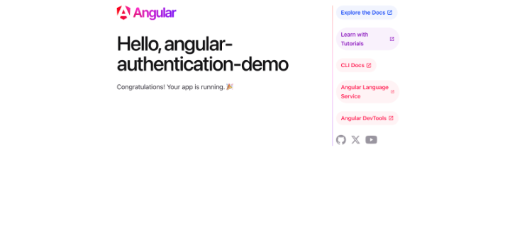

For this guide, you will be creating a simple Angular app using Angular CLI, the official tool provided by Angular to simplify project scaffolding and development.

:::note


The Angular OAuth2 OIDC SDK supports only up to Angular CLI version 17. Therefore, we are creating this application using Angular CLI version 17. 

:::

Open a terminal, change the directory to where you want to initialize the project, and run the following command to create your first Angular sample application

```bash
npm install -g @angular/cli@17

ng new is-angular
```

Running this command will create a folder with a ready-made Angular application.

Once the application is created, install the necessary dependencies using the following command:

```bash

cd is-angular

npm install
```

Then run the sample in the development mode. This allows you to see real-time updates and debug the app as you make changes.

```bash
ng serve
```

By default, the development server will run on the port 4200. You can navigate to [http://localhost:4200](http://localhost:4200)  in your browser, and you should see the sample application working as expected.



At this point, you have a simple yet fully functional Angular app. In the next step, let’s try to integrate an authentication SDK with the app.
