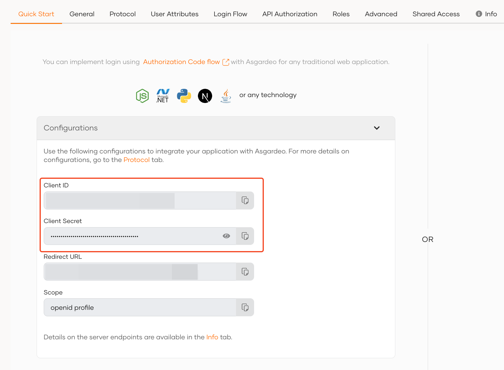
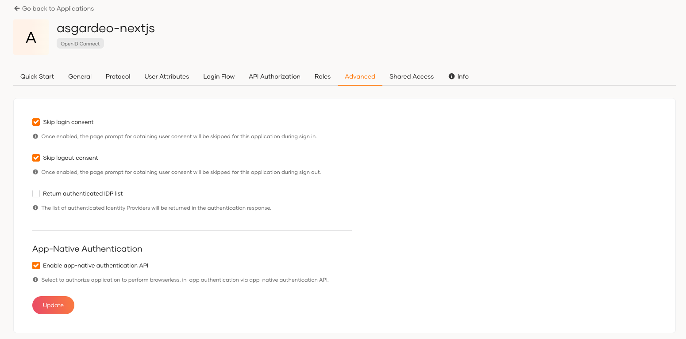

First unless you already have done that, you need to register your application as a Traditional Web Application.

* Download and [setup WSO2 Identity Server](https://is.docs.wso2.com/en/latest/get-started/quick-set-up/)
* Sign in to WSO2 Identity Server console and navigate to **Applications > New Application.**
* Select **Traditional Web Application** (*Make sure that the protocol remains set to OpenID Connect (OIDC)*)

Next, complete the wizard popup by providing a suitable name and an authorized redirect URL.

:::note

**Name**: is-nextjs

**Authorized redirect URL**: http://localhost:3000

:::

:::info

The authorized redirect URL determines where /identity/7.2.0 should send users after they successfully log in. Typically, this will be the web address where your application is hosted. For this guide, we'll use `http://localhost:3000`, as the sample application will be accessible at this URL

:::

Make a note of the following values from the **Protocol** tab of the registered application. You will need them to configure Asgardeo provider for Auth.js.

* **`Client ID`**
* **`Client Secret`**

Since App Native Authentication is used, to enable this navigate to the `Advanced` section of the Application and tick the option for `Enable app-native authentication API` and click on the `Update` button to save the changes.

In this step, we have registered our Next.js app as an application with app-native authentication in the WSO2 Identity Server console and generated the required metadata. Next, we will create a Next.js app.
