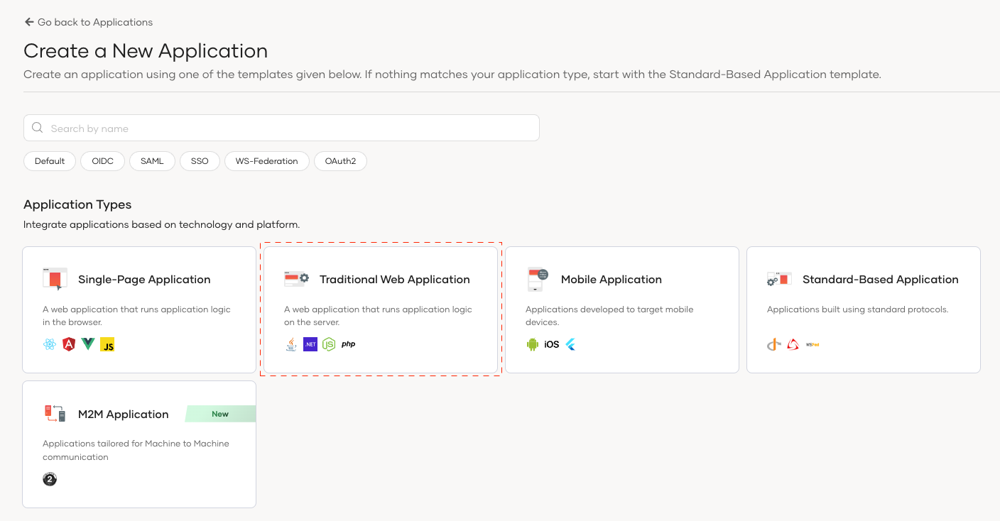
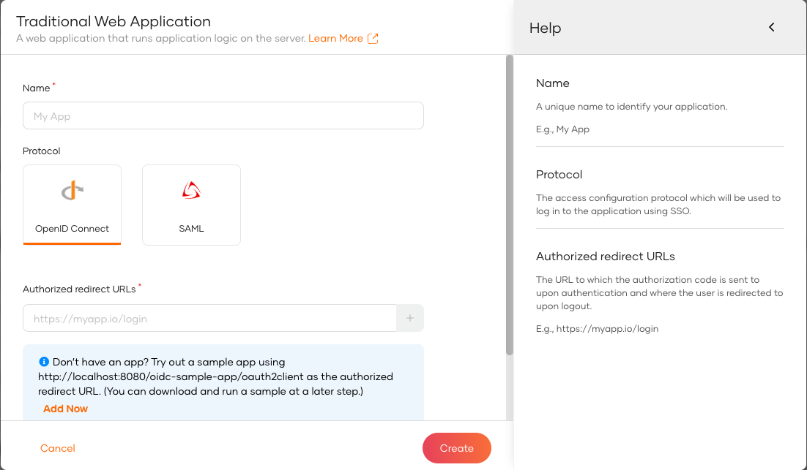
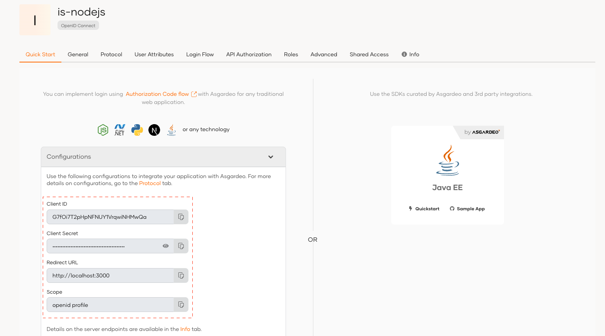

* Sign into WSO2 Identity Server console and navigate to **Applications > New Application.**
* Select Traditional Web Application

  
  
Next, complete the wizard popup by providing a suitable name and following authorized redirect URLs. Keep OpenID Connect selected as the protocol.

:::note

**name:** is-expressjs

**Authorized redirect URLs:** http://localhost:3000/oauth2/redirect,http://localhost:3000

:::

:::info

The authorized redirect URL determines where WSO2 Identity Server should send users after they successfully log in. Typically, this will be the web address where your app is hosted. For this guide, we'll use [http://localhost:3000/oauth2/redirect](http://localhost:3000/oauth2/redirect) and [http://localhost:3000](http://localhost:3000).

:::
    
You will need the following information available in the Quick Start tab of your app.

* Client ID
* Client Secret

After creating the application, navigate to **User Management > Users** and [create a new user](https://wso2.com/asgardeo/docs/guides/users/manage-users/#onboard-users). We will use this user to log in to the Express.js app.

In this step, we have registered our Express.js app as an application in the WSO2 Identity Server console and generated the required metadata. Next, we will create a Express.js app using the Express.js framework.
