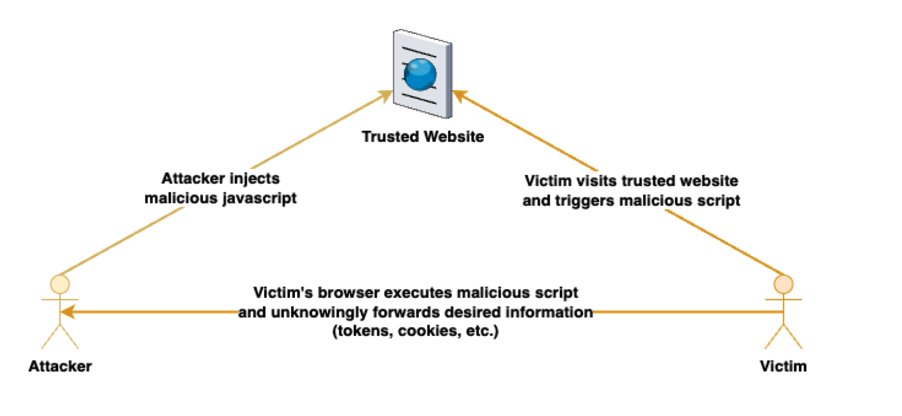

Cross-Site Scripting (XSS) is a vulnerability that allows attackers to inject malicious scripts into web applications. In frontend applications, XSS can occur when untrusted user input is rendered as HTML or JavaScript. XSS can compromise user data, hijack sessions, or perform unauthorized actions.




In React, the React DOM escapes any values embedded in JSX before rendering them. This means that any content inserted into JSX is automatically converted to a string, mitigating XSS risks. By default, React protects against XSS when embedding user input in JSX.
However, When using dangerouslySetInnerHTML to render HTML, the content is directly inserted into the DOM, which can expose XSS vulnerabilities if the HTML is not sanitized. This should be used with extreme caution, especially when dealing with untrusted data.

The example below demonstrates the use of the dangerouslySetInnerHTML function to render HTML from user input, which can lead to XSS vulnerabilities if the input contains malicious scripts.

```javascript

function Comment({ userInput }) {
    return <div dangerouslySetInnerHTML={{ __html: userInput }} />;
}


// Example usage
<Comment userInput="<script>alert('XSS Attack!')</script>" />;
 

```


This is how you can make sure your app is safe from XSS attacks. 

1. When possible, avoid using dangerouslySetInnerHTML altogether and render user input safely within JSX.

```javascript
function Comment({ userInput }) {
    return <div>{userInput}</div>;
}

// Example usage
<Comment userInput="This is a safe comment" />;

```


2. If you must use dangerouslySetInnerHTML, ensure that the HTML is sanitized to prevent XSS attacks.


```javascript
import DOMPurify from 'dompurify';


function Comment({ userInput }) {
    return <div dangerouslySetInnerHTML={{ __html: DOMPurify.sanitize(userInput) }} />;
}
 


```
