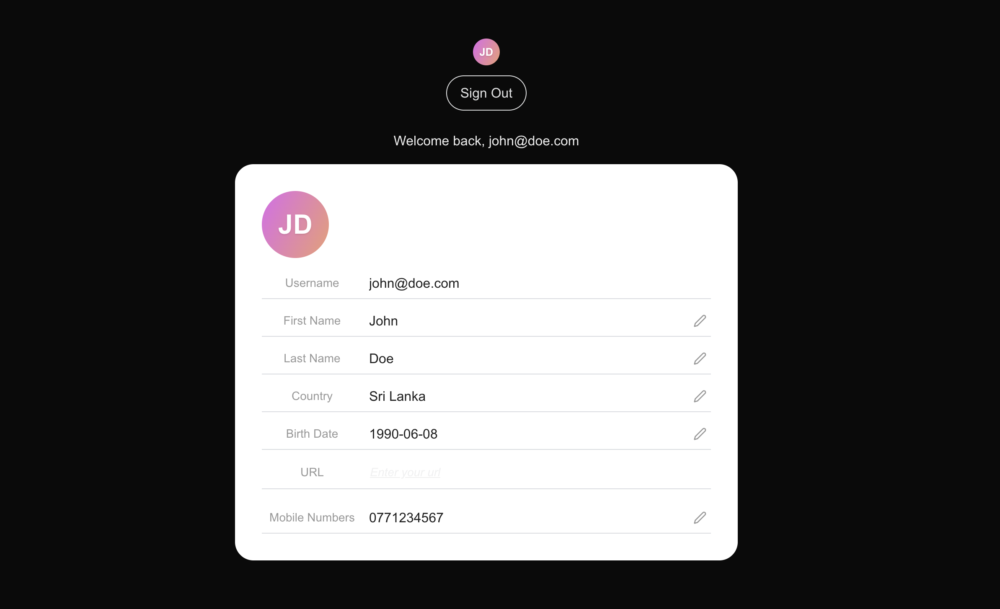

At this point, we’ve successfully implemented login and logout capabilities using the WSO2 Identity Platform  SDK. The next step is to explore how to access and display logged-in user details within the app.

The Next SDK has components can be used to display user information. You can use the `User`, `UserProfile`, or `UserDropdown` components to access and display user profile information in a declarative way.

- `User`: The `User` component provides a render prop pattern to access user profile information:
- `UserProfile`: The `UserProfile` component provides a declarative way to display and update user profile information.
- `UserDropdown`: The `UserDropdown` component provides a dropdown menu with built-in user information and sign-out functionality.

First let's use the `User` Component to display the username as below.

```javascript title="app/page.tsx" {1,17-27}
'use client'

import { SignedIn, SignedOut, SignInButton, SignOutButton, User } from '@asgardeo/nextjs';

export default function Home() {
  return (
    <>
    <div className="flex flex-col items-center justify-center min-h-screen text-center gap-6">
      <header className="flex flex-col items-center gap-2">
        <SignedIn>
          <SignOutButton />
        </SignedIn>
        <SignedOut>
          <SignInButton />
        </SignedOut>
      </header>
      <main className="flex flex-col items-center gap-4">
        <SignedIn>
          <User>
            {(user) => (
              <div>
                <p>Welcome back, {user.userName || user.username || user.sub}</p>
              </div>
            )}
          </User>
        </SignedIn>
      </main>
      </div>
    </>
  );
}
```

Now let's use the `UserProfile` component to display and update user profile information.

```javascript title="app/page.tsx" {1,26}
'use client'

import { SignedIn, SignedOut, SignInButton, SignOutButton, User, UserProfile } from '@asgardeo/nextjs';

export default function Home() {
  return (
    <>
    <div className="flex flex-col items-center justify-center min-h-screen text-center gap-6">
      <header className="flex flex-col items-center gap-2">
        <SignedIn>
          <SignOutButton />
        </SignedIn>
        <SignedOut>
          <SignInButton />
        </SignedOut>
      </header>
      <main className="flex flex-col items-center gap-4">
        <SignedIn>
          <User>
            {(user) => (
              <div>
                <p>Welcome back, {user.userName || user.username || user.sub}</p>
              </div>
            )}
          </User>
          <UserProfile />
        </SignedIn>
      </main>
      </div>
    </>
  );
}
```

Finally we can use the `UserDropdown` component to provide a dropdown menu with built-in user information and sign-out functionality.

```javascript title="app/page.tsx" {1,11}
'use client'

import { SignedIn, SignedOut, SignInButton, SignOutButton, User, UserDropdown, UserProfile } from '@asgardeo/nextjs';

export default function Home() {
  return (
    <>
    <div className="flex flex-col items-center justify-center min-h-screen text-center gap-6">
      <header className="flex flex-col items-center gap-2">
        <SignedIn>
          <UserDropdown />
          <SignOutButton />
        </SignedIn>
        <SignedOut>
          <SignInButton />
        </SignedOut>
      </header>
      <main className="flex flex-col items-center gap-4">
        <SignedIn>
          <User>
            {(user) => (
              <div>
                <p>Welcome back, {user.userName || user.username || user.sub}</p>
              </div>
            )}
          </User>
          <UserProfile />
        </SignedIn>
      </main>
      </div>
    </>
  );
}
```

If your Next application is already running in the development mode, the home page will be reloaded and you will see the updated user interface.



In this step, we further improved our React app to display the user attributes. As the next step, we will try to secure routes within the app.
