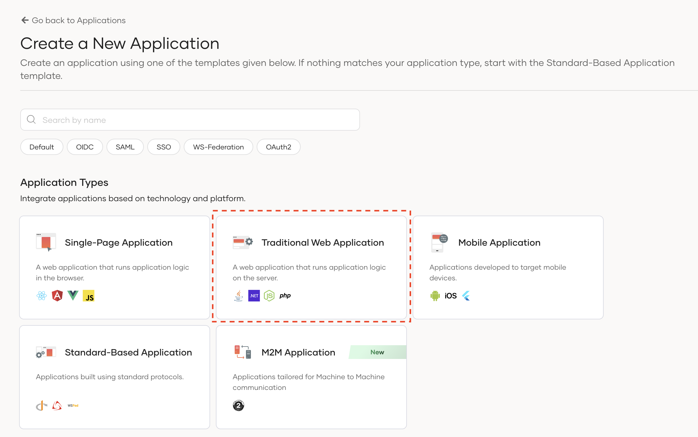
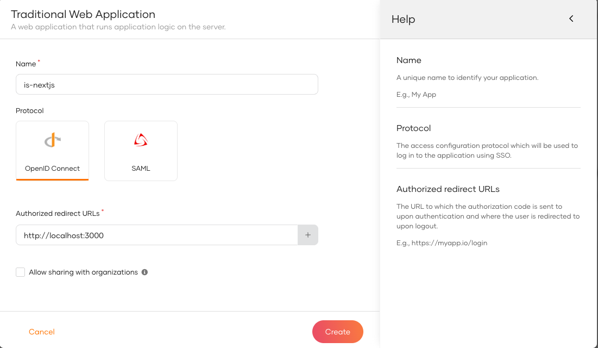

First unless you already have done that, you need to register your application as a Traditional Web Application.

* Download and [setup WSO2 Identity Server](https://is.docs.wso2.com/en/latest/get-started/quick-set-up/)
* Sign into WSO2 Identity Server console and navigate to **Applications > New Application.**
* Select **Traditional Web Application** (*Make sure that the protocol remains set to OpenID Connect (OIDC)*)

  
  
Next, complete the wizard popup by providing a suitable name and an authorized redirect URL.

:::note

name: is-nextjs

Authorized redirect URL: http://localhost:3000

:::

:::info

The authorized redirect URL determines where Asgardeo should send users after they successfully log in. Typically, this will be the web address where your application is hosted. For this guide, we'll use http://localhost:3000, as the sample application will be accessible at this URL

:::

Make a note of the following values from the **Protocol** and **Info** tabs of the registered application. You will need them to configure the Asgardeo provider.

* **`client-id`** from the **Protocol** tab.
* **`client-secret`** from the **Protocol** tab.
* **`issuer`** from the **Info** tab.

In this step, we have registered our Next.js app as an application in the WSO2 Identity Server console and generated the required metadata. Next, we will create a Next.js app.
