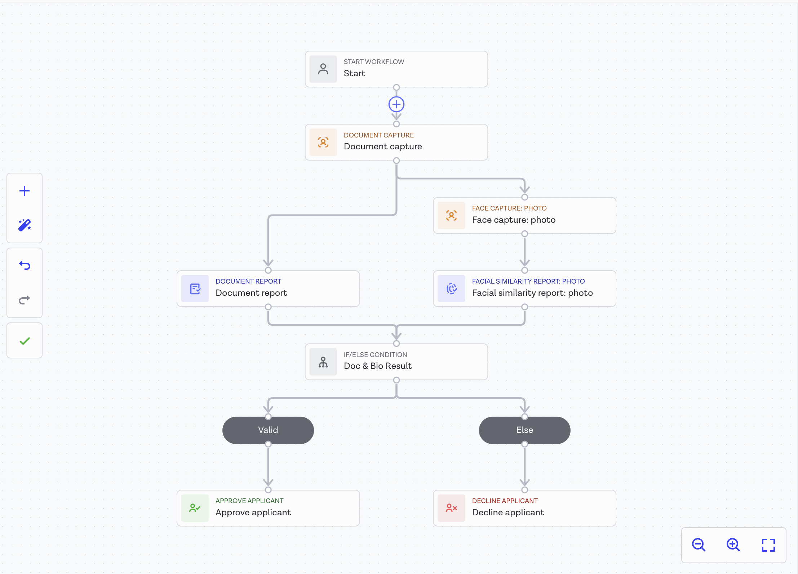
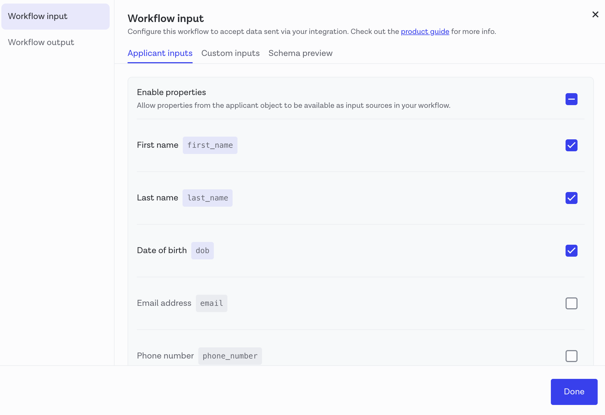
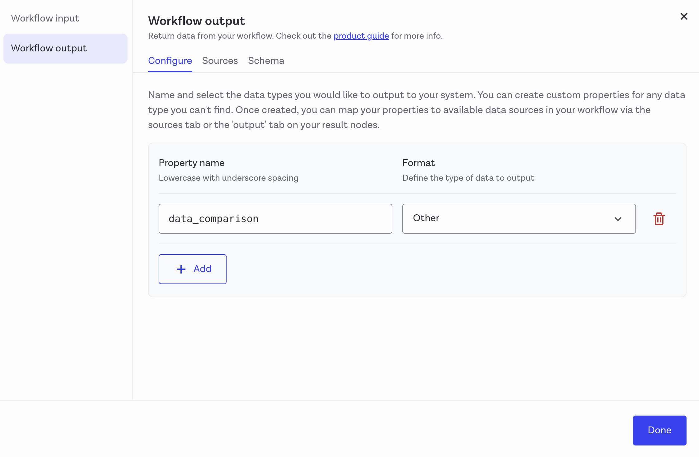
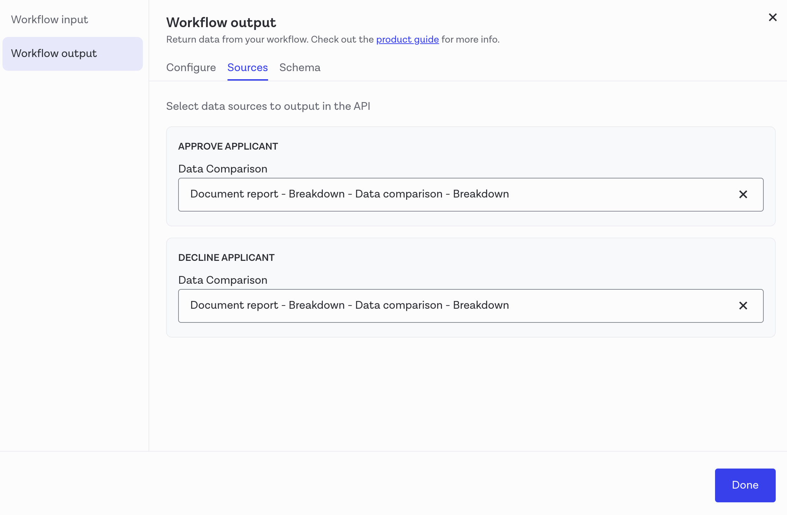

# Usage

This guide explains how to implement an identity verification flow in your application using Onfido and how to finalize the verification process with WSO2 Identity Server. The typical flow includes the following steps:

<Prerequisites>

## Prerequisites

- [Set up Onfido](set-up.mdx) in your WSO2 Identity Server installation.
- Make sure the webhook is correctly configured in Onfido to send verification results to WSO2 Identity Server.

</Prerequisites>

<Steps>

## Create a verification workflow in Onfido {/* #step-1-create-a-verification-workflow-in-onfido */}

Onfido Studio lets you create a dynamic end-user verification experience by designing customizable workflows that guide users through document submission, identity checks, and any other required steps.

<Steps>

### Design the workflow {/* #step-11-design-the-workflow */}

When using the Onfido connector in WSO2 Identity Server, you must create a connector that includes at least document data capture. You can also optionally add face capture to the workflow. Refer to [Onfido studio documentation](https://documentation.onfido.com/getting-started/onfido-studio-product/#building-your-workflow) for instructions.

The following shows a sample workflow you can create using Onfido studio.



### Configure workflow inputs {/* #step-12-configure-workflow-inputs */}

After designing the workflow, configure the input attributes that Onfido will validate. WSO2 Identity Server requires first name and last name as mandatory attributes. Optionally, select any other attributes necessary for your application that Onfido should validate.

Refer to [Onfido input data documentation](https://documentation.onfido.com/getting-started/onfido-studio-product/#workflow-input-data) for instructions.



### Configure workflow outputs {/* #step-13-configure-workflow-outputs */}

Workflow outputs specify the data returned at the end of a workflow run. WSO2 Identity Server receives this response in a webhook, which contains all the configured output properties such as document verification results and data comparison details.

1. Create a property called `data_comparison` and specify its format as **Other** to allow storing a complex JSON structure.

    

2. Specify the sources as **Document report - Breakdown - Data comparison - Breakdown** for both approve applicant and decline applicant paths.

    

Refer to [Onfido output data documentation](https://documentation.onfido.com/getting-started/onfido-studio-product/#workflow-output-data) for instructions.

:::note


Ensure comparison checks are enabled in your Onfido account. For more details, refer to the [comparison checks documentation](https://documentation.onfido.com/api/latest/#data_comparison).

:::

### Set workflow conditions {/* #step-13-set-workflow-conditions */}

Workflow conditions determine the criteria used to approve or decline a user. To set these conditions, click on the **If/Else** condition in the workflow builder.

- **Basic condition**: Check whether the Document Report and, optionally, the Face Capture results are marked **Clear**.

    - If both are Clear, the workflow should **Approve** the user.

    - If either is not Clear, the workflow should **Decline** the user.

- You can add any other conditions such as other data comparison results and additional document checks.

:::note


WSO2 Identity Server only marks the attribute verification as successful if the workflow returns an approved status.

:::

</Steps>

## Integrate your application with Onfido {/* #step-2-integrate-your-application-with-onfido */}

To verify user identity using Onfido, you need to integrate your application with Onfido using the Onfido SDK. The SDK provides a seamless way to capture user documents and faces, and submit them to Onfido for verification.

Refer to the [Onfido SDK documentation](https://documentation.onfido.com/sdk/overview) for instructions.

## Perform the verification process {/* #step-3-perform-the-verification-process */}

WSO2 Identity Server provides a verification API that you can use to start and complete the identity verification process with Onfido.

```bash
https://<IS_HOST>:<IS_PORT>/api/users/v1/me/idv/verify
```

<Steps>

### Start the verification process {/* #step-31-start-the-verification-process */}

To start the identity verification process, make a POST request with the following payload.

    ```json
    {
    "idVProviderId": "<Onfido identity verification provider's ID>",
    "claims": [
         "http://wso2.org/claims/givenname",
         "http://wso2.org/claims/lastname"
    ],
    "properties": [
        {
            "key": "status",
            "value": "INITIATED"
        }
    ]
    }
    ```

:::note


- Replace `<Onfido identity verification provider's ID>` with the actual ID of your Onfido connection in WSO2 Identity Server.

- Including the URLs for the first name and last name is mandatory. You can include any other claims that you configured as workflow inputs in Onfido.

:::

The response looks as follows:

```json
{
  "idVProviderId": "<Onfido identity verification provider's ID>",
  "claims": [
     {
        "id": "<ID>",
        "uri": "<WSO2 Claim URI>",
        "isVerified": false,
        "claimMetadata": {
           "onfido_applicant_id": "<Onfido applicant ID>",
           "onfido_workflow_run_id": "<Onfido workflow run ID>",
           "sdk_token": "<Onfido SDK token>",
           "onfido_workflow_status": "AWAITING_INPUT"
        }
     }
   ]
}

```

### Use the Onfido SDK to capture user documents {/* #step-32-use-the-onfido-sdk-to-capture-user-documents */}

The response from the previous step contains the `sdk_token` and the `onfido_workflow_run_id`. Use these to initialize the Onfido SDK in your application and capture user documents and faces. 

Refer to [Intializing Onfido SDK](https://documentation.onfido.com/sdk/web/#initializing-the-sdk) for instructions.

### Complete the verification process {/* #step-33-complete-the-verification-process */}

After the user completes the document submission using the Onfido SDK, make another POST request with the following payload to complete the verification process.

```json
{
    "idVProviderId": "<Onfido identity verification provider's ID>",
    "claims": [
        "http://wso2.org/claims/givenname",
        "http://wso2.org/claims/lastname"
    ],
    "properties": [
        {
            "key": "status",
            "value": "COMPLETED"
        }
    ]
}
```

:::note


- Replace `<Onfido identity verification provider's ID>` with the actual ID of your Onfido connection in WSO2 Identity Server.

- Including the URLs for the first name and last name is mandatory. You can include any other claims that you configured as workflow inputs in Onfido.

:::

### (Optional) Restart an interrupted verification process {/* #step-34-optional-restart-an-interrupted-verification-process */}

If the user verification process gets interrupted before completion, you can restart it by making a POST request with the following payload.

:::note


- You can only restart a verification process if the workflow status is `AWAITING_INPUT`.
- After restarting, follow step 3.2 and step 3.3 to complete the verification process.

:::

```json
{
    "idVProviderId": "<Onfido identity verification provider's ID>",
    "claims": [
        "http://wso2.org/claims/givenname",
        "http://wso2.org/claims/lastname"
    ],
    "properties": [
        {
            "key": "status",
            "value": "REINITIATED"
        }
    ]
}
```

:::note


- Replace `<Onfido identity verification provider's ID>` with the actual ID of your Onfido connection in WSO2 Identity Server.

- Including the URLs for the first name and last name is mandatory. You can include any other claims that you configured as workflow inputs in Onfido.

:::

</Steps>

</Steps>
