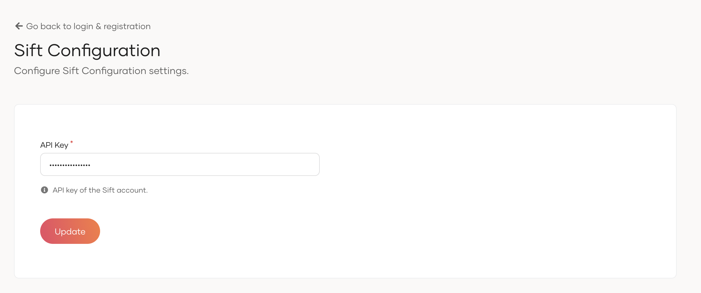

# Set up

The following guide explains how you can install and set up Sift in WSO2 Identity Server.

<Prerequisites>

## Prerequisites

You need to have a Sift account. If you don't have an account, create one by visiting the [Sift website](https://sift.com/).

</Prerequisites>

<Steps>

## Install the Sift connector {/* #step-1-install-the-sift-connector */}

Follow the steps below to install Sift in WSO2 Identity Server.

1. Download the project artifacts from the WSO2 Identity Server [connector store](https://store.wso2.com/connector/identity-fraud-detection-sift).

2. Copy the `org.wso2.carbon.identity.fraud.detection.sift-<version>.jar` file to the `<IS_HOME>/repository/components/dropins` directory.

3. Restart WSO2 Identity Server.

## Add the API key {/* #step-2-add-the-api-key */}

To work with Sift, you need to register your Sift API key in WSO2 Identity Server. To do so,

1. On the WSO2 Identity Server Console, go to **Login & Registration**.

2. Click **Fraud Detection** and enter the API key.

    

3. Click **Update** to save the changes.

</Steps>
