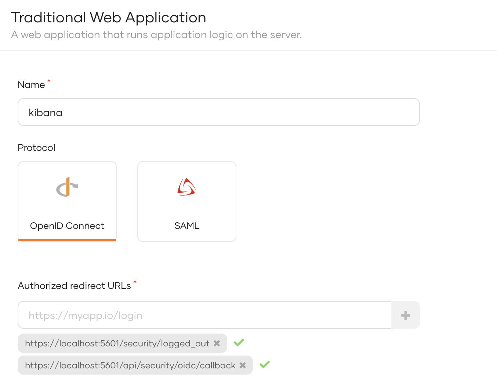
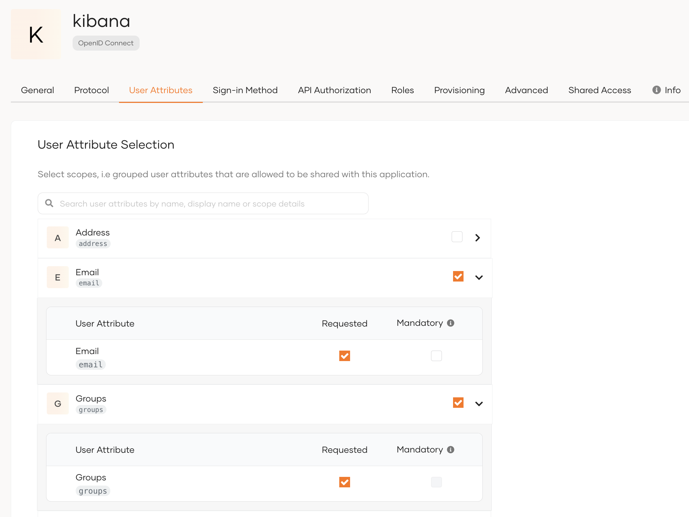
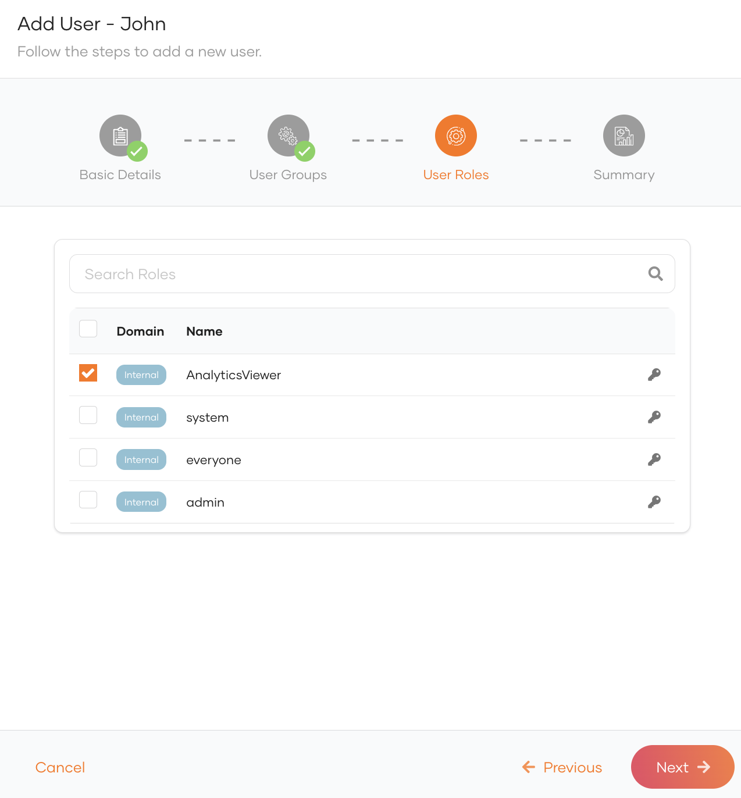
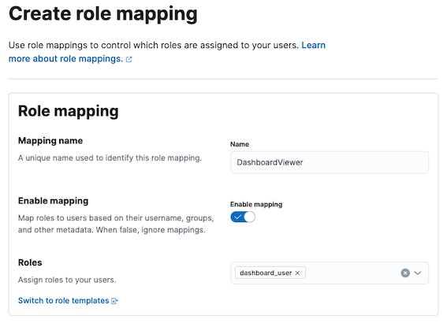
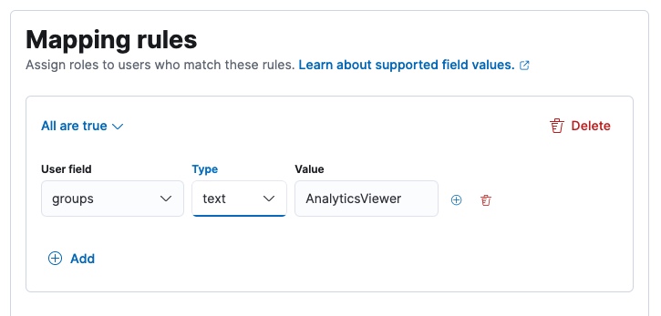
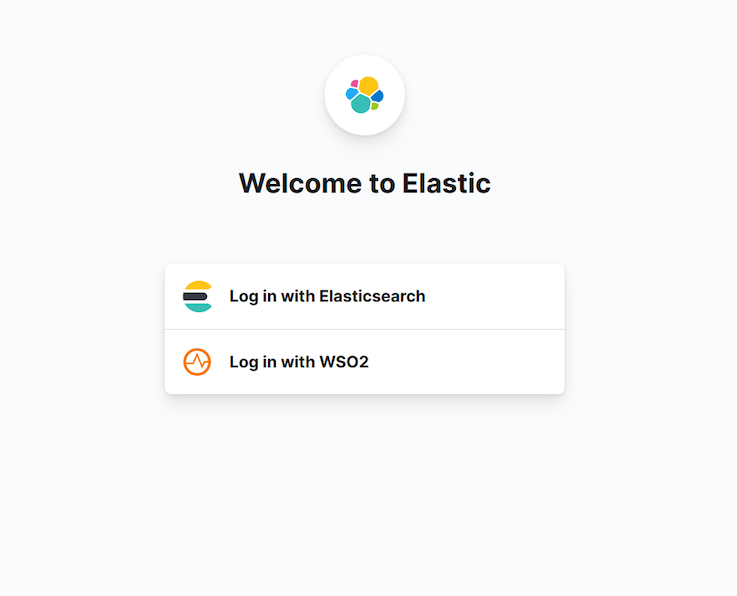

# Configure Single-Sign-On for ELK analytics

 You can enable Single-sign-on for an ElasticSearch/Kibana deployment with WSO2 Identity Server via OpenID Connect. To set this up, follow the steps given below.

<div className="admonition waening">
<p className="admonition-title">Premium feature</p>
<p>To enable Single-Sign-On, you need to be subscribed to an Elastic stack platinum subscription or higher.</p>
</div>

## Prerequisite

[Configure ELK Analytics](./elk-analytics-installation-guide.mdx) in WSO2 Identity Server.

## Configure a service provider

To enable Elastic stack SSO with WSO2 Identity Server, follow the steps given below to create an application.

1. Login to the WSO2 Identity Server console.

2. Navigate to **Applications**, click **New Application** and select **Traditional Web Application**.

3. Provide a name for the service provider (e.g. kibana), select **OpenID Connect** as the protocol and provide the following as the authorized redirect URLs.
    - https://localhost:5601/api/security/oidc/callback
    - https://localhost:5601/security/logged_out

    

4. Click **Register**.

5. Go to the **User Attributes** tab of the application and allow to share the **email** and **groups** attributes with the application. (Username is used as the **Subject attribute** by default.)

    

6. Click Update to save your changes.


## Configure OIDC Realm in Elasticsearch

To configure single sign-on in the Elastic Stack using OpenID connect, follow the steps given [here](https://www.elastic.co/guide/en/elasticsearch/reference/current/oidc-guide.html).

A sample OpenID connect realm is as follows.

  ```js
  xpack.security.authc.token.enabled: true
  xpack.security.authc.realms.oidc.oidc1:
  order: 1
  rp.client_id: "<CLIENT ID>"
  rp.response_type: code
  rp.redirect_uri: "http:///<KIBANA_HOST>:5601/api/security/oidc/callback"
  op.issuer: "https://<IS_HOST>:<PORT>/oauth2/token"
  op.authorization_endpoint: "https://<IS_HOST>:<PORT>/oauth2/authorize"
  op.token_endpoint: "https://<IS_HOST>:<PORT>/oauth2/token"
  op.jwkset_path: "https://<IS_HOST>:<PORT>/oauth2/jwks"
  op.endsession_endpoint: "https://<IS_HOST>:<PORT>/oidc/logout"
  op.userinfo_endpoint: "https://<IS_HOST>:<PORT>/oauth2/userinfo"
  rp.post_logout_redirect_uri: "http://<KIBANA_HOST>:5601/security/logged_out"
  claims.principal: sub
  ssl.verification_mode: none
  claims.groups: groups
  claims.name: name
  claims.mail: email
  ```

## Configure role mappings

Once the above steps are completed, role mapping needs to be configured in Kibana to allow WSO2 Identity Server users to access the dashboards in Kibana. To do so, follow the steps below.

### Create Users and Roles in WSO2 Identity Server

Follow the steps below to create a role.

1. Login to the WSO2 Identity Server Console.

2. Navigate to **User Management** > **Roles**.

3. Create a role (e.g. AnalyticsViewer), and click **Finish**.

Follow the steps below to create a user and assign the user with the created role.

5. Navigate to **User Management** > **Users**.

6. Click **Add User** > **Create User** to create a single user profile.

6. Enter the details of the user, and click **Next** until you reach the **User Roles** section.

7. Assign the role that you created above and proceed to create the user.

      


### Configure role mapping in Kibana

Follow the steps below to associate Kibana roles with the roles you created in WSO2 Identity Server.

1. Login to Kibana using basic authentication.

2. On the left navigation panel, under **Management** click **Stack Management**.

3. Under **Stack Management** > **Security**, click **Role Mappings**.

3. Click **Create Role Mapping** and add a new role mapping by giving a **Mapping name**.

4. Select a role that has access to the particular dashboard from  **Roles**.

    

5. Click **Add Rules** under **Mapping rules**.

6. Select **groups** as the user field and enter the name of the role that you created in the WSO2 Identity Server.

    


## Try it out

Follow the steps below to try out single sign-on to the Kibana dashboard using WSO2 Identity Server.

1. Navigate to Kibana using the following URL.
    <code>https://localhost:5601</code>

7. Logout from Kibana if you have already logged in, and login again by selecting the **Log in with WSO2** option.

    

8. You will be redirected to the WSO2 Identity Server login page. Try logging in with the credentials of the user that you created.

    
