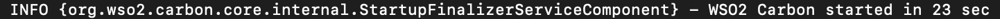
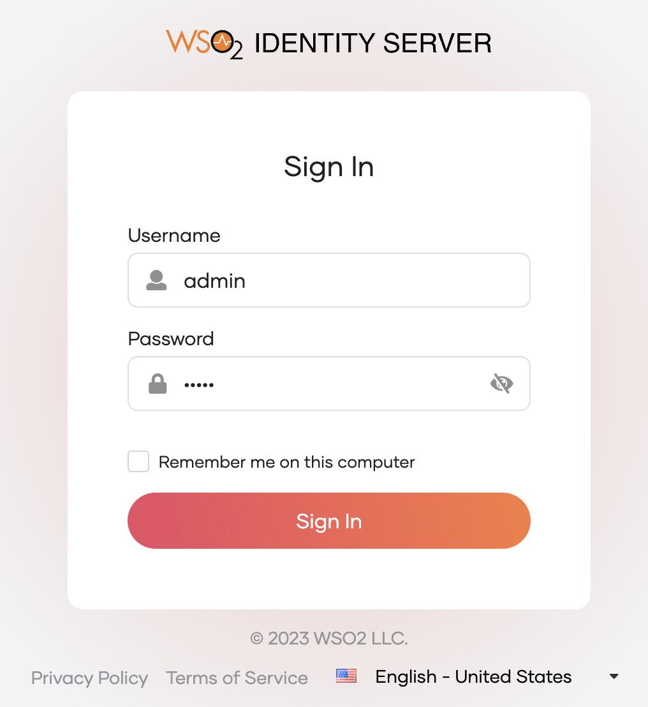

# Quick Setup

Follow the steps given below to quickly set up and install WSO2 Identity Server on your computer.

:::info

For detailed instructions on other installation options and deployments, see the [installation guide](../deploy/get-started/install.mdx).

:::

## Install the WSO2 Identity Server

Follow the steps given below.

1. Download and install Oracle Java SE Development Kit (JDK) version 11 or 17.
2. Go to [WSO2 Identity Server official website](https://wso2.com/identity-server/) and click on **Download**.
3. Install WSO2 Identity Server by downloading the **LATEST RELEASE**.

    :::info

    The installation location of WSO2 Identity Server is referred to as `<IS_HOME>`.

    :::

&lt;!-- The WSO2 Identity Server installation location can vary depending on the operating system as given below:

|OS     |Home Directory                                |
|:------|:---------------------------------------------|
|macOS | `/Library/WSO2/IdentityServer/<IS_HOME>`         |
|Windows| `C:\Program Files\WSO2\IdentityServer\<IS_HOME>` |
|Ubuntu | `/usr/lib/wso2/IdentityServer/<IS_HOME>`         |
|CentOS | `/usr/lib64/IdentityServer/<IS_HOME>`           |

-->

## Start the WSO2 Identity Server

To start WSO2 Identity Server, open a terminal, navigate to the `<IS_HOME>/bin` folder, and execute one of the following commands:

- On Linux/macOS

    ```bash
    sh wso2server.sh
    ```

- On Windows

    ```bash
    wso2server.bat
    ```

Note that the following log appears in the command prompt when the server starts:



:::tip[Shutting down the server]

To shutdown the server, press `Ctrl + C`.
Note that the following log appears in the command prompt on server shutdown.


:::

## Access the Console

Once the server has started, you can access the WSO2 Identity Server console by navigating to the following URL.

`https://{Server Host}:{Port}/console`

For example, if you are using default settings, the console URL will be `https://localhost:9443/console`.

You will then be presented with the login screen for the WSO2 Identity Server. Enter `admin` for both username and password fields to login as the admin user.



## What's next?

Add login to your application using WSO2 Identity Server or try it on a sample application. [Try integrating IS into apps](try-samples/index.mdx).
