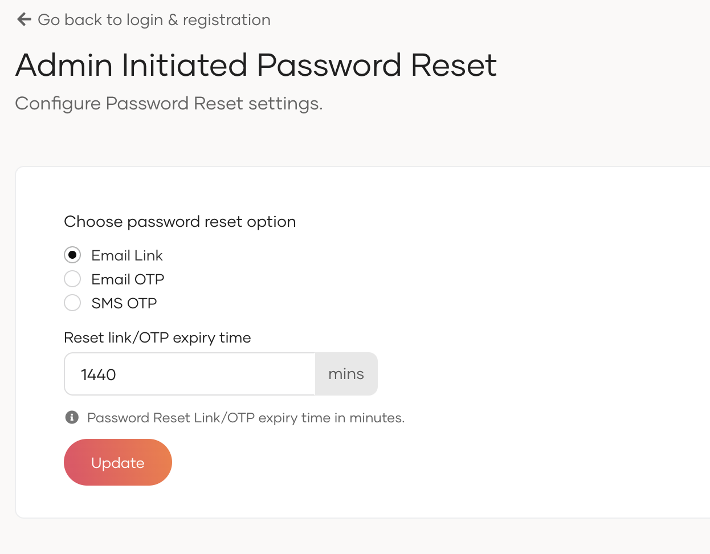

# Admin initiated password reset

Administrators can initiate password reset for users. Once an administrator initiates a password reset, the user's current password becomes invalid and they must complete the password reset process to regain access to their account.

To configure admin-initiated password reset:

1. On the WSO2 Identity Server Console, go to **Login & Registration**.

2. Under **Account Recovery**, click on **Admin Initiated Password Reset**.

3. Select one of the following methods:
    * **Email Link**: Users receive an email containing a password recovery link. Clicking the link initiates the password reset flow.
    * **Email OTP**: Users receive a one-time password (OTP) via email. They can use this OTP to log in once, which will then initiate the password reset flow.
    * **SMS OTP**: Users receive a one-time password (OTP) via SMS. They can use this OTP to log in once, which will then initiate the password reset flow.

4. Click **Update** to save the changes.

:::info

Once an administrator initiates a password reset, the user's previous password will be invalidated immediately. The user must complete the password reset process using the provided method to regain access to their account.

:::
