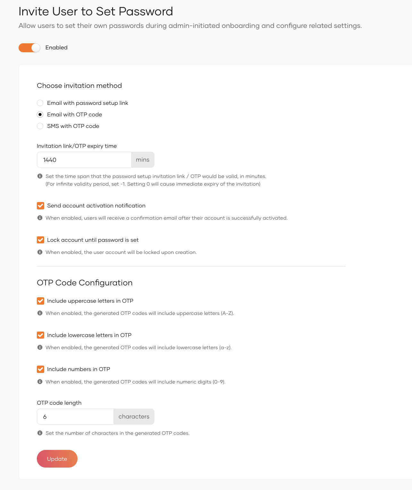

# Invite user to set password

Allow administrator to invite users to set their own passwords during the onboarding process in WSO2 Identity Server.

## Configuration instructions

For inviting users to set their password, follow these instructions:

1. On the WSO2 Identity Server Console, go to **Login & Registration** > **User Onboarding** > **Invite User to Set Password**.
2. Enable the **Invite User to Set Password** feature to invite user to set the password after user creation.
3. From **Choose invitation method**, select Email Link to send an invitation link. Alternatively, select OTP (delivered via Email or SMS) to start the invitation flow.
4. Set the **Invitation link/OTP expiry time** in minutes.
This defines how long the password setup invitation email or OTP remains valid.
    - For infinite validity, set -1
    - Setting 0 causes immediate expiry
5. If you want to send an account activation confirmation notification, enable the **Send account activation notification**.
6. Select the **Lock account until password is set** to lock the user account during user creation.
7. Configure the OTP code options from **OTP Code Configuration**: enable uppercase, lowercase, and numeric characters, then set the desired OTP code length.

    :::note

    When using OTP invitation method, users can use the received OTP as a temporary password to log in. The system redirects users to the password setup page after login to create their permanent password.

    :::

8. Click **Update** to save the changes.

## Parameters

<table>
  <tr>
    <th>Parameter</th>
    <th>Description</th>
  </tr>
  <tr>
    <td><code>Choose invitation method</code></td>
    <td>Select the method for sending password setup invitations: 
        • Email with password setup link 
        • Email with OTP code 
        • SMS with OTP code</td>
  </tr>
  <tr>
    <td><code>Invitation link/OTP expiry time</code></td>
    <td>Defines the validity period in minutes for the password setup invitation link or OTP. 
        • Set -1 for infinite validity 
        • Set 0 for immediate expiry</td>
  </tr>
  <tr>
    <td><code>Send account activation notification</code></td>
    <td>When enabled, users receive a confirmation notification after activating their account.</td>
  </tr>
  <tr>
    <td><code>Lock account until password is set</code></td>
    <td>When enabled, the system locks the user account upon creation until the user creates their password.</td>
  </tr>
  <tr>
    <td><code>Include uppercase letters in OTP</code></td>
    <td>When enabled, the generated OTP codes will include uppercase letters (A-Z).</td>
  </tr>
  <tr>
    <td><code>Include lowercase letters in OTP</code></td>
    <td>When enabled, the generated OTP codes will include lowercase letters (a-z).</td>
  </tr>
  <tr>
    <td><code>Include numbers in OTP</code></td>
    <td>When enabled, the generated OTP codes will include numeric digits (0-9).</td>
  </tr>
  <tr>
    <td><code>OTP code length</code></td>
    <td>Set the number of characters in the generated OTP codes.</td>
  </tr>
</table>

## Try out Invite user to set password

1. On the WSO2 Identity Server Console, go to **User Management**.

2. Go to **Users**.

3. Click **Add User** > **Single User**.

4. Fill in the user's details.

5. Select the **Invite the user to set their own password** option.

6. Click **Next** and **Finish**.

7. You will receive an **email link**, **email OTP**, or **SMS OTP** based on your configuration.

   - **Click the email link** to start the password setup flow.
   - **If you receive an OTP**, enter it to begin the password setup flow.

  This step verifies the user's identity and starts the password creation process.

   **Tip:**
   
   - You can redirect users to the password recovery endpoint with the OTP to initiate setup.

   - Otherwise you can try your application's basic authentication with the username and OTP as the password. This triggers the password setup flow if the OTP is valid.
