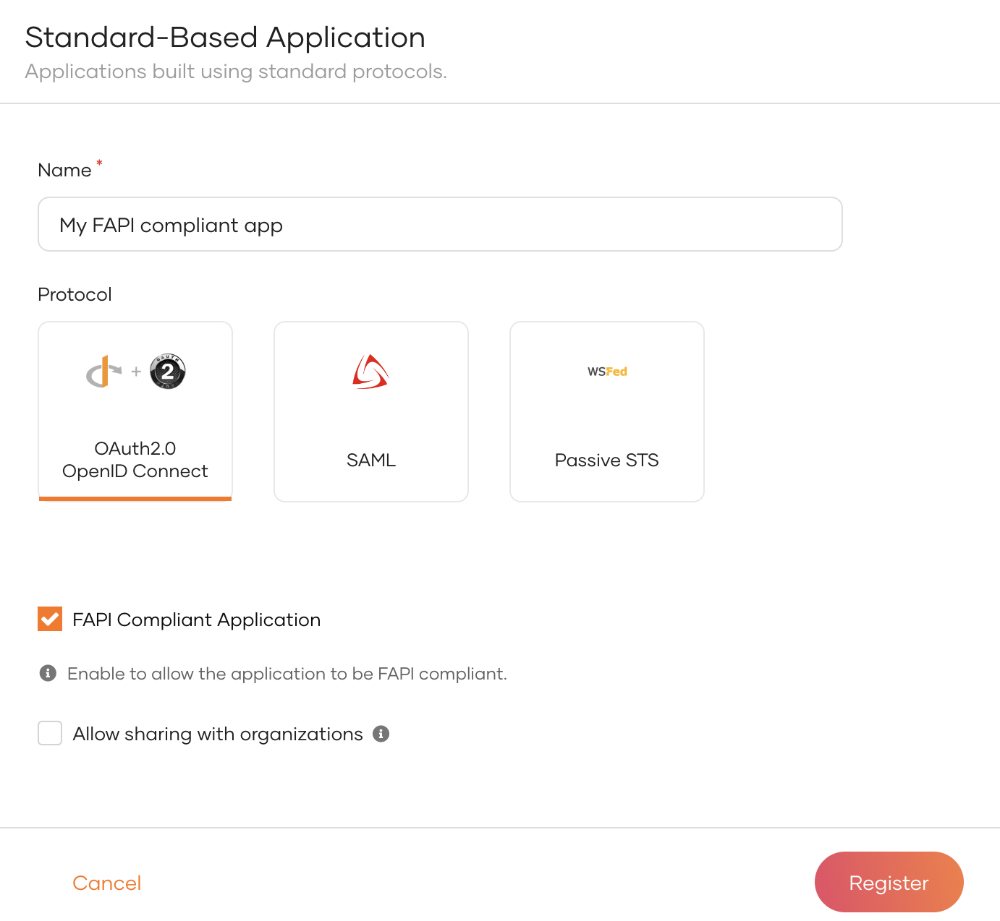

# Register a FAPI-compliant application

Financial-Grade API (FAPI) specification extends the OAuth and OIDC frameworks and defines additional technical requirements to protect high-value APIs. WSO2 Identity Server provides full support for [FAPI 1.0 Advanced](https://openid.net/specs/openid-financial-api-part-2-1_0.html) allowing developers to build applications that meet advanced security standards.

This guide walks you through creating and configuring a FAPI-compliant application in WSO2 Identity Server.


## Configure WSO2 Identity Server for FAPI compliance

WSO2 Identity Server supports both FAPI 1.0 Advanced and FAPI 2.0 specifications.

To configure WSO2 Identity Server to issue FAPI-compliant tokens, open the `<IS_HOME>/repository/conf/deployment.toml` file and add the configurations specific to your FAPI version. After saving the changes, restart WSO2 Identity Server to apply the configuration.


- Limit cipher suites for TLSv1.2.

    ```bash
    [transport.https.sslHostConfig.properties]
    ciphers="TLS_DHE_RSA_WITH_AES_128_GCM_SHA256,TLS_ECDHE_RSA_WITH_AES_128_GCM_SHA256,TLS_DHE_RSA_WITH_AES_256_GCM_SHA384,TLS_ECDHE_RSA_WITH_AES_256_GCM_SHA384"
    ```

- Specify a FAPI-compliant signing algorithm for ID tokens (PS256, ES256).

    ```bash
    [oauth.oidc]
    id_token.signature_algorithm="PS256"
    ```

- Specify a signing algorithm for tokens issued at the token endpoint.

    ```bash
    [oauth.oidc.token_endpoint]
    signing_algorithms=["PS256","ES256"]
    ```

- Specify a signing algorithm for the userinfo response.

    ```bash
    [oauth.oidc.user_info]
    jwt_signature_algorithm="PS256"
    ```

- If your implementation involves TLS termination, specify the following MTLS header name.

    ```bash
     [oauth.mutualtls]
     client_certificate_header = "x-wso2-mtls-cert"
    ```


## Create a FAPI-compliant application

Follow the guides below to create a FAPI-compliant application either using the Console or using Dynamic Client Registration (DCR).

### Use the Console

If you wish to register your application manually using the Console, follow the steps below to make it FAPI-compliant.

1. On the WSO2 Identity Server Console, go to **Applications**.

2. Click **New Application** and select **Standard-Based Application**.

3. Provide an application name.

4. Select **OAuth2.0 OpenID Connect** as the protocol and select **FAPI Compliant Application**.

    :::note

    When an application is made FAPI-compliant, WSO2 Identity Server restricts several configurations to only allow FAPI-compliant options.

    :::

    

5. Click **Register** to complete the registration.

6. [Enable the application](index.md#enabledisable-an-application) when it is ready for users to log in.

### Use Dynamic Client Registration (DCR)

If you have applications that need to dynamically register with WSO2 Identity Server during runtime, follow the steps below to make them FAPI-compliant.


1. Open the `deployment.toml` file found in the `<IS_HOME>/repository/conf/` directory, add the following configuration and restart WSO2 Identity Server.

    ```bash
    [oauth.dcr]
    enable_fapi_enforcement=true
    ```

    :::note


    This configuration enforces FAPI compliance for applications registering with DCR.

    :::

2. Refer to the [Dynamic Client Registration (DCR) API](../../apis/dynamic-client-registration-rest-api.md) documentation to learn how to register an application with DCR.


## What's next?

Refer to the [Financial-grade API](../../references/financial-grade-api.md) documentation to learn about the FAPI-compliant configurations available in WSO2 Identity Server and how to configure them.
