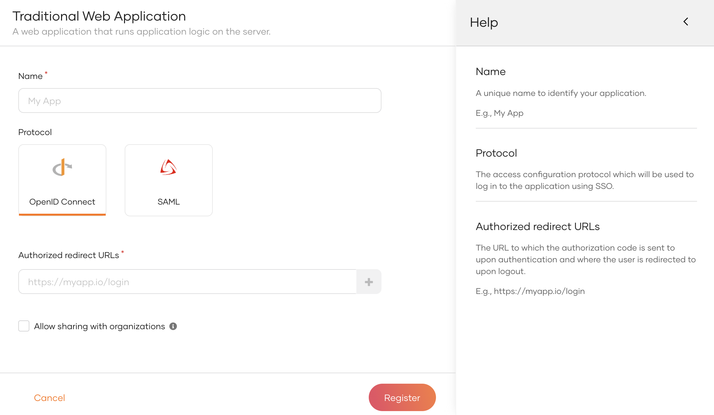

# Register an OpenID Connect web app

To integrate your web application with WSO2 Identity Server using OpenID Connect, you need to first register your web application as an OpenID Connect web application in WSO2 Identity Server. A client ID and client secret are issued to the application upon registration.

Follow the instructions given below.

## Register the app

To register the app:

1. On the WSO2 Identity Server Console, go to **Applications**.

2. Click **New Application** and select **Traditional Web Application**.

    

3. Enter the following details:

    

    <table><tbody><tr><th>{"Parameter"}</th><th>{"Description"}</th></tr><tr><td>{"Name"}</td><td>{"A unique name to identify your application."}</td></tr><tr><td>{"Protocol"}</td><td>
{"The access configuration protocol used to log in to the application with SSO."}
{" Select "}<b>{"OpenID Connect"}</b>{"."}</td></tr><tr><td>{"Authorized redirect URLs"}</td><td>
{"The URL to which the authorization code is sent upon user authentication and where the user is redirected upon logout."}

{"To comply with "}[{"RFC 8252 section 7.3"}](https://datatracker.ietf.org/doc/html/rfc8252#section-7.3){"{:target=\"_blank\"}, the redirect URL in the request does not need to have an exact port match with the authorized redirect URL if it is a loopback redirect URL. Only URLs with loopback IP addresses ("}<b>{"127.0.0.1"}</b>{" and "}<b>{"[::1]"}</b>{" not "}<b>{"localhost"}</b>{") are supported for this feature."}
{" Click "}<b>{"Add Now"}</b>{" if you want to try a sample app."}</td></tr><tr><td>{"Allow sharing with organizations"}</td><td>{"Enable this to share the new application with all or any selected B2B organizations that belong to your primary organization."}</td></tr></tbody></table>

4. Click **Register** to complete the registration.

    

    
Sharing with selected organizations

    If you have enabled **Allow sharing with organizations** while registering the application, you will see a popup window with the following options.

    

    <table><tbody><tr><th>{"Option"}</th><th>{"Description"}</th></tr><tr><td>{"Share with all organizations"}</td><td>{"If selected, the application will be shared with all existing organizations and any new organizations you may create in the future."}</td></tr><tr><td>{"Share with only selected organizations"}</td><td>{"If selected, you can select the organizations you wish to share the application with."}</td></tr></tbody></table>

    

5. [Enable the application](index.md#enabledisable-an-application) when it is ready for use.

## Get the client ID and secret

When you register your web application, a client ID and client secret are generated. Your web application will identify itself to WSO2 Identity Server with these credentials.

You can get this client ID and client secret from the **Protocol** tab of the application, as shown below.

## What's next?

- [Add login to your web app](../authentication/add-login-to-web-app.md)
