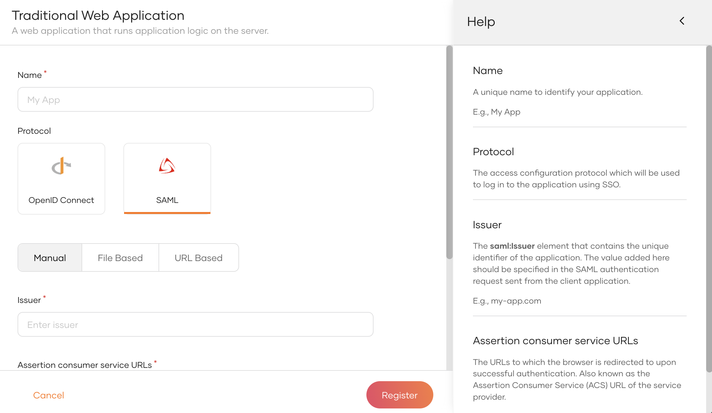
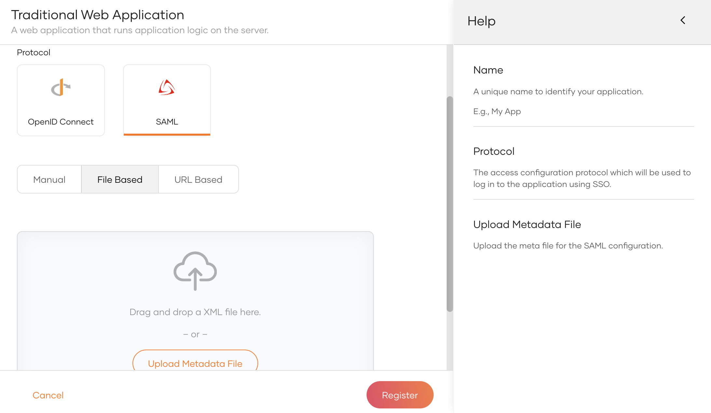
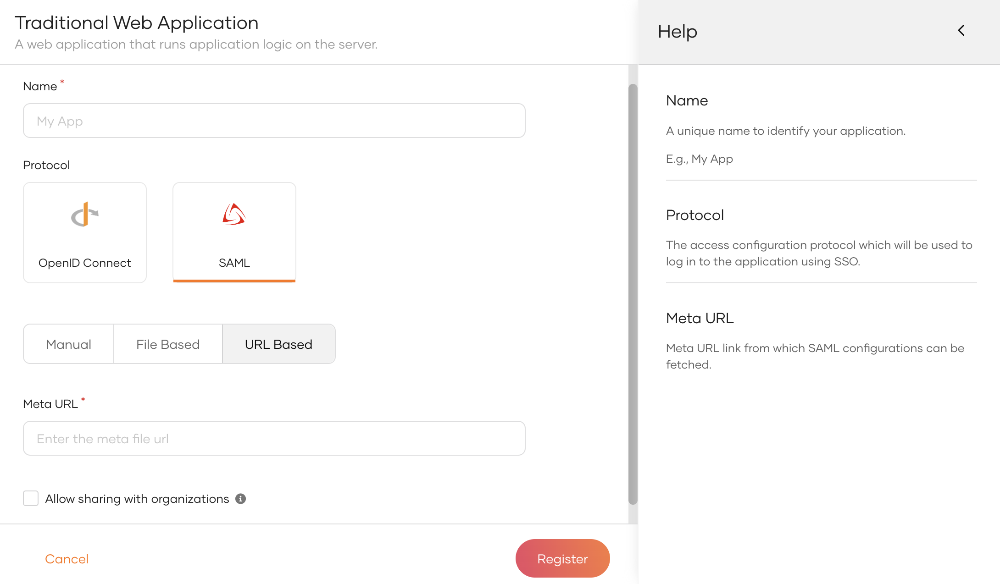

# Register a SAML web app

To integrate your web application with WSO2 Identity Server using [SAML](https://docs.oasis-open.org/security/saml/v2.0/saml-core-2.0-os.pdf), you need to first register your application as a SAML application in WSO2 Identity Server.

There are two ways to provide your SAML application configurations to WSO2 Identity Server during registration:

- Use a SAML SP metadata file
- Add SAML SP configurations manually

Follow the instructions given below.

## Register the app

To register the app:

1. On the WSO2 Identity Server Console, click **Applications**.

    

2. Click **New Application** and select **Traditional Web Application**.
3. In the **Name** field, enter a unique name to identify your application.
4. Select the **SAML** protocol.
5. Select one of the following methods and add the SAML configurations:

    <table>
        <tr>
            <th>Method</th>
            <th>Description</th>
        </tr>
        <tr>
            <td>Manual</td>
            <td>
Use this option to manually specify the required SAML configurations.
 See [Add SAML configs manually](#add-saml-configs-manually).</td>
        </tr>
        <tr>
            <td>File Based</td>
            <td>
Upload a SAML metadata file with the required configurations.
 See [Use a SAML metadata file](#use-a-saml-metadata-file).</td>
        </tr>
        <tr>
            <td>URL Based</td>
            <td>
Point to the endpoint with the SAML metadata.
 See [Use a SAML metadata file](#use-a-saml-metadata-file).</td>
        </tr>
    </table>

6. [Optional] Enable **Allow sharing with organizations** to share the new application with all or any selected organizations that belong to your organization.

7. Click **Register** to complete the registration.

    

    
Sharing with selected organizations

    If you have enabled **Allow sharing with organizations** while registering the application, you will see a popup window with the following options.

    

    <table>
        <tr>
            <th>Option</th>
            <th>Description</th>
        </tr>
        <tr>
            <td>Share with all organizations</td>
            <td>If selected, the application will be shared with all existing organizations and any new organizations you may create in the future.</td>
        </tr>
        <tr>
            <td>Share with only selected organizations</td>
            <td>If selected, you can select the organizations you wish to share the application with.</td>
        </tr>
    </table>

    

8. [Enable the application](index.md#enabledisable-an-application) when it is ready for use.

### Add SAML configs manually

If you selected **Manual** in the previous step, you can manually specify the SAML configurations as follows:

<table>
    <tr>
        <th>Parameter</th>
        <th>Description</th>
    </tr>
    <tr>
        <td>Issuer</td>
        <td>The unique identifier of the application. The value added here should be specified in the SAML authentication request as <code>saml:Issuer</code> element sent from the client application. You can't change this <code>issuer</code> configuration after you register the app.</td>
    </tr>
    <tr>
        <td>Assertion consumer service URLs</td>
        <td>The URLs to which the browser is redirected upon successful authentication. This receives the SAML response.</td>
    </tr>
</table>

### Use a SAML metadata file

An SP metadata XML file contains the following:

- SP certificate
- The entity ID (also known as issuer)
- Assertion Consumer Service URLs (ACS URLs)
- Single Logout Service URLs

There are two ways to use a SAML metadata file during application registration:

- Select the **File Based** option and upload the SAML SP metadata file.

    

- Select the **URL Based** option and specify the SAML meta URL, which refers to the endpoint that hosts the SAML metadata file.

    

## What's next?

- [Add login to your web app](../authentication/add-login-to-web-app.md)
