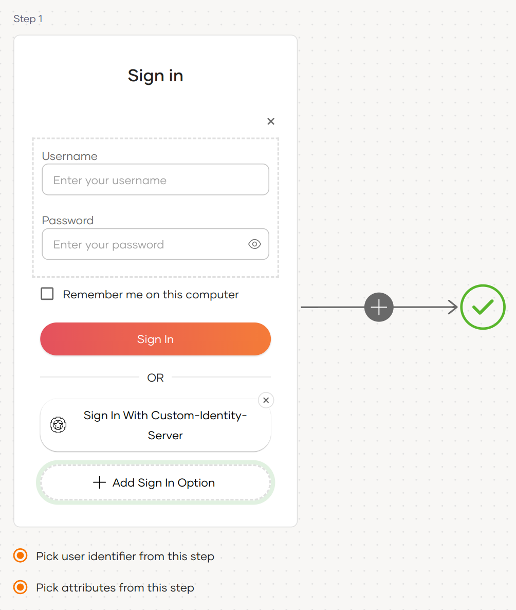
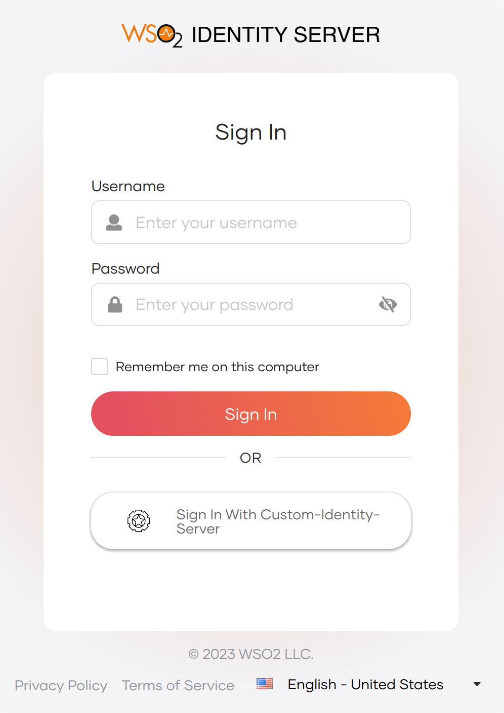
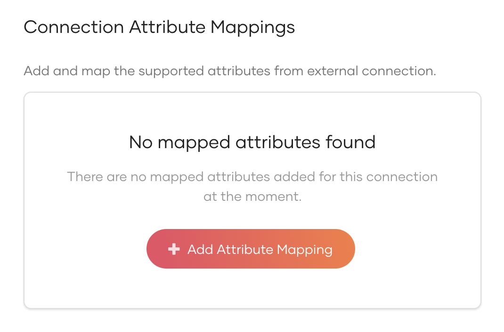
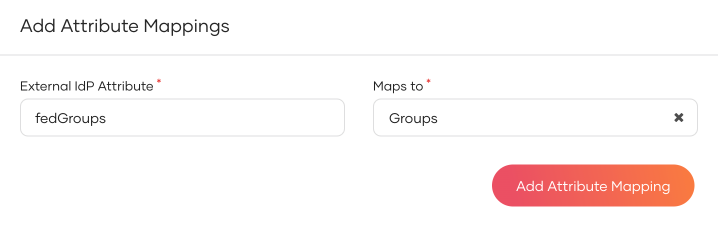
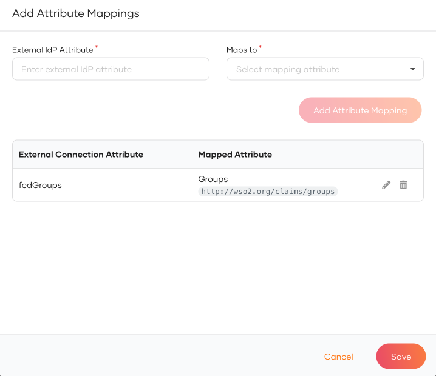
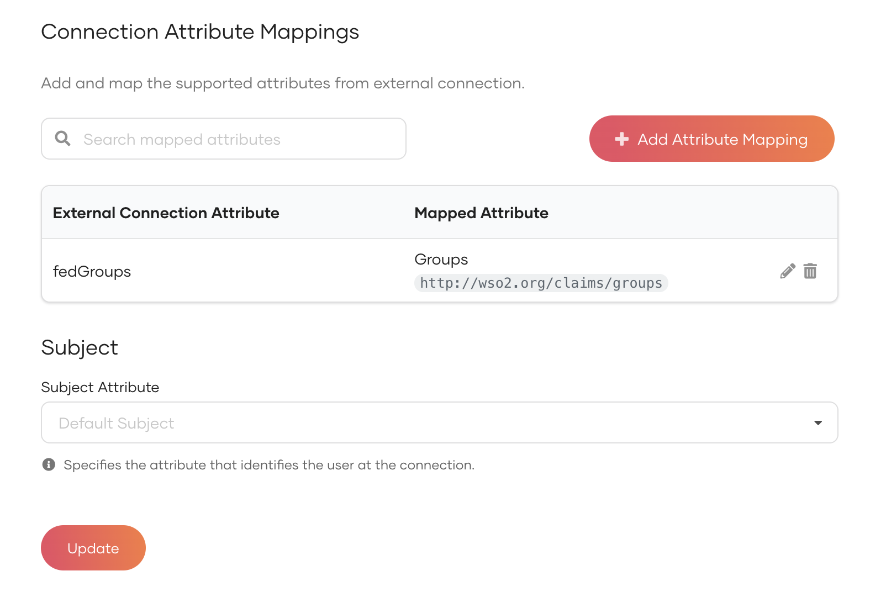
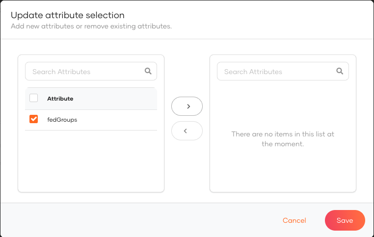
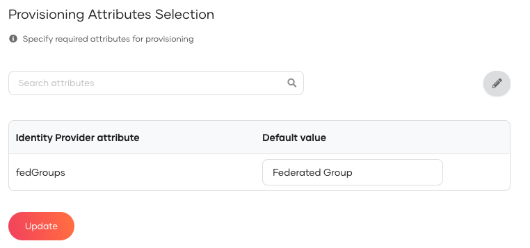
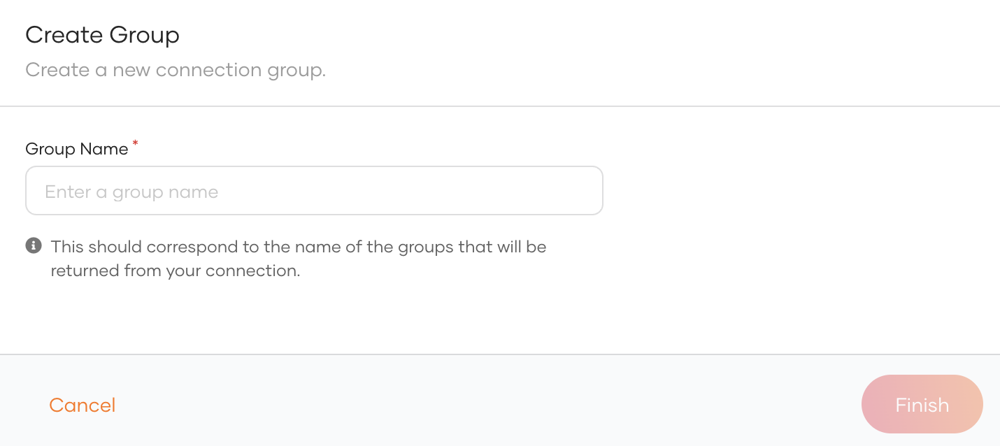
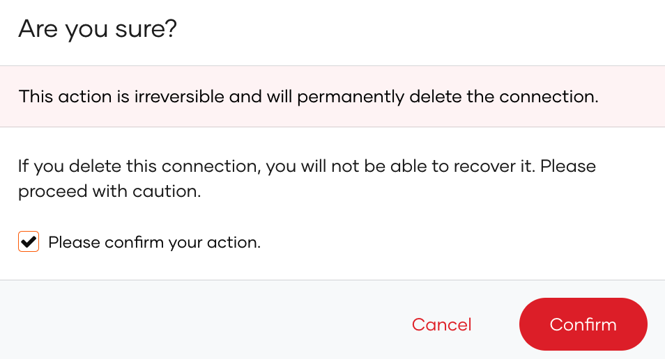

# Configure a custom connector

You can add login to your applications using a custom connector in WSO2 Identity Server and enable users to log in with the configured connector. This custom connector can be any identity provider such as Facebook, Twitter, Google, Yahoo or a [custom federated authenticator](../../references/extend/federation/write-a-custom-federated-authenticator.md).

Follow this guide for instructions.

## Register the custom connector

1. On the WSO2 Identity Server Console, go to **Connections**.
2. Click **Create Connection** and select **Custom Connector**.
3. Enter a unique name and a description and click **Finish**.
4. Go to **Settings** tab and click **New Authenticator**.
5. Select the authenticator you want to add and click **Next**.

    :::note

    You can configure predefined authenticators as well as the custom federated authenticators. See [Write a custom federated authenticator](../../references/extend/federation/write-a-custom-federated-authenticator.md) for more information.

    :::

6. Enter the requested details depending on the selected authenticator and click **Finish**.

:::tip

You can add multiple authenticators to the custom connector and select one authenticator as the default.

:::

## Enable login using the custom connector

:::note[Before you begin]

You need to [register an application with WSO2 Identity Server](../applications/index.md). You can register your own application or use one of the [sample applications](../../get-started/try-samples/index.md) provided.

:::

1. On the WSO2 Identity Server console, go to **Applications**.

2. Select your application, go to the **Login Flow** tab and add the custom connector from your preferred editor:

    
    1. Click **Add Sign In Option** to add a new authenticator to the first step.

    2. Select the custom connection.

    3. Click **Confirm** to add login with the custom connection to the sign-in flow.

        
    

    :::note[Recommendations]


    :::
    It is recommended to add your social and enterprise connections to the first authentication step as they are used for identifying the user.

3. Click **Update** to save your changes.

## Try it out

1. Access the application URL.

2. Click **Login** to open the WSO2 Identity Server login page.

3. On the WSO2 Identity Server login page, select the sign in option configured.

    

4. Log in using an existing account in the authenticator selected (e.g. Google, Facebook, custom federated authenticator etc.)

5. The user is now redirected to the application and logged in.

## Map groups with WSO2 Identity Server

### Map local attributes to external attributes

Follow the steps below to map attributes of WSO2 Identity Server with that of a connection.

1. On the WSO2 Identity Server Console, go to **Connections**.

2. Select your connection and go to its **Attributes** tab.

3. Click **Add Attribute Mapping** to add a new attribute mapping.

    

4. Enter the  **External IdP Attribute** of the connection and map it to the **Groups** attribute of WSO2 Identity Server.

    

5. Click **Add Attribute Mapping** and then click **Save**.

    

6. Click **Update** to save the changes.

    


### Add required attributes for provisioning

When provisioning users from an external identity provider (IdP), you may want to include specific attributes in the user’s profile. Follow the steps below to define the required attributes and assign default values.

1. On the WSO2 Identity Server Console, go to **Connections**.
2. Select your connection and go to its **Attributes** tab.
3. Under **Provisioning Attributes Selection**, click **Add Attribute**.
4. Move the attributes that you want to include in the provisioned user's profile and click **Save**.

    

5. Add a default value to the attribute. If the federated user lacks data for it, the system adds the default to the provisioned user’s profile.

    

    :::note


    To add default values to the provisioned user’s profile when the federated user has no value, configure the following in the `<IS_HOME>/repository/conf/deployment.toml` file.

    ```toml
    [authentication.endpoint]
    enable_merging_custom_claim_mappings_with_default = true
    ```

    :::


### Add groups to connections

Follow the steps below to add the groups from your connection to WSO2 Identity Server:

1. On the WSO2 Identity Server Console, go to **Connections**.
2. Select your connection and go to its **Groups** tab.
3. Click **New Group** and enter the group name. Be sure to enter the exact group name that will be returned from the connection.

    

4. Click **Finish** to add the group information.


## Delete a connection


:::note[Before you begin]

If your connection has applications associated with it, you will not be able to delete the connection.

Before deleting such connections:

1. Check the associated applications from the **Connected Apps** tab of the connection.
2. Click on an application that uses the connection and you will be redirected to the Login Flow tab of the respective application.
3. Remove the connection from the sign-in flow of the associated applications.
4. Repeat steps 2 and 3 for all listed applications.
5. Proceed to delete the connection.

:::

To delete a connection:

1. On the WSO2 Identity Server Console, go to **Connections**.
2. Click **Set up** and navigate to the **General** tab.
3. At the bottom of the page, click the button in the **Delete connection**.

    :::note

        You cannot delete connections that are available by default.

    :::

3. Select the checkbox and confirm your action.

    
